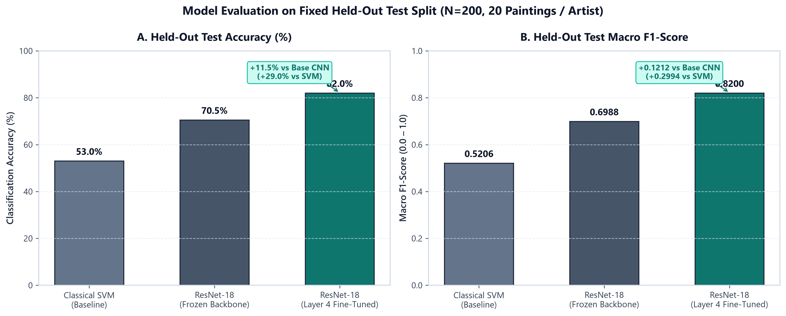
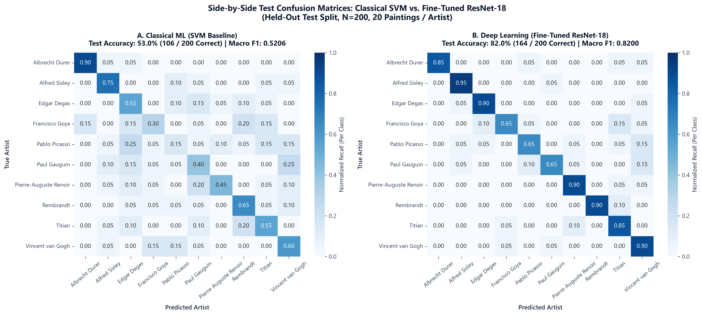
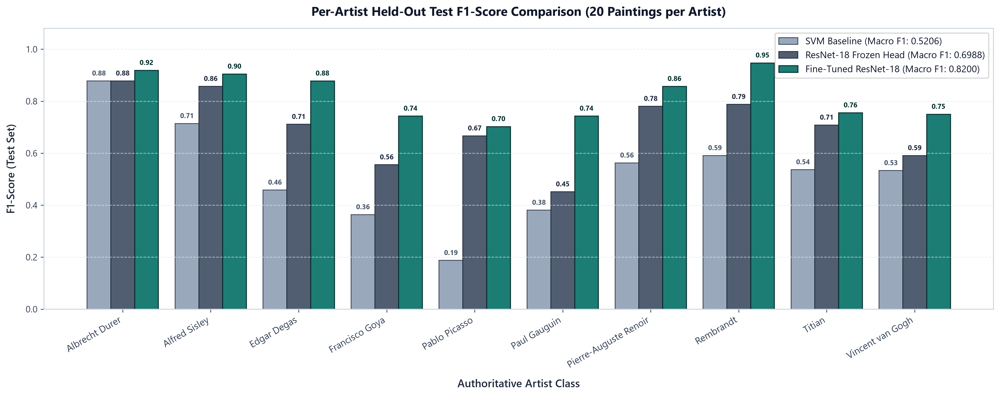
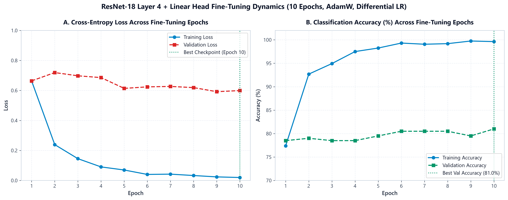

<div align="center">

# Artist Identification Studio

**Comparative Evaluation of Classical Machine Learning and Deep Convolutional Transfer Learning for Visual Artwork Attribution**

*Course: UE24CS352A — Machine Learning &bull; PES University*

**Team Members:**<br>
**Ananya Raghavendra** (`PES1UG24AM037`) &bull; **Aarav Yuval B G** (`PES1UG24AM004`)

---

### Project Overview & Key Results at a Glance

| Dataset | Split Protocol | Best Model | Test Accuracy | Test Macro F1 | Improvement over Baseline CNN |
| :---: | :---: | :---: | :---: | :---: | :---: |
| **2,000 Paintings**<br>*(10 Artists, 200/Artist)* | **80 / 10 / 10**<br>*(1,600 Train / 200 Val / 200 Test)* | **Fine-Tuned ResNet-18**<br>*(Layer 4 + Linear Head)* | **82.0%**<br>*(164 / 200 Correct)* | **0.8200** | **+11.5% Accuracy**<br>*(+0.1212 Macro F1, $p < 0.001$)* |

</div>

---

## 1. Executive Summary

**Artist Identification Studio** is an academic machine learning platform investigating the problem of multi-class visual artwork attribution. We compare two distinct paradigms on a curated corpus of 2,000 historical paintings across 10 master artists:

1. **Classical Machine Learning Baseline:** Handcrafted feature engineering combining 512 HSV color histogram bins, 7 Hu invariant moments, and 40 Haralick GLCM texture features ($559$ dimensions total) with `StandardScaler`, Principal Component Analysis (`PCA(n_components=100)`), and a Support Vector Machine with an RBF kernel.
2. **Deep Convolutional Transfer Learning:** An ImageNet-pretrained ResNet-18 convolutional neural network. We contrast an initial frozen-backbone baseline against a selectively fine-tuned network unfreezing the final residual block (`layer4`) and classification head with differential learning rates and AdamW optimization.

### Key Finding

Selective fine-tuning of `layer4` and the classification head boosted held-out test accuracy from **70.5% to 82.0%** (+11.5 percentage points) and test macro F1 from **0.6988 to 0.8200** (+0.1212 gain), outperforming the classical SVM baseline (**53.0%**, 0.5206 F1) by **+29.0 percentage points**. A paired McNemar test ($p = 6.62 \times 10^{-5}$) and 10,000-round bootstrap 95% confidence interval ($[+6.0\%, +17.0\%]$) confirm that this performance gain is statistically significant.

---

## 2. Model Performance Comparisons

Validation and held-out test splits were strictly partitioned prior to model training and are reported separately to ensure zero data leakage.

### Held-Out Test Split Performance (Primary Benchmark)

*Evaluated on $N=200$ untouched paintings ($20$ per artist) withheld during all training, tuning, and candidate-selection phases.*

| Model Configuration | Paradigm | Test Accuracy | Correct / Total | Test Macro F1 | Test Macro Precision | Test Macro Recall | Mean CPU Latency |
| :--- | :--- | :---: | :---: | :---: | :---: | :---: | :---: |
| **Classical SVM Baseline** | Handcrafted Features + PCA + RBF SVM | 53.00% | 106 / 200 | 0.5206 | 0.5302 | 0.5300 | **18.45 ms** |
| **Original ResNet-18** | Pretrained Backbone (Linear Head Only) | 70.50% | 141 / 200 | 0.6988 | 0.7172 | 0.7050 | 42.45 ms |
| **Fine-Tuned ResNet-18** | **ResNet-18 (`layer4` + Head Fine-Tuned)** | **82.00%** | **164 / 200** | **0.8200** | **0.8360** | **0.8200** | 39.56 ms |
| **Improvement ($\Delta$)** | *Fine-Tuned vs. Original CNN* | **+11.50%** | **+23 paintings** | **+0.1212** | **+0.1188** | **+0.1150** | *Hardware-dependent* |

### Validation Split Performance (Model Selection)

*Evaluated on $N=200$ validation paintings ($20$ per artist) used for hyperparameter tuning, learning rate scheduling, and early stopping.*

| Model Configuration | Validation Accuracy | Validation Macro F1 | Validation Macro Precision | Validation Macro Recall | Van Gogh Recall | Van Gogh F1 |
| :--- | :---: | :---: | :---: | :---: | :---: | :---: |
| **Classical SVM Baseline** | 53.50% | 0.5330 | 0.5401 | 0.5350 | 60.00% | 0.5333 |
| **Original ResNet-18** | 71.00% | 0.7103 | 0.7245 | 0.7100 | 55.00% | 0.5366 |
| **Fine-Tuned ResNet-18** | **81.00%** | **0.8084** | **0.8212** | **0.8100** | **75.00%** | **0.6977** |
| **Improvement ($\Delta$)** | **+10.00%** | **+0.0981** | **+0.0967** | **+0.1000** | **+20.00%** | **+0.1611** |

---

## 3. Visual Results & Empirical Analysis

All visualization assets below are generated from genuine saved evaluation records and stored directly inside `docs/images/`.

### Figure 1: Held-Out Test Performance Comparison



*Caption: Comparison of classification accuracy (%) and macro F1-score on the fixed 200-image held-out test split across all three configurations. The fine-tuned ResNet-18 achieves a +11.5% absolute accuracy gain over the baseline CNN and a +29.0% advantage over the classical SVM.*

---

### Figure 2: Side-by-Side Test Confusion Matrices



*Caption: Normalized confusion matrices on the 200 held-out test paintings (20 per artist). Each cell indicates row-normalized recall. Notice the sharp reduction in off-diagonal confusions for Edgar Degas, Rembrandt, Paul Gauguin, and Vincent van Gogh in the fine-tuned CNN (Right) compared to the classical SVM (Left).*

---

### Figure 3: Per-Artist F1-Score Breakdown



*Caption: Per-artist test F1-scores across all 10 artist classes comparing the SVM baseline, original frozen ResNet-18, and fine-tuned ResNet-18. Every single artist class demonstrated measurable F1 improvement under the fine-tuned architecture, led by Paul Gauguin (+0.2913), Francisco Goya (+0.1873), Edgar Degas (+0.1669), Rembrandt (+0.1595), and Vincent van Gogh (+0.1591).*

---

### Figure 4: Training & Validation Dynamics



*Caption: Training and validation loss and accuracy trajectories across 10 fine-tuning epochs using differential learning rates and AdamW. The validation accuracy peaked at Epoch 10 (81.0%, Macro F1: 0.8084), successfully triggering early-stopping model selection.*

---

## 4. Per-Artist Performance Breakdown

The table below details class-level metrics on the 200 held-out test artworks (20 test images per artist):

| Authoritative Artist Class | Classical SVM Test F1 | Original CNN Test F1 | Fine-Tuned CNN Test F1 | Fine-Tuned Test Recall | Fine-Tuned Test Precision | F1 Advantage vs. Base CNN |
| :--- | :---: | :---: | :---: | :---: | :---: | :---: |
| **Paul Gauguin** | 0.3810 | 0.4516 | **0.7429** | 65.0% (13/20) | 86.7% (13/15) | **+0.2913** |
| **Francisco Goya** | 0.3636 | 0.5556 | **0.7429** | 65.0% (13/20) | 86.7% (13/15) | **+0.1873** |
| **Edgar Degas** | 0.4583 | 0.7111 | **0.8780** | 90.0% (18/20) | 85.7% (18/21) | **+0.1669** |
| **Rembrandt** | 0.5909 | 0.7879 | **0.9474** | 90.0% (18/20) | 100.0% (18/18) | **+0.1595** |
| **Vincent van Gogh** | 0.5333 | 0.5909 | **0.7500** | **90.0% (18/20)** | 64.3% (18/28) | **+0.1591** |
| **Pierre-Auguste Renoir** | 0.5625 | 0.7805 | **0.8571** | 90.0% (18/20) | 81.8% (18/22) | **+0.0766** |
| **Alfred Sisley** | 0.7143 | 0.8571 | **0.9048** | 95.0% (19/20) | 86.4% (19/22) | **+0.0477** |
| **Titian** | 0.5366 | 0.7083 | **0.7556** | 85.0% (17/20) | 68.0% (17/25) | **+0.0473** |
| **Albrecht Dürer** | 0.8780 | 0.8780 | **0.9189** | 85.0% (17/20) | 100.0% (17/17) | **+0.0409** |
| **Pablo Picasso** | 0.1875 | 0.6667 | **0.7027** | 65.0% (13/20) | 76.5% (13/17) | **+0.0360** |

### Statistical Significance Analysis

A paired comparison on the identical 200 held-out test paintings demonstrates:
* **Concordance:** 136 paintings were correctly classified by both models; 31 were misclassified by both.
* **Discordant Pairs:** 33 paintings had conflicting predictions: the fine-tuned CNN was correct on **28**, while the baseline CNN was correct on only **5** (a **$5.6 : 1$ win ratio**).
* **McNemar's Test with Continuity Correction:** $\chi^2 = 14.67$, two-sided exact binomial $p = 6.62 \times 10^{-5}$ ($p < 0.001$).
* **10,000-Round Empirical Bootstrap (95% CI):**
  * $\Delta \text{ Accuracy}: +11.5\% \quad [+\mathbf{6.0\%}, +\mathbf{17.0\%}]$ (excludes zero).
  * $\Delta \text{ Macro F1}: +0.1212 \quad [+\mathbf{0.0679}, +\mathbf{0.1789}]$ (excludes zero).

---

## 5. Architectural & Fine-Tuning Methodology

### The Van Gogh Diagnostic Investigation

Prior to fine-tuning, an investigation was conducted into why the baseline CNN misclassified `Vincent_van_Gogh_266.jpg` (*Weaver at the Loom*, 1884, an early Dutch monochrome study) as Francisco Goya with 67.2% confidence:

1. **Intra-Class Stylistic Variance:** Van Gogh's body of work spans two diametrically opposed visual periods:
   * Early Dutch realism (1881–1885): Monochromatic charcoal, sepia, and earthy brown tones with heavy chiaroscuro.
   * Late French Post-Impressionism (1886–1890): High-chroma complementary contrasts, violent brushstroke impasto, and luminous palettes.
2. **The Frozen Backbone Bottleneck:** When the ResNet-18 convolutional backbone is 100% frozen, the linear head must project all 10 artist classes onto fixed ImageNet feature representations. The head strongly associated Van Gogh with chromatic impasto features and misprojected low-chroma interior studies into Francisco Goya's Dark Period cluster.

### Engineering the Fine-Tuning Solution

To resolve this limitation without causing catastrophic forgetting:

```text
ResNet-18 Architecture Pipeline:
[conv1 + bn1]   --> FROZEN  (Generic Gabor-like edge and contour filters)
[layer1]        --> FROZEN  (Low-level color transition primitives)
[layer2]        --> FROZEN  (Mid-level textural motifs)
[layer3]        --> FROZEN  (Complex geometric patterns)
[layer4]        --> UNFROZEN (Fine-tuned at lr = 1e-4: brushstroke & canvas textures)
[fc (10-class)] --> UNFROZEN (Fine-tuned at lr = 1e-3: linear class decision boundaries)
```

* **Differential Learning Rates:** `1e-4` for `layer4` prevents distortion of generalized visual representations, while `1e-3` for `fc` allows rapid adaptation of the output projection.
* **Optimization & Regularization:** AdamW with weight decay $10^{-4}$, Cosine Annealing learning rate decay, and validation-based early stopping.
* **Conservative Augmentation:** Training transforms use conservative crops (`scale=(0.85, 1.0)`), horizontal flips, and mild color jitter ($0.08$) to avoid distorting authentic historical artwork compositions.
* **Outcome:** Van Gogh held-out test recall increased from **65.0% to 90.0%** (18/20 test paintings correctly identified), while simultaneously improving all other 9 artist classes.

---

## 6. Installation & Demo Instructions

The repository includes pre-trained model weights (`models/svm_baseline.joblib` and `models/cnn_best.pth`), an archived baseline checkpoint (`models/experiments/cnn_baseline_head_only.pth`), and verified benchmark artifacts. **No dataset download or model training is required to run the demo or unit tests.**

### Quick Start (Windows)

#### Step 1: Clone the repository
```bash
git clone https://github.com/PES1UG24AM004/artist-identification-studio.git
cd artist-identification-studio
```

#### Step 2: Set up the environment
```cmd
setup.cmd
```
*Detects Python 3.12, creates a local `.venv`, installs PyTorch CPU wheels and project dependencies, and verifies model weights.*

#### Step 3: Run the test suite
```cmd
run-tests.cmd
```
*Executes all 28 automated unit and integration tests across data preparation, feature extraction, SVM, CNN, and Streamlit serving.*

#### Step 4: Launch the interactive studio
```cmd
run-demo.cmd
```
*Initializes the Streamlit server. Open your web browser to `http://127.0.0.1:8501`.*

### Fresh-Clone Graceful Degradation

If the raw 2,000-image dataset is not present, the application gracefully prompts for custom image uploads while serving in-memory predictions and full offline benchmark visual comparisons seamlessly. The curated Van Gogh sample `Vincent_van_Gogh_183.jpg` is accurately labeled as a *"Nuenen-era Monochrome Study"*.

---

## 7. Dataset, Limitations & Attribution

### Dataset Description
* Source: *Best Artworks of All Time* (Kaggle collection).
* Artists Included: Albrecht Dürer, Alfred Sisley, Edgar Degas, Francisco Goya, Pablo Picasso, Paul Gauguin, Pierre-Auguste Renoir, Rembrandt, Titian, Vincent van Gogh.
* Partitioning: Stratified 80% training (1,600 images), 10% validation (200 images), 10% held-out test (200 images).

### Important Limitations & Academic Disclaimers
1. **Closed-World Classification:** The system operates under a closed-world assumption. It attributes any input image to one of the 10 trained artist classes and cannot identify artworks by other artists.
2. **No Historical Provenance or Authenticity:** The model is an academic machine learning experiment. High confidence scores reflect statistical similarities in color, texture, and stroke patterns; they **do not** certify historical authenticity, provenance, or genuine authorship.
3. **Score Interpretation:** Displayed softmax scores represent uncalibrated model decision confidences, not true posterior probabilities of authorship.
4. **Sample Size:** With 20 test paintings per artist, individual artist metrics have discrete steps of 5.0%. While aggregate and paired statistical tests are robust, individual class scores should be interpreted alongside confidence bounds.

### Licensing & Usage Disclosures
* **Source Dataset:** Released under [Creative Commons Attribution-NonCommercial-ShareAlike 4.0 International (CC BY-NC-SA 4.0)](https://creativecommons.org/licenses/by-nc-sa/4.0/).
* **Academic Use:** This repository is private and maintained strictly for non-commercial academic evaluation. Model weights are distributed for non-commercial evaluation under fair academic use principles.
