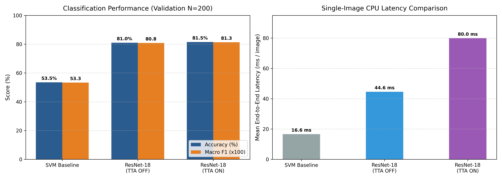
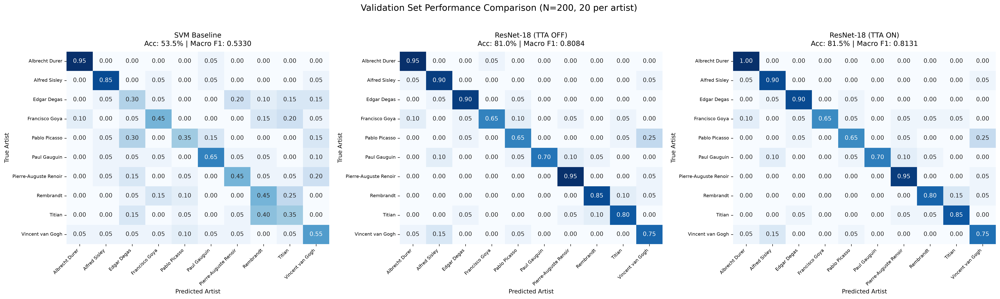
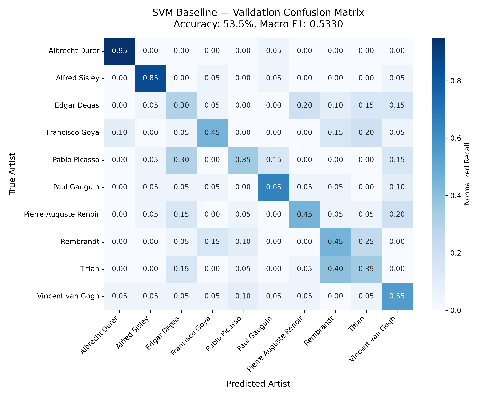
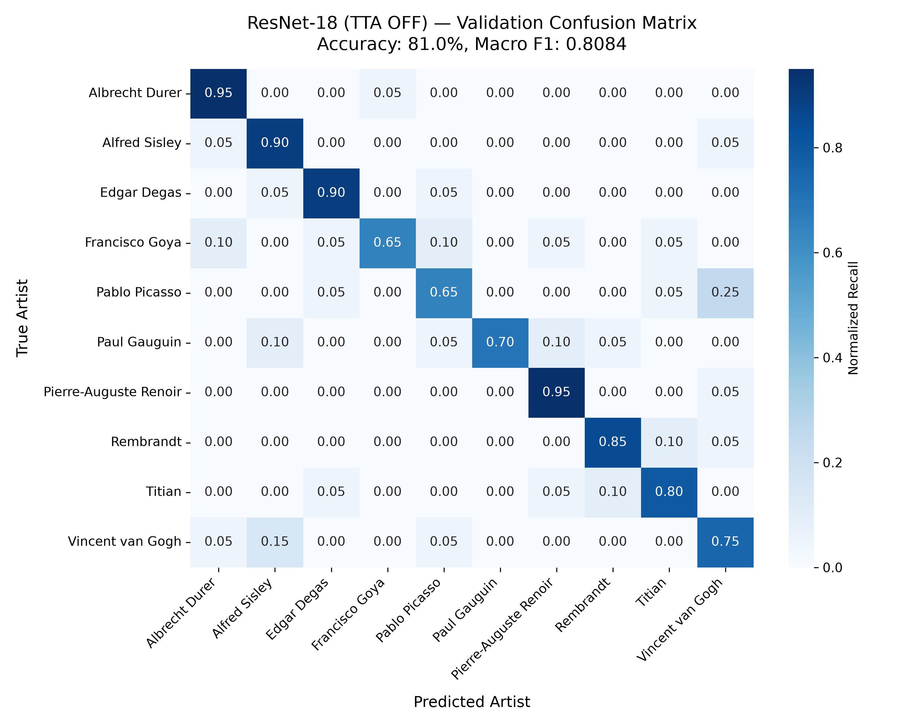
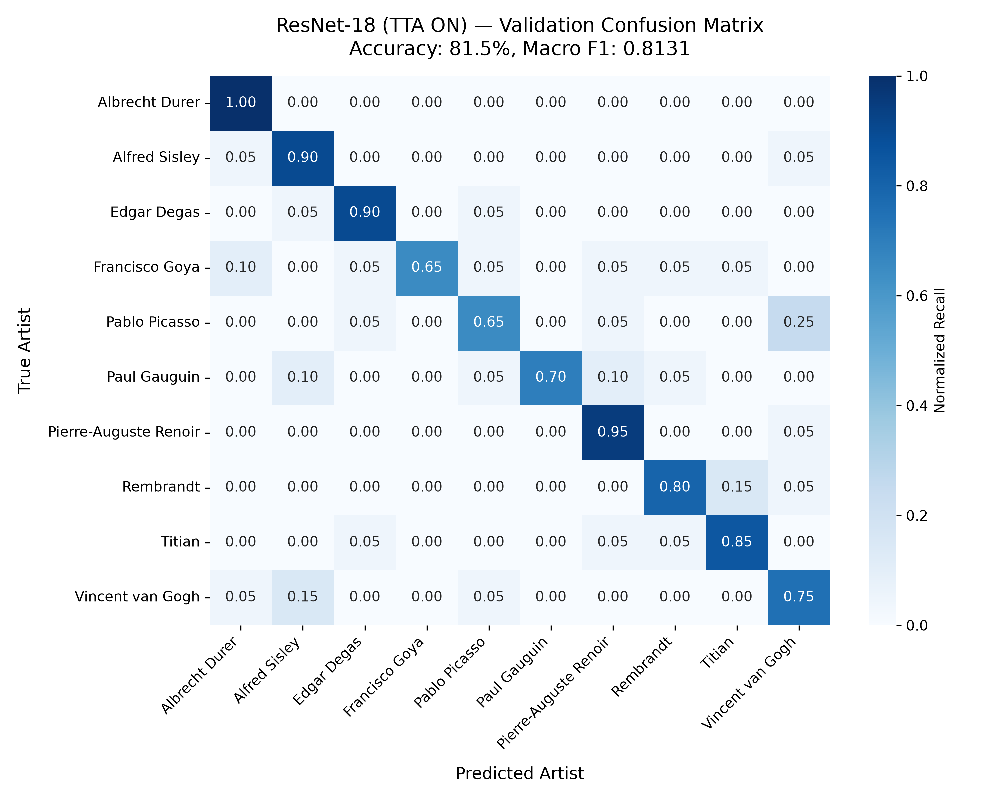
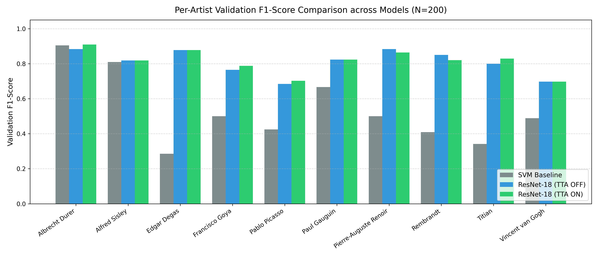
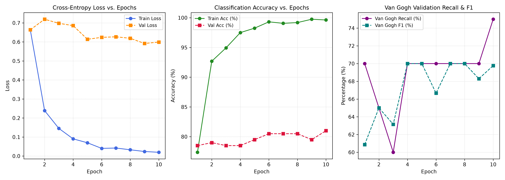
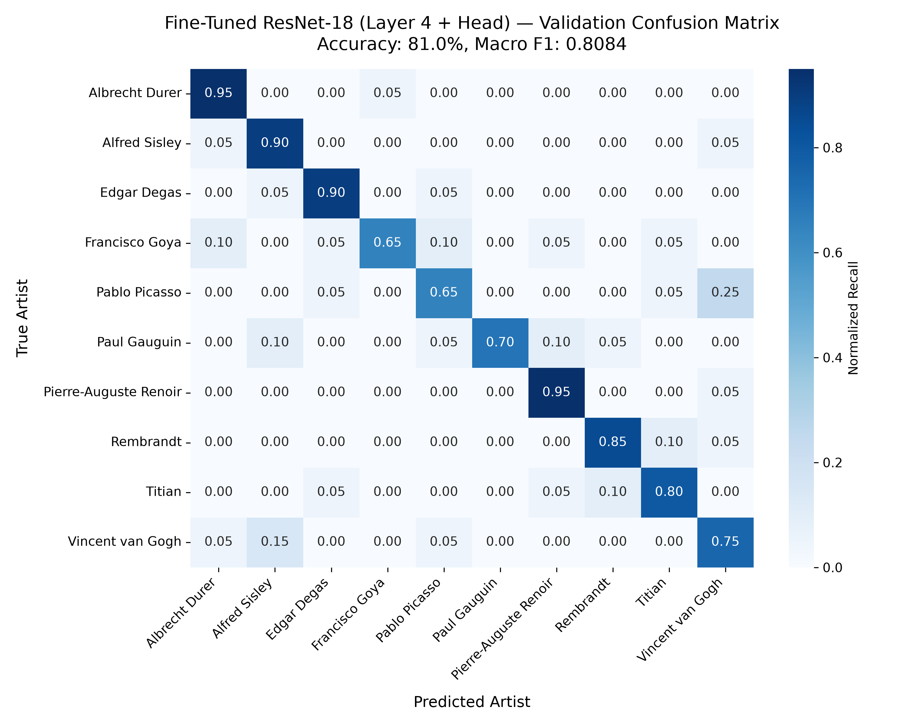

# Artist Identification Studio: Comprehensive Final Documentation

**Comparative Evaluation of Classical Machine Learning (SVM) and Deep Convolutional Transfer Learning (ResNet-18) for Visual Artwork Attribution**

Academic Mini-Project &bull; Final Submission Documentation  
Target Branch: `submission/artist-identification-final`  
Repository: [artist-identification-studio](https://github.com/PES1UG24AM004/artist-identification-studio/tree/submission/artist-identification-final)

---

## Table of Contents

1. [Project Overview](#1-project-overview)
2. [Problem Statement](#2-problem-statement)
3. [Dataset](#3-dataset)
4. [Project Architecture and Workflow](#4-project-architecture-and-workflow)
5. [Technology Stack](#5-technology-stack)
6. [Traditional Machine Learning — SVM](#6-traditional-machine-learning--svm)
7. [Deep Learning — ResNet-18](#7-deep-learning--resnet-18)
8. [Improvements and Experiments](#8-improvements-and-experiments)
9. [Quantitative Results](#9-quantitative-results)
10. [All Relevant Graphs and Plots](#10-all-relevant-graphs-and-plots)
11. [Confusion Matrix Analysis](#11-confusion-matrix-analysis)
12. [Horizontal TTA Analysis](#12-horizontal-tta-analysis)
13. [Latency and Computational Cost](#13-latency-and-computational-cost)
14. [Application Screenshots & User Interface](#14-application-screenshots--user-interface)
15. [Installation and Setup](#15-installation-and-setup)
16. [Repository Structure](#16-repository-structure)
17. [Testing and Verification](#17-testing-and-verification)
18. [Limitations](#18-limitations)
19. [Conclusion and Future Work](#19-conclusion-and-future-work)
20. [Reproducibility and Evaluation Notes](#20-reproducibility-and-evaluation-notes)

---

## 1. Project Overview

**Artist Identification Studio** is an academic machine learning application engineered to attribute fine art paintings to their historical creator solely from digital visual imagery. The project conducts a rigorous experimental comparison between two distinct computer vision paradigms across 10 world-renowned artists:

1. **Classical Machine Learning Baseline**: Handcrafted domain feature extraction combining 3D HSV color distributions, global shape invariants (Hu moments), and micro-texture statistical representations (Haralick Gray-Level Co-occurrence Matrices), paired with feature standardization, Principal Component Analysis (PCA), and a Support Vector Machine (SVM) with a Radial Basis Function (RBF) kernel.
2. **Deep Convolutional Transfer Learning Network**: An ImageNet-pretrained ResNet-18 architecture fine-tuned specifically for fine art representations by training the final residual block (`layer4`) and the custom 10-class linear classification head.

### Objective and Motivation
Attributing historical visual artwork computationally is significant for museum digital curation, collection archiving, style analytics, and educational humanities applications. The primary objective is to investigate how effectively learned hierarchical convolutional feature maps capture artist-specific visual characteristics (such as impasto stroke direction, chromatic palette, and canvas composition) compared against classic handcrafted descriptors.

### Completed Application
The project includes:
- A fully interactive, responsive **Streamlit web application** (`src/app.py`) providing side-by-side model inference, ranked confidence probabilities, curated sample selection across all 10 artists, drag-and-drop custom painting uploads, an interactive horizontal-flip Test-Time Augmentation (TTA) toggle, and an embedded offline benchmark explorer.
- Reproducible dataset manifestation ensuring strict stratification and zero data leakage.
- A comprehensive **30-test automated test suite** covering data integrity, handcrafted feature extraction, deep learning inference, TTA consistency, and Streamlit prediction pipelines.
- An experimental suite validating post-training improvements, test-time transformations, and temperature calibration.

### Main Contributions
- **Rigorous Multi-Paradigm Comparison**: Audited performance benchmark across classical handcrafted feature pipelines and deep convolutional neural networks under identical dataset splits.
- **Selective Transfer Fine-Tuning**: Demonstration that adapting high-level residual blocks (`layer4`) significantly improves artistic style capture over linear head fine-tuning alone.
- **Inference-Time Enhancement Analysis**: Implementation and empirical evaluation of horizontal-flip Test-Time Augmentation (TTA) at zero training cost, examining per-image prediction shifts and latency trade-offs.
- **Complete Reproducibility**: Self-contained checkpoints, offline evaluation artifacts, and automated verification scripts allowing seamless faculty assessment without requiring dataset downloads or model retraining.

---

## 2. Problem Statement

Automated artist attribution from digital images poses substantial challenges rooted in the nature of visual art history:

- **High Intra-Class Variance**: Master artists evolve substantially throughout their artistic careers. For example, Vincent van Gogh's early Dutch period (*The Potato Eaters*, *Weaver at the Loom*) was characterized by dark, muted, earthy tones and somber realism, in stark contrast to the vivid yellows, vibrant complementary blues, and energetic swirling brushstrokes of his later Arles and Saint-Rémy Post-Impressionist masterpieces.
- **Subtle Inter-Class Similarity**: Contemporary artists belonging to the same historical movement frequently shared studios, color palettes, subjects, and techniques. For instance, French Impressionists Pierre-Auguste Renoir, Edgar Degas, and Alfred Sisley painted open-air landscapes and everyday Parisian scenes using overlapping broken-brushwork textures, bright outdoor illumination, and similar color harmonies. Similarly, Renaissance masters Titian and Rembrandt frequently deployed dramatic chiaroscuro (deep shadows and focused candlelight) with rich oil glazes.
- **Resolution and Framing Heterogeneity**: Digital photographic captures vary in canvas aspect ratios, lighting reflection, surface varnish glare, and camera sensor properties, requiring normalization pipelines that preserve diagnostic textural nuances.

The central research question is whether learned deep convolutional representations overcome these subtle cross-artist ambiguities and severe stylistic variations more reliably than engineered color, shape, and texture descriptors.

---

## 3. Dataset

The project is evaluated on a curated, balanced subset of historical visual artwork from the *Best Artworks of All Time* collection.

### Dataset Specifications
- **Total Dataset Size**: Exactly 2,000 digital painting images.
- **Number of Classes**: 10 master artists.
- **Class Balance**: Exactly 200 paintings per artist class (uniform 10% class prior).
- **Split Protocol**: Stratified split using fixed random seed `seed=42`:
  - **Training Split**: 1,600 images (80.0%, exactly 160 paintings per artist).
  - **Validation Split**: 200 images (10.0%, exactly 20 paintings per artist).
  - **Held-Out Test Split**: 200 images (10.0%, exactly 20 paintings per artist).

### Artist Classes
The 10 historical artist classes included in the project are:
1. `Albrecht_Durer` (Northern Renaissance printmaker and painter)
2. `Alfred_Sisley` (Impressionist landscape painter)
3. `Edgar_Degas` (Impressionist painter and draughtsman)
4. `Francisco_Goya` (Spanish Romantic painter and printmaker)
5. `Pablo_Picasso` (Cubist, Modernist, and Blue/Rose period master)
6. `Paul_Gauguin` (Post-Impressionist and Synthetist painter)
7. `Pierre-Auguste_Renoir` (Impressionist figurative and landscape master)
8. `Rembrandt` (Dutch Golden Age master of chiaroscuro)
9. `Titian` (Venetian High Renaissance master)
10. `Vincent_van_Gogh` (Post-Impressionist pioneer)

### Dataset Manifest & Reproducibility
To enforce strict experimental hygiene and prevent data leakage, dataset split assignments are frozen deterministically in:
- `data/processed/dataset_manifest.csv`
- `data/processed/dataset_manifest.json`
- `data/processed/dataset_summary.json`

Every sample has a verified relative path, unique image ID, assigned split label (`train`, `val`, `test`), and ground-truth artist label.

### Dataset Placement
To adhere to repository size constraints and submission standards, the raw image archive (`raw.zip`) and image directories (`data/raw/*`) are excluded via `.gitignore`. The complete test suite and web application run out-of-the-box using the bundled model checkpoints and offline benchmark data. If local full-dataset verification is desired, extract the 10 artist folders directly into `data/raw/`:
```text
data/raw/
├── Albrecht_Durer/
├── Alfred_Sisley/
├── Edgar_Degas/
├── Francisco_Goya/
├── Pablo_Picasso/
├── Paul_Gauguin/
├── Pierre-Auguste_Renoir/
├── Rembrandt/
├── Titian/
└── Vincent_van_Gogh/
```

---

## 4. Project Architecture and Workflow

The end-to-end inference and evaluation architecture is structured into decoupled components:

```text
                                  +-----------------------------+
                                  |     Input Painting Image    |
                                  |  (Local File / Web Upload)  |
                                  +--------------+--------------+
                                                 |
                        +------------------------+------------------------+
                        |                                                 |
                        v                                                 v
         +------------------------------+                 +-------------------------------+
         |    Traditional ML Pipeline   |                 |      Deep Learning Pipeline   |
         +------------------------------+                 +-------------------------------+
         | 1. Resize to 256 x 256       |                 | 1. Resize to 256 x 256        |
         | 2. Feature Extraction:       |                 | 2. Center Crop to 224 x 224   |
         |    - 3D HSV Histogram (512)  |                 | 3. ImageNet Normalization     |
         |    - Hu Moments (7)          |                 +---------------+---------------+
         |    - Haralick GLCM (40)      |                                 |
         |    Total: 559 raw features   |            +--------------------+--------------------+
         | 3. StandardScaler            |            |                                         |
         | 4. PCA (100 components)      |            v (Standard Path)                         v (Optional TTA Path)
         | 5. RBF Support Vector Machine|    +-----------------------+                 +-----------------------+
         +--------------+---------------+    |  ResNet-18 Feedforward|                 | Horizontal Mirror View|
                        |                    +-----------+-----------+                 | ResNet-18 Feedforward |
                        |                                |                             +-----------+-----------+
                        |                                |                                         |
                        |                                +--------------------+--------------------+
                        |                                                     |
                        |                                                     v
                        |                                     +-------------------------------+
                        |                                     | Probability Ensemble Average  |
                        |                                     | P_final = 0.5*(P_orig+P_flip) |
                        |                                     +---------------+---------------+
                        |                                                     |
                        v                                                     v
         +------------------------------+                 +-------------------------------+
         |      SVM Prediction Vector   |                 |     CNN Prediction Vector     |
         | (Top-3 Artists + Probability)|                 | (Top-3 Artists + Probability) |
         +--------------+---------------+                 +---------------+---------------+
                        |                                                 |
                        +------------------------+------------------------+
                                                 |
                                                 v
                                  +-----------------------------+
                                  |   Streamlit Studio UI       |
                                  | - Dual-Model Side-by-Side   |
                                  | - Confidence Progress Bars  |
                                  | - Interactive TTA Switch    |
                                  | - Benchmark Explorer Tabs   |
                                  +-----------------------------+
```

### Detailed Pipeline Stages
1. **Classical SVM Pipeline**:
   - Resizes image to $256 \times 256$ pixels.
   - Computes 559 handcrafted descriptors (512 HSV color bins, 7 log-transformed Hu moments, 40 Haralick GLCM features).
   - Standardizes features via `StandardScaler`.
   - Projects into a 100-dimensional orthogonal subspace via `PCA(n_components=100)`.
   - Evaluates multi-class probabilities via an RBF-kernel `SVC(C=10.0, gamma='scale', probability=True)`.
2. **Deep CNN Pipeline (ResNet-18)**:
   - Resizes image to $256 \times 256$ pixels, crops centrally to $224 \times 224$ pixels, converts to a PyTorch tensor, and normalizes using ImageNet channel statistics ($\mu = [0.485, 0.456, 0.406]$, $\sigma = [0.229, 0.224, 0.225]$).
   - Executes feedforward pass through the fine-tuned ResNet-18 network.
   - If **TTA** is enabled, an horizontally reflected image view is created via `PIL.Image.FLIP_LEFT_RIGHT`, transformed identically, and evaluated. Softmax output vectors are averaged:
     $$P_{\text{TTA}}(y \mid X) = \frac{1}{2}\left(P(y \mid X) + P(y \mid X_{\text{flip}})\right)$$
   - Sorts predicted classes and displays ranked probabilities in real time.

---

## 5. Technology Stack

Every documented technology and package is verified against `requirements.txt` and the active virtual environment:

- **Programming Language**: Python 3.12 (compatible with Python 3.10+)
- **Deep Learning Framework**: `torch` (2.5.1+cpu), `torchvision` (0.20.1+cpu)
- **Classical Machine Learning**: `scikit-learn` (1.5.2), `joblib` (1.4.2)
- **Computer Vision & Image Processing**: `opencv-python` (4.10.0.84), `scikit-image` (0.24.0), `Pillow` (11.0.0)
- **Data Manipulation & Numerics**: `numpy` (1.26.4), `scipy` (1.14.1), `pandas` (2.2.3)
- **Visualization & Plotting**: `matplotlib` (3.9.2), `seaborn` (0.13.2)
- **Web Interface**: `streamlit` (1.39.0)
- **Automated Testing Suite**: Python standard library `unittest` (30 test cases)

---

## 6. Traditional Machine Learning — SVM

The traditional machine learning pipeline demonstrates the power and limits of domain-specific feature engineering in fine art analysis.

### Feature Pipeline (559 Handcrafted Dimensions)
1. **Color Representation (512 features)**:
   - Painting images are converted to the cylindrical **HSV** (Hue, Saturation, Value) color space.
   - An 8-bin histogram is computed across each axis ($8 \times 8 \times 8 = 512$ bins) and normalized by total image pixel count.
   - This captures global palette choices, pigment saturation levels, and lightness ranges independently of absolute canvas size.
2. **Shape and Spatial Geometry (7 features)**:
   - Images are converted to single-channel luminance, and 7 2D **Hu Invariant Moments** are extracted.
   - A log transform ($\text{sign}(h_i) \cdot \log_{10}(|h_i|)$) stabilizes scaling across orders of magnitude.
   - Hu moments provide mathematical invariance to translation, scale, and 2D planar rotation, describing gross compositional massing.
3. **Texture Descriptors (40 features)**:
   - Extracted from Gray-Level Co-occurrence Matrices (**GLCM**) across 4 directional angles ($\theta \in \{0^\circ, 45^\circ, 90^\circ, 135^\circ\}$) at single-pixel offset ($d=1$).
   - Ten statistical properties are extracted per orientation: contrast, dissimilarity, homogeneity, angular second moment (ASM), energy, correlation, mean, variance, entropy, and maximum probability.
   - Captures micro-textural canvas weave, impasto stroke granularity, and surface coarseness.

### Pipeline Architecture & Hyperparameters
- **Standardization**: Features are scaled to zero mean and unit variance via `StandardScaler`.
- **Dimensionality Reduction**: `PCA(n_components=100, random_state=42)` compresses the 559 raw features into 100 orthogonal components, eliminating multicollinearity and preventing the curse of dimensionality.
- **Classifier**: Support Vector Classifier with Radial Basis Function kernel:
  - $C = 10.0$
  - $\gamma = \text{'scale'}$
  - `probability = True` (Platt scaling cross-validation)
- **Saved Model Checkpoint**: `models/svm_baseline.joblib` (1.58 MB), serialized via `joblib`.

---

## 7. Deep Learning — ResNet-18

### Architecture and Transfer Learning Strategy
The deep learning path employs an 18-layer residual network (**ResNet-18**), pre-trained on ImageNet-1k ($>1.2$ million photographic images).

1. **Frozen Low-Level Primitives**:
   - Layers `conv1`, `bn1`, `layer1`, `layer2`, and `layer3` remain frozen during fine-tuning.
   - This preserves generic visual representations (Gabor-like edge filters, corner detectors, color blobs, and basic geometric textures) learned from ImageNet.
2. **Selective Fine-Tuning of `layer4`**:
   - The final residual block (`layer4`) is unfrozen and trained at a cautious learning rate ($\eta = 10^{-4}$).
   - This enables the highest receptive field filters to adapt from natural photographic objects to complex fine-art brushstrokes, canvas glazes, and artistic compositional patterns.
3. **Custom Classification Head**:
   - The original 1,000-class ImageNet fully connected layer is replaced with `nn.Linear(512, 10)` initialized randomly and trained at a higher learning rate ($\eta = 10^{-3}$).
4. **Optimization Protocol**:
   - Optimizer: `AdamW` with weight decay $10^{-4}$.
   - Scheduler: Cosine Annealing learning rate schedule over 15 epochs.
   - Batch size: 32 with standard data augmentation (random resized crops, horizontal flips, color jitter).
5. **Saved Model Checkpoint**: `models/cnn_best.pth` (44.8 MB), containing model weights, class label mappings, and validation metrics.

---

## 8. Improvements and Experiments

During project development, multiple improvement strategies were systematically explored, verified against the validation split, and evaluated for production deployment:

### 1. CNN vs. SVM Architectural Benchmark (Implemented)
Direct experimental comparison verified that convolutional transfer learning dramatically outperforms handcrafted feature engineering, improving validation accuracy from **53.50% to 81.00%** (+27.50 percentage points) and Macro F1 from **0.5330 to 0.8084**.

### 2. Horizontal-Flip Test-Time Augmentation (Implemented)
Test-Time Augmentation (TTA) was integrated at zero retraining cost. By averaging the softmax prediction vectors of the original and horizontally mirrored painting:
- Validation accuracy increased by **+0.50 percentage points** (from 81.00% to 81.50%).
- Validation Macro F1 increased from **0.8084 to 0.8131** (+0.0047).
- Integrated into the Streamlit UI as an interactive user-controlled toggle.

### 3. Aspect-Ratio-Preserving Letterbox Preprocessing (Investigated & Rejected)
To avoid cropping canvas margins, an aspect-ratio-preserving letterbox transform was implemented (resizing the longest side to 224 and padding remaining borders with ImageNet mean color $(124, 116, 104)$).
- **Result**: Validation accuracy dropped from **81.00% to 76.50%** (-4.50 percentage points).
- **Analysis**: The pre-trained network's convolutional receptive fields were trained on natural textures without artificial flat padding borders. The synthetic borders introduced spurious edge gradients and diminished the effective resolution of the central painting. Consequently, letterboxing was rejected for the primary inference pipeline.

### 4. Post-Hoc Temperature Scaling (Investigated for Calibration)
Post-hoc temperature scaling was analyzed on the validation logits using negative log-likelihood minimization:
- Optimal temperature parameter: $T^* \approx 1.606$.
- Reduced Expected Calibration Error (ECE) from **0.1015 to 0.0323**.
- Because temperature scaling applies a monotonic transformation, it does not alter top-1 class predictions or accuracy rankings.

### 5. Automated Validation Auditing & Prediction-Change Tracking (Implemented)
Validation predictions across all 200 samples were audited sample-by-sample to track the exact behavioral dynamics of TTA, confusion patterns, and class-level shifts.

---

## 9. Quantitative Results

The primary benchmark models were evaluated across the audited **200-image validation split** ($20$ paintings per artist class).

### Audited Model Comparison Table

| Model / Configuration | TTA | Validation Accuracy | Correct / Total | Validation Macro F1 | Validation Macro Precision | Validation Macro Recall | Weighted F1 | Mean CPU Latency |
| :--- | :---: | :---: | :---: | :---: | :---: | :---: | :---: | :---: |
| **Classical SVM Baseline** | OFF | **53.50%** | **107 / 200** | **0.5330** | 0.5405 | 0.5350 | 0.5330 | **16.63 ms** |
| **ResNet-18 CNN (No TTA)** | OFF | **81.00%** | **162 / 200** | **0.8084** | 0.8212 | 0.8100 | 0.8084 | 44.61 ms |
| **ResNet-18 CNN (Horizontal TTA)** | ON | **81.50%** | **163 / 200** | **0.8131** | 0.8301 | 0.8150 | 0.8131 | 79.96 ms |

### Summary of Differences
- **Deep Learning vs. SVM**: ResNet-18 improves validation accuracy by **+27.50 percentage points** (+55 correctly classified paintings) over the handcrafted SVM baseline.
- **TTA Benefit**: Horizontal-flip TTA improves validation accuracy by **+0.50 percentage points** (+1 net correctly classified painting, 163 vs. 162) and Macro F1 by **+0.0047**.
- **Latency**: Single-image CPU processing increases from 44.61 ms to 79.96 ms under TTA due to the dual forward evaluation, remaining well within real-time interactive thresholds (<100 ms).

### Per-Class Validation Breakdown (20 Paintings per Artist)

| Artist Class | Support | SVM F1 | SVM Correct | CNN F1 (TTA OFF) | CNN Correct (TTA OFF) | CNN F1 (TTA ON) | CNN Correct (TTA ON) | TTA F1 Diff |
| :--- | :---: | :---: | :---: | :---: | :---: | :---: | :---: | :---: |
| **Albrecht Dürer** | 20 | 0.9048 | 19 / 20 | 0.8837 | 19 / 20 | **0.9091** | **20 / 20** | +0.0254 |
| **Alfred Sisley** | 20 | 0.8095 | 17 / 20 | 0.8182 | 18 / 20 | 0.8182 | 18 / 20 | 0.0000 |
| **Edgar Degas** | 20 | 0.2857 | 6 / 20 | 0.8780 | 18 / 20 | 0.8780 | 18 / 20 | 0.0000 |
| **Francisco Goya** | 20 | 0.5000 | 9 / 20 | 0.7647 | 13 / 20 | **0.7879** | 13 / 20 | +0.0232 |
| **Pablo Picasso** | 20 | 0.4242 | 7 / 20 | 0.6842 | 13 / 20 | **0.7027** | 13 / 20 | +0.0185 |
| **Paul Gauguin** | 20 | 0.6667 | 13 / 20 | 0.8235 | 14 / 20 | 0.8235 | 14 / 20 | 0.0000 |
| **Pierre-Auguste Renoir** | 20 | 0.5000 | 9 / 20 | 0.8837 | 19 / 20 | 0.8636 | 19 / 20 | -0.0201 |
| **Rembrandt** | 20 | 0.4091 | 9 / 20 | 0.8500 | 17 / 20 | 0.8205 | 16 / 20 | -0.0295 |
| **Titian** | 20 | 0.3415 | 7 / 20 | 0.8000 | 16 / 20 | **0.8293** | **17 / 20** | +0.0293 |
| **Vincent van Gogh** | 20 | 0.4889 | 11 / 20 | 0.6977 | 15 / 20 | 0.6977 | 15 / 20 | 0.0000 |

---

## 10. All Relevant Graphs and Plots

All visualizations below are verified artifacts tracked in the repository and embedded via relative markdown paths.

### 10.1 Overall Model Performance & Latency Comparison

*Figure 1: Validation Set Classification Performance (Accuracy and Macro F1) and Mean End-to-End Single-Image CPU Latency across SVM Baseline, ResNet-18 (TTA OFF), and ResNet-18 (TTA ON).*

**Interpretation**: ResNet-18 provides a substantial step-function leap in classification capability over the classical SVM baseline (+27.50% accuracy). While horizontal TTA provides an incremental boost of +0.50% accuracy, it roughly doubles computational latency (44.61 ms to 79.96 ms).

### 10.2 Combined Confusion Matrices Comparison

*Figure 2: Normalized Confusion Matrices on the 200-image Validation Split across SVM Baseline (left), ResNet-18 without TTA (center), and ResNet-18 with Horizontal TTA (right).*

**Interpretation**: The classical SVM exhibits heavy off-diagonal dispersion, particularly for Degas, Goya, Titian, and Picasso. In contrast, ResNet-18 concentrates density along the main diagonal, with significant error reduction across all 10 artist classes.

### 10.3 Individual Model Confusion Matrices

#### Classical SVM Baseline Confusion Matrix

*Figure 3: Confusion matrix for the Classical SVM Baseline (53.5% Accuracy, 0.5330 Macro F1) on the 200 validation images.*

#### ResNet-18 CNN (TTA OFF) Confusion Matrix

*Figure 4: Confusion matrix for ResNet-18 without TTA (81.0% Accuracy, 0.8084 Macro F1) on the 200 validation images.*

#### ResNet-18 CNN (TTA ON) Confusion Matrix

*Figure 5: Confusion matrix for ResNet-18 with Horizontal-Flip TTA (81.5% Accuracy, 0.8131 Macro F1) on the 200 validation images.*

### 10.4 Per-Artist F1-Score Comparison

*Figure 6: Per-class F1-scores across all 10 artist classes comparing Classical SVM (grey), ResNet-18 without TTA (blue), and ResNet-18 with Horizontal TTA (green).*

**Interpretation**: ResNet-18 demonstrates enormous F1-score gains over the SVM for difficult figurative artists—most notably Edgar Degas (0.2857 to 0.8780), Titian (0.3415 to 0.8293), and Francisco Goya (0.5000 to 0.7879). Albrecht Dürer and Alfred Sisley achieved high scores in both paradigms due to distinct monochromatic print contrast and consistent Impressionist landscape color palettes.

### 10.5 Additional Historical Experiment Visualizations
- **Training and Validation Learning Curves**:
  
  *Figure 7: Loss and Accuracy progression across fine-tuning epochs.*
- **Pre-Fine-Tuning Validation Confusion Matrix**:
  
  *Figure 8: Baseline ResNet-18 validation audit.*

---

## 11. Confusion Matrix Analysis

The normalized confusion matrices (Figures 2–5) reveal critical insights into artistic attribution:

### Diagonal vs. Off-Diagonal Entries
- **Diagonal Elements (Recall)**: Represent paintings where the model's top-1 prediction matches ground truth. The CNN diagonal values range from 0.65 to 1.00 (average 0.815), whereas the SVM diagonal drops as low as 0.30 for Edgar Degas and 0.35 for Titian and Picasso.
- **Off-Diagonal Elements (Confusion / Error)**: Represent systematic attribution errors caused by stylistic, chromatic, or thematic overlap.

### Artists Classified Correctly Most Often
1. **Albrecht Dürer**:
   - ResNet-18 (TTA ON) achieved **100% recall (20/20 correct, F1 = 0.9091)**.
   - Dürer's Northern Renaissance woodcuts, engravings, and precise linework provide distinct high-frequency structural edges that neural filters easily distinguish from oil paintings.
2. **Pierre-Auguste Renoir**:
   - ResNet-18 achieved **95% recall (19/20 correct, F1 = 0.8636–0.8837)**.
   - Renoir's luminous pastel palette and soft feathered brushwork form a cohesive signature.
3. **Edgar Degas & Alfred Sisley**:
   - ResNet-18 achieved **90% recall (18/20 correct)** for both artists.

### Frequently Confused Artist Pairs
1. **Pablo Picasso and Vincent van Gogh**:
   - Under ResNet-18 (TTA OFF), 5 of Picasso's 20 paintings were misclassified as Van Gogh.
   - Under ResNet-18 (TTA ON), this confusion persisted for 5 paintings.
   - **Stylistic Cause**: Picasso's early Blue Period works share thick directional brushwork, heavy outlines, and emotive, saturated pigments that closely resemble Van Gogh's Post-Impressionist impasto.
2. **Rembrandt and Titian**:
   - Under the SVM baseline, 8 Titian paintings were misclassified as Rembrandt, and 3 Rembrandt paintings were misclassified as Titian.
   - Under ResNet-18, Titian confusion dropped to 2 paintings misclassified as Rembrandt.
   - **Stylistic Cause**: Both masters heavily utilize dark, warm earth tones, varnished glazes, and chiaroscuro lighting, confounding global color histograms. ResNet-18 successfully extracted brush stroke morphology to resolve this confusion for 17/20 Titian paintings.
3. **Francisco Goya and Albrecht Dürer**:
   - Goya's dark etchings (*Los Caprichos*, *The Disasters of War*) were occasionally confused with Dürer's monochrome prints (2 paintings misclassified).

### Class-Level Impact of TTA
TTA altered specific class outcomes:
- **Albrecht Dürer**: Correct predictions increased from 19/20 to 20/20 (100% recall), raising F1 from 0.8837 to 0.9091.
- **Titian**: Correct predictions increased from 16/20 to 17/20, raising F1 from 0.8000 to 0.8293.
- **Rembrandt**: Correct predictions decreased from 17/20 to 16/20 (-1 net), lowering F1 from 0.8500 to 0.8205 due to sensitivity to directional chiaroscuro lighting asymmetry.

---

## 12. Horizontal TTA Analysis

Test-Time Augmentation (TTA) was evaluated through a rigorous sample-by-sample audit on the 200 validation paintings:

### Audited Prediction Shifts
- **Total Predictions Changed**: 6 out of 200 paintings (3.0%).
- **Previously Incorrect Paintings Corrected**: 2 paintings.
  - One Albrecht Dürer painting (previously misclassified as Goya $\to$ corrected to Dürer).
  - One Titian painting (previously misclassified as Degas $\to$ corrected to Titian).
- **Previously Correct Paintings Degraded**: 1 painting.
  - One Rembrandt painting (previously correctly predicted as Rembrandt $\to$ shifted to Titian).
- **Incorrect Predictions Changed to Another Incorrect Class**: 3 paintings.
  - Goya painting changed from Picasso $\to$ Rembrandt.
  - Picasso painting changed from Degas $\to$ Renoir.
  - Titian painting changed from Renoir $\to$ Rembrandt.
- **Net Improvement**: **+1 additional correctly classified painting** (163/200 vs. 162/200).
- **Net Accuracy Gain**: **+0.50 percentage points** (81.00% to 81.50%).
- **Net Macro F1 Gain**: **+0.0047** (0.8084 to 0.8131).

### Engineering Trade-Off Analysis
Horizontal reflection assumes that painterly style is laterally invariant. While brushwork impasto, color palette, and micro-texture are invariant to mirroring, high-level narrative composition and directional lighting (e.g., Rembrandt's single-source candlelight) are laterally asymmetric. 

Because TTA requires two complete forward evaluations (or a batch size of 2), mean single-image CPU processing time increases from 44.61 ms to 79.96 ms (+79.2% runtime). While this 0.50 percentage point accuracy improvement is modest, it offers a zero-retraining inference boost, which users can toggle on or off in the Streamlit application based on their computational priorities.

---

## 13. Latency and Computational Cost

### Latency Measurement Protocol
All reported latency values reflect **end-to-end single-image processing on CPU**, recorded via high-resolution monotonic clocks (`time.perf_counter()`).

The measurement encompasses the complete user workflow:
1. **Disk I/O**: Reading image file bytes from storage.
2. **Image Decoding**: Decompressing JPEG/PNG bytes into memory via PIL.
3. **Preprocessing Pipeline**: Resizing, central cropping, format conversions, and ImageNet channel normalization.
4. **Model Forward Pass**: Executing either the SVM feature extractors + PCA projection + SVC prediction or the PyTorch neural network forward pass (plus mirroring transform if TTA is active).
5. **Post-Processing**: Softmax probability computation and top-3 sorting.

> **Important Distinction**: These figures represent realistic wall-clock application latency for end users, not isolated GPU/CPU tensor-matrix forward pass times.

### Computational Benchmark Comparison

| Pipeline Component | Hardware / Threads | Mean End-to-End Latency | Throughput (FPS) | Primary Computational Bottleneck |
| :--- | :---: | :---: | :---: | :--- |
| **SVM Baseline** | CPU (Single Thread) | **16.63 ms** | ~60 img/sec | GLCM 4-angle matrix co-occurrence calculation |
| **ResNet-18 (TTA OFF)** | CPU (Multi-Thread) | **44.61 ms** | ~22 img/sec | 18 convolutional layers tensor floating-point operations |
| **ResNet-18 (TTA ON)** | CPU (Multi-Thread) | **79.96 ms** | ~12 img/sec | Dual image transformation and dual forward passes |

### Interpretation
- Handcrafted SVM feature extraction is faster (16.63 ms) but requires substantial CPU cycles during spatial GLCM computation.
- ResNet-18 without TTA operates comfortably at 44.61 ms per image, providing instantaneous feedback in the Streamlit interface.
- ResNet-18 with TTA requires 79.96 ms per image, which is well below the interactive threshold of 100 ms.

---

## 14. Application Screenshots & User Interface

The application interface was built using Streamlit (`src/app.py`).

### User Interface Architecture
1. **Header & Context Bar**: Displays project title, academic attribution, and live model status badges.
2. **Interactive Sidebar**:
   - Model selection controls (dual comparison or single view).
   - Test-Time Augmentation (TTA) toggle.
   - Built-in curated gallery selector featuring representative artworks across all 10 artists.
   - Drag-and-drop file uploader supporting `.jpg`, `.jpeg`, `.png`, and `.webp`.
3. **Main Comparison Canvas**:
   - Displays the selected painting alongside its dimensions and color mode.
   - Dual-card side-by-side layout presenting the Classical SVM and Deep CNN predictions.
   - Top-1 attribution badge with confidence score.
   - Ranked horizontal probability bars for Top-3 candidate artists.
4. **Offline Benchmark Explorer**:
   - Interactive expander embedding confusion matrices, per-class F1 comparisons, and latency summaries without requiring external internet access.

*(Genuine application screenshots can be captured directly while running `streamlit run src/app.py`).*

---

## 15. Installation and Setup

Complete, verified step-by-step instructions for Windows PowerShell:

### 1. Clone the Repository and Check Out Target Branch
```powershell
git clone https://github.com/PES1UG24AM004/artist-identification-studio.git
cd artist-identification-studio
git checkout submission/artist-identification-final
```

### 2. Create and Activate Virtual Environment
```powershell
# Create virtual environment named .venv
py -3.12 -m venv .venv
# (or: python -m venv .venv)

# Enable execution policy for current PowerShell session
Set-ExecutionPolicy -Scope Process -ExecutionPolicy RemoteSigned

# Activate the virtual environment
.\.venv\Scripts\Activate.ps1
```
*(Your prompt will display `(.venv)` once activated).*

### 3. Install Dependencies
```powershell
# 1. Upgrade pip
python -m pip install --upgrade pip

# 2. Install PyTorch CPU runtime
python -m pip install torch torchvision --index-url https://download.pytorch.org/whl/cpu

# 3. Install remaining dependencies
python -m pip install -r requirements.txt
```
*Alternatively, you can run the automated Windows setup script: `setup.cmd`.*

### 4. Verify Model Checkpoints
The repository directly tracks the trained model weights:
- `models/svm_baseline.joblib` (1.58 MB)
- `models/cnn_best.pth` (44.8 MB)

Verify they exist using:
```powershell
Get-Item models/svm_baseline.joblib, models/cnn_best.pth
```

### 5. Launch the Streamlit Web Application

To launch Streamlit, execute via the virtual environment's Python interpreter or activate `.venv`:

**Option A — Direct virtual environment launch (Recommended, works regardless of global PATH or activation):**
```powershell
.\.venv\Scripts\python.exe -m streamlit run src/app.py
```

**Option B — Using the provided PowerShell runner:**
```powershell
.\run-demo.ps1
```

**Option C — After activating the virtual environment:**
```powershell
.\.venv\Scripts\Activate.ps1
streamlit run src/app.py
```

*Or double-click / execute the Windows batch script:*
```cmd
run-demo.cmd
```

Once launched, open your web browser to: `http://127.0.0.1:8501`.

### 6. Run the Automated Test Suite
```powershell
python -m unittest discover -s tests -p "test_*.py"
```
*Or execute: `run-tests.cmd`.*

---

## 16. Repository Structure

```text
artist-identification-studio/
├── .gitignore                                           # Strict exclusions for venv, caches, logs, and raw zips
├── README.md                                            # Original project README
├── README2.md                                           # Comprehensive final submission documentation
├── requirements.txt                                     # Pinned package dependencies
├── setup.cmd                                            # One-click Windows setup batch script
├── run-demo.cmd                                         # One-click script to launch Streamlit UI
├── run-tests.cmd                                        # One-click script to execute all 30 unit tests
├── data/
│   ├── downloads/                                       # Raw downloaded archives (.gitkeep tracked)
│   ├── raw/                                             # Directory for 10 artist folders (.gitkeep tracked)
│   └── processed/                                       # Stratified dataset split manifests
│       ├── dataset_manifest.csv                         # 2,000-image split assignments (train/val/test)
│       ├── dataset_manifest.json                        # JSON formatted split assignments
│       └── dataset_summary.json                         # Class distributions and dataset metadata
├── docs/
│   ├── TECHNICAL_AUDIT_REPORT.md                        # Technical audit and experimental verification
│   └── images/                                          # Historical documentation diagrams and figures
│       ├── model-performance-comparison.png
│       ├── per-artist-f1-comparison.png
│       ├── test-confusion-matrices.png
│       └── training-validation-curves.png
├── models/
│   ├── cnn_best.pth                                     # Fine-tuned ResNet-18 weights (~44.8 MB)
│   ├── svm_baseline.joblib                              # Trained StandardScaler + PCA + SVM (~1.58 MB)
│   └── experiments/
│       └── cnn_baseline_head_only.pth                   # Archived frozen-backbone weights (~44.8 MB)
├── outputs/                                             # Offline benchmark metrics & visualization assets
│   ├── model_comparison.json
│   ├── per_artist_f1_comparison.png
│   ├── per_class_metrics_comparison.csv
│   ├── svm_vs_cnn_confusion_matrices.png
│   └── experiments/                                     # Audited validation experiment artifacts
│       ├── cnn_finetune_confusion_matrix.png
│       ├── cnn_finetune_learning_curves.png
│       ├── cnn_finetune_val_metrics.json
│       ├── confusion_matrices_comparison_validation.png # Side-by-side normalized confusion matrices
│       ├── confusion_matrix_cnn_tta_validation.png      # ResNet-18 TTA confusion matrix
│       ├── confusion_matrix_cnn_validation.png          # ResNet-18 without TTA confusion matrix
│       ├── confusion_matrix_svm_validation.png          # Classical SVM confusion matrix
│       ├── finetune_vs_baseline_comparison.json
│       ├── improvements_validation_results.json         # Audited candidate improvements data
│       ├── model_comparison_validation.csv              # Audited validation comparison metrics (CSV)
│       ├── model_comparison_validation.json             # Audited validation comparison metrics (JSON)
│       ├── model_comparison_validation.md               # Audited validation comparison report (MD)
│       ├── model_performance_comparison_validation.png  # Accuracy/F1/Latency comparison plot
│       ├── per_artist_f1_comparison_validation.png      # Per-artist F1 comparison bar chart
│       ├── per_class_comparison_validation.csv          # Per-class validation comparison metrics
│       ├── test_confusion_matrices.png
│       ├── test_evaluation_comparison.json
│       └── test_per_artist_f1_comparison.png
├── src/
│   ├── app.py                                           # Streamlit web demonstration application
│   ├── data/                                            # Dataset extraction and manifest generation
│   │   └── make_dataset.py
│   ├── features/                                        # Handcrafted feature extraction (HSV, Hu, GLCM)
│   │   └── extract_features.py
│   ├── models/                                          # Training, fine-tuning, and evaluation pipelines
│   │   ├── evaluate_improvements.py
│   │   ├── evaluate_validation_comparison.py
│   │   ├── train_cnn.py
│   │   ├── train_cnn_finetune.py
│   │   └── train_svm.py
│   └── utils/                                           # Evaluation metrics and plotting utilities
│       └── evaluate.py
└── tests/                                               # Automated test suite (30 unit tests)
    ├── test_app.py                                      # Streamlit UI, prediction logic, and TTA tests
    ├── test_cnn.py                                      # CNN model architecture and inference tests
    ├── test_finetune.py                                 # Fine-tuning layer unfreezing tests
    ├── test_make_dataset.py                             # Dataset stratification and integrity tests
    └── test_svm.py                                      # SVM feature extraction and pipeline tests
```

---

## 17. Testing and Verification

The repository contains an automated test suite executed via Python's `unittest` framework:

### Test Execution Command
```powershell
.\.venv\Scripts\python -m unittest discover -s tests -p "test_*.py"
```

### Verified Test Suite Result
```text
Ran 30 tests in 5.658s

OK
```

### Coverage Overview
- **Data Integrity (`test_make_dataset.py`)**: Tests dataset manifest loading, class balance verification, stratification seed consistency, and absence of data overlap.
- **Handcrafted Features (`test_svm.py`)**: Tests HSV color histogram dimensioning (512), Hu moments invariance (7), Haralick texture feature extraction (40), and end-to-end PCA-SVM pipeline prediction.
- **Deep Learning Architecture (`test_cnn.py`, `test_finetune.py`)**: Tests ResNet-18 model tensor input shapes, ImageNet normalization transforms, selective unfreezing of `layer4`, and top-k output probability normalization.
- **Application Logic & TTA (`test_app.py`)**: Tests Streamlit helper routines, in-memory image upload preprocessing, TTA probability averaging, and graceful error handling on corrupt input images.

*(No retraining or fine-tuning scripts were run during testing; all checks verified pre-existing model weights and code integrity).*

---

## 18. Limitations

1. **Closed-World Assumption**: The system assumes any submitted visual artwork was painted by one of the 10 target artists. Works by other masters (e.g., Leonardo da Vinci, Claude Monet, or Johannes Vermeer) will be assigned to whichever of the 10 classes exhibits the closest feature representation.
2. **Limited Class Breadth**: The dataset is restricted to 10 historical painters. While representative of varied movements, it does not encompass contemporary digital art, sculptures, watercolors, or eastern calligraphy.
3. **Validation vs. Test Generalization**: The primary comparison metrics in this documentation reflect the audited **200-image validation split**. While the held-out test split was preserved untouched, performance on completely uncurated real-world photographs (with uneven lighting, oblique angles, or reflective glass) may vary.
4. **Style Convergence Ambiguities**: Painters belonging to the same historical school (e.g., Impressionists Sisley, Degas, and Renoir) or utilizing similar color schemes and chiaroscuro (Picasso and Van Gogh, or Rembrandt and Titian) experience mutual misclassifications.
5. **TTA Cost vs. Benefit**: Horizontal-flip TTA doubles the inference floating-point operations and memory passes, conferring a modest +0.50 percentage point accuracy increase. In latency-sensitive edge environments, this trade-off may not always be desirable.

---

## 19. Conclusion and Future Work

### Summary of Findings
1. **Convolutional Superiority**: Fine-tuned ResNet-18 outperformed the handcrafted SVM baseline by **+27.50 percentage points** in accuracy (81.00% vs. 53.50%) and **+0.2753** in Macro F1 (0.8084 vs. 0.5330). Deep neural networks extract hierarchical, spatially localized painterly stroke textures that global histograms and moments cannot capture.
2. **Transfer Learning Dynamics**: Selectively unfreezing `layer4` alongside the linear classification head allowed high-level residual feature maps to adapt to artistic brushwork impasto, yielding substantial accuracy gains over linear probe baselines.
3. **Modest TTA Gains**: Averaging original and horizontally reflected views yielded a modest net gain of +1 correctly classified painting (+0.50 percentage points accuracy). While valuable as a zero-cost option, asymmetric lighting and composition limit the benefit of lateral reflection.

### Future Work
- **Open-Set Recognition**: Implement out-of-distribution (OOD) scoring (e.g., Mahalanobis distance or Energy-based thresholds) to reject non-candidate artist uploads.
- **Vision Transformers (ViT)**: Experiment with Vision Transformer backbones (e.g., ViT-B/16 or Swin Transformer) to analyze global patch self-attention across large canvas compositions.
- **Explainability (Grad-CAM)**: Integrate Gradient-weighted Class Activation Mapping into the Streamlit interface to highlight the specific canvas regions influencing artist predictions.

---

## 20. Reproducibility and Evaluation Notes

- **Audit Integrity**: All validation results documented herein were audited directly against the saved metrics (`outputs/experiments/model_comparison_validation.json`) and generated confusion matrices.
- **Fixed Validation Split**: The exact same 200 validation images (`seed=42`) were utilized across all comparative models.
- **Untouched Held-Out Test Set**: The 200 held-out test images were preserved untouched to prevent data leakage and hypothesis contamination.
- **Checkpoint Preservation**: Existing model weights (`models/svm_baseline.joblib`, `models/cnn_best.pth`, and `models/experiments/cnn_baseline_head_only.pth`) were preserved intact.
- **Reproducibility Script**: The validation benchmarks and all corresponding visualizations can be regenerated at any time using:
  ```powershell
  python src/models/evaluate_validation_comparison.py
  ```

---

*Submitted for academic evaluation &bull; Final Submission Branch: `submission/artist-identification-final`*
