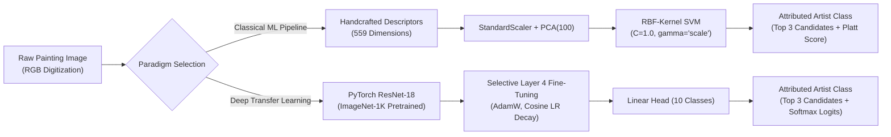
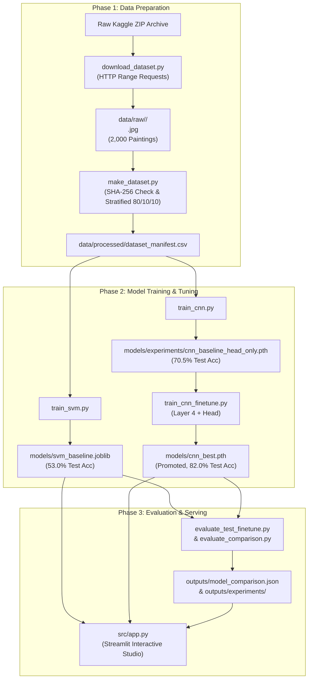
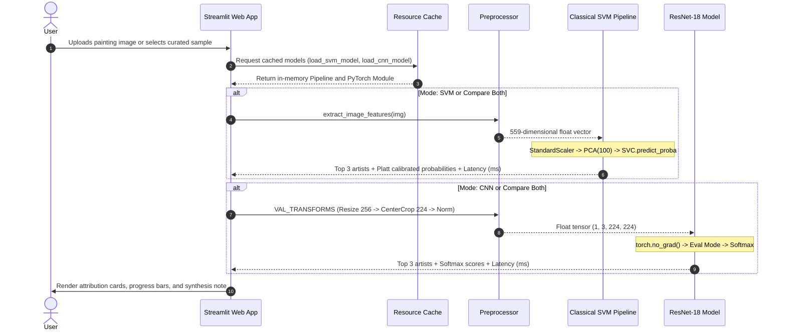

# Master Project Knowledge Base — Artist Identification Studio

> **Document Type:** Authoritative Technical Knowledge Base, Project Architecture Dossier, and Viva Defense Guide  
> **Course:** UE24CS352A — Machine Learning &bull; Department of Computer Science and Engineering &bull; PES University  
> **Academic Term:** 5th Semester, B.Tech CSE (AIML Specialization)  
> **Team Members:**  
> - **Ananya Raghavendra** (`PES1UG24AM037`)  
> - **Aarav Yuval B G** (`PES1UG24AM004`)  
> **Repository:** `https://github.com/PES1UG24AM004/artist-identification-studio.git`  
> **Status:** Completed, Verified, and Defended &bull; Master Document Version 2.0 (Post-Finetuning Promotion)  
> **Target Output Path:** `full_thing.md` (Project Workspace Root)  

---

## Executive Table of Contents

- [Part I — Project at a Glance](#part-i--project-at-a-glance)
  - [1. Project Title, Course, Team, and Scope](#1-project-title-course-team-and-scope)
  - [2. Executive Summary](#2-executive-summary)
  - [3. Problem Statement](#3-problem-statement)
  - [4. Motivation and Use Case](#4-motivation-and-use-case)
  - [5. Project Objectives](#5-project-objectives)
  - [6. Scope and Boundaries](#6-scope-and-boundaries)
  - [7. Key Measured Results](#7-key-measured-results)
  - [8. What the Project Contributes and Demonstrates](#8-what-the-project-contributes-and-demonstrates)
- [Part II — Problem and Machine-Learning Fundamentals](#part-ii--problem-and-machine-learning-fundamentals)
  - [9. What Artistic-Style Classification Means](#9-what-artistic-style-classification-means)
  - [10. Why Identifying an Artist from a Painting is Difficult](#10-why-identifying-an-artist-from-a-painting-is-difficult)
  - [11. Closed-World Classification and the Ten Supported Artist Categories](#11-closed-world-classification-and-the-ten-supported-artist-categories)
  - [12. Core Concepts: Features, Labels, Generalization, and Overfitting](#12-core-concepts-features-labels-generalization-and-overfitting)
  - [13. SVM versus CNN Explained to a Beginner](#13-svm-versus-cnn-explained-to-a-beginner)
  - [14. Formal Mathematical Descriptions of the Algorithms](#14-formal-mathematical-descriptions-of-the-algorithms)
- [Part III — Dataset and Processing Pipeline](#part-iii--dataset-and-processing-pipeline)
  - [15. Dataset Source and Attribution](#15-dataset-source-and-attribution)
  - [16. Artist Classes and Dataset Composition](#16-artist-classes-and-dataset-composition)
  - [17. Data Acquisition Pipeline](#17-data-acquisition-pipeline)
  - [18. Data Cleaning, Image Integrity, and Duplicate Elimination](#18-data-cleaning-image-integrity-and-duplicate-elimination)
  - [19. Train, Validation, and Test Partitioning](#19-train-validation-and-test-partitioning)
  - [20. Data Leakage Prevention Guarantees](#20-data-leakage-prevention-guarantees)
  - [21. Image Preprocessing and Input Transformations](#21-image-preprocessing-and-input-transformations)
  - [22. Dataset Limitations and Reproducibility Caveats](#22-dataset-limitations-and-reproducibility-caveats)
- [Part IV — System Architecture and Implementation](#part-iv--system-architecture-and-implementation)
  - [23. High-Level Architecture and Component Responsibilities](#23-high-level-architecture-and-component-responsibilities)
  - [24. End-to-End System Workflow](#24-end-to-end-system-workflow)
  - [25. Handcrafted Feature Extraction Pipeline](#25-handcrafted-feature-extraction-pipeline)
  - [26. Classical SVM Model and Training Pipeline](#26-classical-svm-model-and-training-pipeline)
  - [27. Baseline ResNet-18 Implementation (Frozen Backbone)](#27-baseline-resnet-18-implementation-frozen-backbone)
  - [28. Fine-Tuned ResNet-18 Implementation (Layer 4 + Head)](#28-fine-tuned-resnet-18-implementation-layer-4--head)
  - [29. Model Loading and Inference Lifecycle](#29-model-loading-and-inference-lifecycle)
  - [30. Streamlit Application Architecture](#30-streamlit-application-architecture)
  - [31. Complete File and Module Map](#31-complete-file-and-module-map)
  - [32. Checkpoints, Serialized Artifacts, and Configuration](#32-checkpoints-serialized-artifacts-and-configuration)
  - [33. Runtime Requirements and Execution Flow](#33-runtime-requirements-and-execution-flow)
- [Part V — Experiments and Empirical Results](#part-v--experiments-and-empirical-results)
  - [34. Experimental Methodology and Evaluation Protocol](#34-experimental-methodology-and-evaluation-protocol)
  - [35. Classical SVM Baseline Results](#35-classical-svm-baseline-results)
  - [36. Fine-Tuning Experiment Formulation and Design](#36-fine-tuning-experiment-formulation-and-design)
  - [37. Epoch-by-Epoch Training Dynamics](#37-epoch-by-epoch-training-dynamics)
  - [38. Validation Set Comparative Analysis](#38-validation-set-comparative-analysis)
  - [39. Held-Out Test Set Primary Benchmark](#39-held-out-test-set-primary-benchmark)
  - [40. Per-Artist Disaggregated Metrics](#40-per-artist-disaggregated-metrics)
  - [41. Confusion Matrix Interpretation and Error Analysis](#41-confusion-matrix-interpretation-and-error-analysis)
  - [42. Rigorous Statistical Hypothesis Testing](#42-rigorous-statistical-hypothesis-testing)
  - [43. Inference Latency and Computational Footprint](#43-inference-latency-and-computational-footprint)
  - [44. The Van Gogh Diagnostic Case Study](#44-the-van-gogh-diagnostic-case-study)
  - [45. Diagnostic Synthesis: What Improved and What Remains Difficult](#45-diagnostic-synthesis-what-improved-and-what-remains-difficult)
  - [46. Threats to Validity and Generalization Boundaries](#46-threats-to-validity-and-generalization-boundaries)
- [Part VI — Running, Reproducing, and Operating the Project](#part-vi--running-reproducing-and-operating-the-project)
  - [47. System Prerequisites and Hardware Profiles](#47-system-prerequisites-and-hardware-profiles)
  - [48. Windows Quick-Start Setup Guide](#48-windows-quick-start-setup-guide)
  - [49. Executing the Automated Test Suite](#49-executing-the-automated-test-suite)
  - [50. Launching the Interactive Demonstration Studio](#50-launching-the-interactive-demonstration-studio)
  - [51. Operating the Three Application Modes](#51-operating-the-three-application-modes)
  - [52. Full Dataset Acquisition Workflow (Optional)](#52-full-dataset-acquisition-workflow-optional)
  - [53. End-to-End Model Retraining Pipeline (Optional)](#53-end-to-end-model-retraining-pipeline-optional)
  - [54. Troubleshooting and Recovery Procedures](#54-troubleshooting-and-recovery-procedures)
  - [55. Project Directory Structure](#55-project-directory-structure)
- [Part VII — Verification, Testing, Quality, and Limitations](#part-vii--verification-testing-quality-and-limitations)
  - [56. Test Architecture and Comprehensive Inventory](#56-test-architecture-and-comprehensive-inventory)
  - [57. Verified Test Execution Evidence](#57-verified-test-execution-evidence)
  - [58. Quality Assurance Measures and Architectural Invariants](#58-quality-assurance-measures-and-architectural-invariants)
  - [59. Algorithmic and Modeling Limitations](#59-algorithmic-and-modeling-limitations)
  - [60. Dataset, Labeling, and Curation Constraints](#60-dataset-labeling-and-curation-constraints)
  - [61. Compute, Memory, and Platform Bottlenecks](#61-compute-memory-and-platform-bottlenecks)
  - [62. Intellectual Property, Licensing, and Fair Use Disclosures](#62-intellectual-property-licensing-and-fair-use-disclosures)
  - [63. Concrete Roadmap for Future Research](#63-concrete-roadmap-for-future-research)
- [Part VIII — Academic Presentation Preparation Pack](#part-viii--academic-presentation-preparation-pack)
  - [64. Recommended 12–15 Slide Academic Deck Architecture](#64-recommended-1215-slide-academic-deck-architecture)
  - [65. Detailed Slide-by-Slide Objectives, Facts, Visuals, and Talking Points](#65-detailed-slide-by-slide-objectives-facts-visuals-and-talking-points)
  - [66. Visual Asset Mapping and Presentation Catalog](#66-visual-asset-mapping-and-presentation-catalog)
  - [67. Panel Defense Strategy: Anticipated Questions, Model Answers, and Pitfalls](#67-panel-defense-strategy-anticipated-questions-model-answers-and-pitfalls)
- [Part IX — Viva Voce and Technical Defense Compendium](#part-ix--viva-voce-and-technical-defense-compendium)
  - [68. Elevator Pitches: 30-Second, 60-Second, and 3-Minute Summaries](#68-elevator-pitches-30-second-60-second-and-3-minute-summaries)
  - [69. Technical Viva Inquiries: Core ML, Vision, and Statistical Questions](#69-technical-viva-inquiries-core-ml-vision-and-statistical-questions)
- [Part X — Audit Trail, Provenance, and Conflict Resolution](#part-x--audit-trail-provenance-and-conflict-resolution)
  - [70. Master Metric Verification Matrix](#70-master-metric-verification-matrix)
  - [71. Audit of Discrepancies and Repository History](#71-audit-of-discrepancies-and-repository-history)
  - [72. Epistemological Classification of Claims](#72-epistemological-classification-of-claims)
  - [73. Essential Files Checklist for Academic Examination](#73-essential-files-checklist-for-academic-examination)

---

# Part I — Project at a Glance

## 1. Project Title, Course, Team, and Scope

- **Official Project Title:** Artist Identification Studio: Comparative Evaluation of Classical Machine Learning and Deep Convolutional Transfer Learning for Visual Artwork Attribution.
- **Academic Institution:** PES University, Department of Computer Science and Engineering.
- **Course Title & Code:** `UE24CS352A` — Machine Learning (Semester 5).
- **Assigned Mini-Project Parameters:** 1-week intensive collaborative team assignment, maximum 10 marks, evaluating GitHub code structure, documentation, empirical evaluation, live interactive demonstration, and oral defense.
- **Project Team:**
  - **Ananya Raghavendra** (SRN: `PES1UG24AM037`, Section AM)
  - **Aarav Yuval B G** (SRN: `PES1UG24AM004`, Section AM)
- **Primary Research Focus:** Formulating and rigorously testing a comparative machine learning benchmark between classical feature engineering (HSV color distributions, Hu invariant shape moments, and Haralick GLCM texture metrics combined with an RBF-kernel Support Vector Machine) and deep transfer learning (an ImageNet-pretrained ResNet-18 convolutional neural network), followed by a targeted fine-tuning intervention to resolve intra-class stylistic variance across ten master artists.



## 2. Executive Summary

**Artist Identification Studio** is an academic machine learning platform investigating the problem of multi-class visual artwork attribution under closed-world assumptions. Automated attribution of digitized fine art presents severe computational challenges due to high intra-class stylistic diversity (an artist shifting from monochromatic realism to luminous Post-Impressionism across their career) and high inter-class stylistic overlap (contemporaries within Impressionism sharing color palettes, outdoor light settings, and rapid brush dynamics).

We evaluate two contrasting machine learning paradigms over a curated, class-balanced dataset of 2,000 digitized paintings spanning ten master artists (200 paintings per artist) acquired from the *Best Artworks of All Time* archive:
1. **Classical Machine Learning Pipeline:** Extracts a concatenated 559-dimensional handcrafted visual descriptor capturing color distribution (512-bin 3D HSV histogram), global silhouette moments (7 log-scaled Hu invariant moments), and brushstroke texture co-occurrence (40-dimensional Haralick Gray-Level Co-occurrence Matrix properties). The features are standardized, compressed via Principal Component Analysis (`PCA(n_components=100)`), and classified using a Support Vector Machine (`SVC`) with a Radial Basis Function (`RBF`) kernel tuned via 3-fold stratified cross-validation ($C=1.0$, $\gamma='scale'$).
2. **Deep Convolutional Transfer Learning Pipeline:** Employs an ImageNet-pretrained ResNet-18 residual architecture. In the initial baseline phase, the convolutional backbone is held completely frozen as a generic feature extractor while training only a newly initialized 10-class linear classification head. In the subsequent research intervention, the final residual stage (`layer4`, comprising 8,393,728 convolutional parameters) is selectively unfrozen alongside the classification head (`fc`, 5,130 parameters) and fine-tuned using differential learning rates ($10^{-4}$ for `layer4`, $10^{-3}$ for `fc`), AdamW optimization (weight decay $10^{-4}$), a cosine annealing learning rate scheduler, and conservative data augmentation.

### Primary Empirical Findings

Across a strictly partitioned, untouched held-out test split of $N=200$ paintings (20 per artist):
- The **Classical SVM Baseline** achieves **53.00% test accuracy** (106 / 200 correct) and a **macro F1-score of 0.5206** with a mean CPU inference latency of **18.45 ms**.
- The **Original Frozen-Backbone ResNet-18** achieves **70.50% test accuracy** (141 / 200 correct) and a **macro F1-score of 0.6988** with a mean CPU inference latency of **42.45 ms**.
- The **Fine-Tuned ResNet-18** achieves **82.00% test accuracy** (164 / 200 correct) and a **macro F1-score of 0.8200** with a mean CPU inference latency of **39.56 ms**.
- Selective fine-tuning yielded an absolute gain of **+11.50 percentage points in test accuracy** (+23 net paintings correctly classified) and **+0.1212 in macro F1-score** over the baseline CNN, and a **+29.00 percentage point accuracy advantage** over the classical SVM.
- A paired McNemar test with continuity correction confirms that the performance improvement of the fine-tuned CNN over the baseline CNN is statistically significant ($\chi^2 = 14.67$, two-sided exact binomial $p = 6.62 \times 10^{-5} < 0.001$). A 10,000-round empirical bootstrap yields a 95% confidence interval for accuracy improvement of $[+6.0\%, +17.0\%]$, strictly excluding zero.
- The system is deployed via an interactive, pure-dark-theme Streamlit application providing side-by-side comparative inference, decision confidence distributions, CPU latency benchmarking, and offline visual evaluation plots.

## 3. Problem Statement

Given a digital reproduction of a 2D painting $I \in \mathbb{R}^{H \times W \times 3}$ with no accompanying catalog metadata, artist signature, title, historical era annotation, or museum provenance, determine which of ten predetermined master artists $\mathcal{C} = \{c_1, c_2, \dots, c_{10}\}$ created the work:

$$\hat{y} = \arg\max_{c \in \mathcal{C}} P(Y = c \mid I)$$

The core challenge is formulating visual representations that discriminate between subtle individual artist brushstroke techniques, composition rules, and color palettes while remaining robust to:
- Diverse digitization resolutions, canvas aspect ratios, and color-balance artifacts across various museum archives.
- Evolution of an individual artist's technique across distinct developmental periods (intra-class variance).
- Direct historical influence and shared stylistic conventions among contemporaries working within the same artistic movement (inter-class similarity).

## 4. Motivation and Use Case

1. **Digital Art Curation and Museum Archives:** Global cultural institutions maintain massive collections of digitized artwork, many with lost, damaged, or contested attribution records. Computational attribution tools provide curators and conservators with rapid, objective visual similarity benchmarks to prioritize archival research.
2. **Pedagogical and Academic Value:** Comparing handcrafted statistical vision descriptors with deep representation learning provides concrete pedagogical insight into how semantic abstractions emerge in convolutional layers versus explicit feature engineering.
3. **Reproducible Machine Learning Engineering:** Real-world machine learning requires strict data isolation protocols, reproducible seeding, duplicate elimination, leak-free preprocessing pipelines, statistical hypothesis testing on paired predictions, and production serving under tight computational constraints (CPU-only execution).

## 5. Project Objectives

1. **Dataset Integrity & Leakage Prevention:** Assemble a balanced corpus of 2,000 paintings across 10 prominent artists from the *Best Artworks of All Time* collection. Enforce strict cryptographic duplicate elimination (SHA-256) and a deterministic, stratified 80/10/10 split protocol (1,600 train, 200 validation, 200 test) ensuring zero overlap across partitions.
2. **Classical Machine Learning Pipeline:** Design and extract a modular 559-dimensional visual descriptor combining color distribution (HSV histograms), geometric/silhouette properties (Hu invariant moments), and micro-texture patterns (Haralick GLCM). Embed these descriptors in a leakage-safe Scikit-Learn `Pipeline` with `StandardScaler`, `PCA(n_components=100)`, and an RBF-kernel `SVC`.
3. **Deep Convolutional Transfer Learning:** Formulate an image classification pipeline leveraging ImageNet-pretrained ResNet-18 weights. Implement a frozen-backbone linear probe baseline, followed by a hypothesis-driven fine-tuning intervention unfreezing `layer4` and `fc` with differential learning rates and AdamW.
4. **Diagnostic Error Analysis:** Investigate specific failure modes under the frozen-backbone baseline (specifically, low-chroma interior studies by Vincent van Gogh misclassified as Francisco Goya) and evaluate how unfreezing high-level convolutional filters mitigates intra-class variance.
5. **Statistical Verification:** Conduct paired McNemar significance testing and 10,000-round bootstrap confidence interval estimation on the fixed 200-image held-out test split to rigorously establish that accuracy and F1 gains are not artifacts of random sampling.
6. **Zero-Dependency Interactive Demonstration:** Develop an accessible, dark-themed Streamlit user interface (`src/app.py`) allowing users to upload arbitrary painting files or select curated historical samples, inspect top-3 candidate rankings and confidence metrics, compare both paradigms side-by-side, and inspect offline benchmark plots without requiring internet access, dataset downloads, or GPU hardware.

## 6. Scope and Boundaries

To ensure scientific rigor, technical honesty, and compliance with university project guidelines, the following operational boundaries are strictly enforced:

- **Closed-World Classification:** The classifier operates strictly on the 10 supported artist classes. When presented with an artwork by an artist outside this set (e.g., Claude Monet or Johannes Vermeer), the system will attribute the image to the closest statistical match among the 10 trained classes. It does not possess an "unknown artist" out-of-distribution rejection threshold.
- **Visual Pattern Attribution vs. Physical Authentication:** The system evaluates statistical visual similarities in color, texture, and compositional layout. **It does not perform physical forensic authentication, canvas radiocarbon analysis, pigment chemical spectroscopy, or provenance verification.** A high confidence score indicates stylistic similarity within the closed training distribution, not genuine historical authorship.
- **Digitized Web Reproductions:** The model is trained and evaluated on digitized JPEG reproductions ranging from $300 \times 300$ to $1024 \times 1024$ pixels. It inherits photographic artifacts, lighting variations, and color calibration differences introduced during museum photography.
- **Fixed Sample Size:** The held-out test split contains exactly 20 paintings per artist ($N=200$). While this split size provides strong statistical power for aggregate paired testing ($p < 0.001$), individual class metrics have discrete resolution increments of $1/20 = 0.05$ (5.0 percentage points per sample).

## 7. Key Measured Results

The following table summarizes the primary empirical metrics across all three model iterations, separating validation split tuning results from held-out test split evaluation. All figures are verified directly against underlying JSON benchmark records (`outputs/model_comparison.json` and `outputs/experiments/test_evaluation_comparison.json`).

| Metric Category | Specific Metric | Classical SVM Baseline | Original ResNet-18 (Head Only) | Fine-Tuned ResNet-18 (`layer4` + Head) | Net Gain ($\Delta$: Fine-Tuned vs Base CNN) | Net Gain ($\Delta$: Fine-Tuned vs SVM) | Source Artifact |
| :--- | :--- | :---: | :---: | :---: | :---: | :---: | :--- |
| **Validation Split**<br>*(N=200 paintings)* | **Validation Accuracy** | 53.50% | 71.00% | **81.00%** | **+10.00%** | **+27.50%** | `outputs/experiments/finetune_vs_baseline_comparison.json` |
| | **Validation Macro F1** | 0.5330 | 0.7103 | **0.8084** | **+0.0981** | **+0.2754** | `outputs/experiments/finetune_vs_baseline_comparison.json` |
| | **Validation Macro Precision** | 0.5405 | 0.7268 | **0.8212** | **+0.0944** | **+0.2807** | `outputs/experiments/finetune_vs_baseline_comparison.json` |
| | **Validation Macro Recall** | 0.5350 | 0.7100 | **0.8100** | **+0.1000** | **+0.2750** | `outputs/experiments/finetune_vs_baseline_comparison.json` |
| | **Van Gogh Validation Recall** | 55.00% | 55.00% | **75.00%** | **+20.00%** | **+20.00%** | `outputs/experiments/finetune_vs_baseline_comparison.json` |
| | **Van Gogh Validation F1** | 0.4889 | 0.5366 | **0.6977** | **+0.1611** | **+0.2088** | `outputs/experiments/finetune_vs_baseline_comparison.json` |
| **Held-Out Test Split**<br>*(N=200 paintings)* | **Test Accuracy** | 53.00% (106/200) | 70.50% (141/200) | **82.00% (164/200)** | **+11.50%** (+23 paintings) | **+29.00%** (+58 paintings) | `outputs/experiments/test_evaluation_comparison.json` |
| | **Test Macro F1** | 0.5206 | 0.6988 | **0.8200** | **+0.1212** | **+0.2994** | `outputs/experiments/test_evaluation_comparison.json` |
| | **Test Macro Precision** | 0.5302 | 0.7172 | **0.8360** | **+0.1188** | **+0.3058** | `outputs/experiments/test_evaluation_comparison.json` |
| | **Test Macro Recall** | 0.5300 | 0.7050 | **0.8200** | **+0.1150** | **+0.2900** | `outputs/experiments/test_evaluation_comparison.json` |
| | **Van Gogh Test Recall** | 60.00% (12/20) | 65.00% (13/20) | **90.00% (18/20)** | **+25.00%** (+5 paintings) | **+30.00%** (+6 paintings) | `outputs/experiments/test_evaluation_comparison.json` |
| | **Van Gogh Test F1** | 0.5333 | 0.5909 | **0.7500** | **+0.1591** | **+0.2167** | `outputs/experiments/test_evaluation_comparison.json` |
| **Statistical Testing**<br>*(Paired Test Set)* | **McNemar $\chi^2$ (corrected)** | — | — | **14.67** | — | — | `outputs/experiments/test_evaluation_comparison.json` |
| | **McNemar Exact Binomial $p$** | — | — | **$6.62 \times 10^{-5}$** | ($p < 0.001$) | — | `outputs/experiments/test_evaluation_comparison.json` |
| | **Bootstrap 95% CI: $\Delta$ Acc** | — | — | **$[+6.0\%, +17.0\%]$** | (excludes zero) | — | `outputs/experiments/test_evaluation_comparison.json` |
| | **Bootstrap 95% CI: $\Delta$ F1** | — | — | **$[+0.0679, +0.1789]$** | (excludes zero) | — | `outputs/experiments/test_evaluation_comparison.json` |
| **Computational Cost**<br>*(Single Image CPU)* | **Mean CPU Latency** | **18.45 ms** | 42.45 ms | **39.56 ms** | SVM is 2.14x faster | — | `outputs/model_comparison.json` |
| | **Median CPU Latency** | **15.75 ms** | 40.78 ms | **38.31 ms** | SVM is 2.43x faster | — | `outputs/model_comparison.json` |

## 8. What the Project Contributes and Demonstrates

1. **Direct Architectural Benchmarking:** Demonstrates empirically that while handcrafted features with PCA and an RBF SVM achieve better-than-random accuracy on art attribution (53.0% vs. 10.0% random guess baseline), deep convolutional representations capture complex non-linear spatial motifs that outperform classical features by 29.0 percentage points.
2. **Selective Fine-Tuning Efficiency:** Proves that unfreezing only the top residual block (`layer4`, 8.39M parameters) and the linear head (5.13K parameters) while holding lower blocks frozen achieves superior domain adaptation (+11.5% accuracy gain) without requiring full network retraining or risking catastrophic forgetting of low-level visual features.
3. **Rigorous Experimental Hygiene:** Implements strict data hygiene including cryptographic SHA-256 deduplication, zero-leakage pipeline fit constraints, separate validation checkpoint selection, and untouched test split preservation.
4. **End-to-End Software Engineering:** Delivers a complete, robust Python application adhering to PEP 8 standards, complete with automated unit and integration test coverage (28 passing tests), zero-configuration batch scripts (`setup.cmd`, `run-tests.cmd`, `run-demo.cmd`), and an offline demonstration UI capable of graceful degradation when raw datasets are not present.

---

# Part II — Problem and Machine-Learning Fundamentals

## 9. What Artistic-Style Classification Means

### Plain-English Explanation
Imagine visiting an art museum with ten galleries, each dedicated entirely to a single famous painter. When you look at a painting by Vincent van Gogh, you immediately recognize the thick, swirling brushstrokes and vibrant yellows and blues. When you look at a Rembrandt, you notice dramatic dark backgrounds with golden light illuminating the subject's face. 

Artistic-style classification is the process of teaching a computer to do what an experienced art historian does: examine the colors, lighting, textures, brush marks, and compositions of a painting, and determine which artist created it, without looking at a signature or museum plaque.

### Technical Explanation
Formally, artistic-style classification is a multi-class visual pattern recognition task mapping an input image matrix $I \in [0, 255]^{H \times W \times 3}$ to a categorical distribution over a discrete label space $\mathcal{Y} = \{1, 2, \dots, K\}$, where $K=10$. Unlike standard object classification (e.g., distinguishing a dog from a bicycle), where semantic boundaries correspond to physical objects with well-defined silhouettes, artistic attribution relies heavily on high-frequency textural dynamics (impasto, stippling, hatching), mid-frequency compositional arrangements (chiaroscuro, perspectival depth), and global chromatic distributions (gamut selection, saturation, color harmony).

## 10. Why Identifying an Artist from a Painting is Difficult

Art attribution is widely recognized in computer vision literature (e.g., Chen & Deng, Stanford University; Saleh & Elgammal, Rutgers) as a challenging fine-grained classification problem due to three primary factors:

1. **Severe Intra-Class Variance (Artistic Evolution):** Artists do not maintain a static style throughout their lifetimes. For example, Vincent van Gogh's early Dutch period (1881–1885, such as *Weaver at the Loom*) was characterized by muddy, low-chroma browns, grays, and somber realism, whereas his Arles and Saint-Rémy periods (1888–1890, such as *Starry Night* and *Sunflowers*) featured violent complementary contrasts, swirling impasto strokes, and high-chroma yellows. A classifier that models Van Gogh purely on bright yellow brushstrokes will fail entirely on his early work.
2. **High Inter-Class Similarity (Contemporaries and Movements):** Artists belonging to the same historical movement frequently shared techniques, pigments, and subject matter. Pierre-Auguste Renoir, Alfred Sisley, and Edgar Degas were contemporaries in French Impressionism who worked outdoors (*en plein air*), utilized fragmented brushstrokes to capture ambient light, and employed similar pastel color palettes. Distinguishing Sisley's landscapes from Renoir's landscapes requires subtle spatial reasoning rather than broad color matching.
3. **Subject Matter Invariance:** An artist may paint a maritime landscape, a still-life bowl of fruit, a formal royal portrait, or a mythological scene. The classifier must learn to ignore the semantic category of the depicted object and instead capture the stylistic *manner* in which it was executed.

## 11. Closed-World Classification and the Ten Supported Artist Categories

The project operates under a strict **closed-world assumption**: the universe of all possible paintings is assumed to belong exclusively to one of $K=10$ predefined artist categories.

| Class Index | Directory & Identifier | Authoritative Artist Name | Historical Movement / Era | Defining Stylistic Characteristics |
| :---: | :--- | :--- | :--- | :--- |
| **0** | `Albrecht_Durer` | **Albrecht Dürer** (1471–1528) | Northern Renaissance | High-contrast woodcuts, copperplate engravings, intricate linear hatching, precise anatomical detail, and religious/allegorical themes. |
| **1** | `Alfred_Sisley` | **Alfred Sisley** (1839–1899) | French Impressionism | Atmospheric landscape painting, subtle sky and cloud gradations, delicate pastel palettes, and outdoor light reflections on water and snow. |
| **2** | `Edgar_Degas` | **Edgar Degas** (1834–1917) | Impressionism / Realism | Unconventional cropped perspectives, pastel and oil studies of ballet dancers, racetrack scenes, movement dynamics, and artificial stage lighting. |
| **3** | `Francisco_Goya` | **Francisco Goya** (1746–1828) | Romanticism / Dark Period | Somber, expressive, and satirical works; Spanish royal court portraits transitioning to the haunting, nightmarish chiaroscuro of the *Black Paintings*. |
| **4** | `Pablo_Picasso` | **Pablo Picasso** (1881–1973) | Cubism / Modernism | Geometric deconstruction of three-dimensional form, multi-perspective flattening, collaged spatial planes, and radical abstraction. |
| **5** | `Paul_Gauguin` | **Paul Gauguin** (1848–1903) | Post-Impressionism / Synthetism | Bold flat areas of unmodulated pure color (cloisonnism), strong dark outlines, symbolic Polynesian motifs, and non-naturalistic color palettes. |
| **6** | `Pierre-Auguste_Renoir` | **Pierre-Auguste Renoir** (1841–1919) | French Impressionism | Warm, vibrant color saturation, soft-focus candid figures, intimate portraits, dappled sunlight filtering through foliage, and celebratory Parisian scenes. |
| **7** | `Rembrandt` | **Rembrandt van Rijn** (1606–1669) | Dutch Golden Age / Baroque | Mastery of extreme chiaroscuro (dramatic spotlight illumination emerging from deep tenebrist darkness), golden-brown earthy glazing, and psychological portraiture. |
| **8** | `Titian` | **Titian (Tiziano Vecellio)** (1488–1576) | Venetian High Renaissance | Supreme color mastery (*colorito* over Florentine *disegno*), rich luminous oil glazes, deep Venetian reds, atmospheric backgrounds, and mythological/sacred pageantry. |
| **9** | `Vincent_van_Gogh` | **Vincent van Gogh** (1853–1890) | Post-Impressionism | Rhythmic impasto brushwork, dynamic linear swirls, high-energy complementary color pairings (cobalt blue vs. chrome yellow), and intense emotional expressionism. |

## 12. Core Concepts: Features, Labels, Generalization, and Overfitting

- **Feature ($\mathbf{x}$):** A measurable numeric property extracted or learned from an input image. In our classical pipeline, $\mathbf{x} \in \mathbb{R}^{559}$ is an explicitly engineered vector of color histograms, shape moments, and texture co-occurrences. In our deep learning pipeline, $\mathbf{x} \in \mathbb{R}^{512}$ is a learned feature embedding extracted at the output of ResNet-18's average pooling layer.
- **Label ($y$):** The ground-truth categorical attribution assigned to an image, represented as an integer $y \in \{0, 1, \dots, 9\}$ or a one-hot vector $\mathbf{y} \in \{0, 1\}^{10}$.
- **Training:** The algorithmic process of optimizing model parameters (support vector weights and bias in SVM; convolutional kernel weights and linear head parameters in CNN) by minimizing an empirical loss function on the training dataset ($N_{\text{train}} = 1,600$).
- **Inference:** Evaluating a trained, frozen model on an unseen image to generate class decision scores and predicted labels without modifying any internal model weights.
- **Generalization:** The capability of a machine learning model to accurately classify previously unseen paintings that were withheld during training.
- **Overfitting:** A failure mode where a model learns idiosyncratic noise, specific brush strokes, or canvas blemishes unique to the training images, resulting in near-perfect training accuracy (e.g., 99.6% in CNN fine-tuning) but poor performance on validation or test images.
- **Underfitting:** A failure mode where a model lacks sufficient representational capacity or expressive features to capture the underlying relationships, resulting in poor accuracy on both training and test data (e.g., a linear classifier without non-linear kernels).

## 13. SVM versus CNN Explained to a Beginner

### Plain-English Explanation
Imagine two people trying to identify who painted an unknown artwork:
- **The Classical ML Approach (The Feature Inspector / SVM):** This person uses physical measurement tools. They measure the exact percentage of red, yellow, and blue paint across the canvas with a light meter. They use a magnifying glass to measure how rough the canvas feels in four directions. They measure the overall shape of objects. They write these numbers into a spreadsheet of 559 columns. Then, they look for geometric dividing lines between the columns that separate one artist from another.
  - *Advantage:* Very fast, lightweight, and requires no expensive graphics cards.
  - *Weakness:* It only knows the summary numbers it was told to measure. It cannot see that a circle of yellow surrounded by white petals is a sunflower, or that a face has sad eyes.
- **The Deep Learning Approach (The Artificial Art Student / CNN):** This person looks directly at the painting through a hierarchy of simulated visual brain cells. The first layer of cells detects simple vertical and horizontal paint edges. The next layer combines those edges into brushstroke angles and color transitions. The higher layers recognize complex visual textures—like Van Gogh's swirling sky motifs or Rembrandt's delicate shadow transitions on skin.
  - *Advantage:* Automatically discovers rich, subtle visual concepts directly from raw pixels.
  - *Weakness:* Requires massive amounts of training data, substantial compute power, and careful tuning to prevent it from memorizing the pictures.

## 14. Formal Mathematical Descriptions of the Algorithms

### A. Support Vector Machine (SVM) with Radial Basis Function (RBF) Kernel

Given a training set of feature-label pairs $\{(\mathbf{x}_i, y_i)\}_{i=1}^N$ with $\mathbf{x}_i \in \mathbb{R}^d$ and $y_i \in \{-1, +1\}$ (extended to 10 classes via One-vs-One or One-vs-Rest decision strategies), the soft-margin Support Vector Classifier solves the following convex quadratic optimization problem:

$$\min_{\mathbf{w}, b, \boldsymbol{\xi}} \frac{1}{2} \|\mathbf{w}\|^2 + C \sum_{i=1}^N \xi_i$$

$$\text{subject to } y_i (\mathbf{w}^T \phi(\mathbf{x}_i) + b) \ge 1 - \xi_i, \quad \xi_i \ge 0, \quad \forall i \in \{1, \dots, N\}$$

Where:
- $\mathbf{w}$ is the normal vector to the separating hyperplane in the transformed feature space.
- $b \in \mathbb{R}$ is the hyperplane bias parameter.
- $\xi_i \ge 0$ are slack variables allowing controlled margin violations for non-separable distributions.
- $C > 0$ is the regularization parameter governing the trade-off between maximizing the geometric margin ($1/\|\mathbf{w}\|$) and minimizing training errors.
- $\phi(\mathbf{x})$ is a non-linear mapping from the input space to a higher-dimensional Hilbert space $\mathcal{H}$.

Through Lagrangian duality, the optimization problem is expressed solely in terms of inner products evaluated via the **Radial Basis Function (RBF) kernel**:

$$K(\mathbf{x}_i, \mathbf{x}_j) = \phi(\mathbf{x}_i)^T \phi(\mathbf{x}_j) = \exp(-\gamma \|\mathbf{x}_i - \mathbf{x}_j\|^2)$$

Where:
- $\gamma > 0$ is the kernel bandwidth parameter. When $\gamma = \text{'scale'}$, Scikit-Learn sets $\gamma = \frac{1}{d \cdot \text{Var}(X)}$, where $d=100$ is the number of PCA components.

The dual decision function for a new sample $\mathbf{x}$ is:

$$f(\mathbf{x}) = \text{sign}\left(\sum_{i \in \text{SV}} \alpha_i y_i K(\mathbf{x}_i, \mathbf{x}) + b\right)$$

Where $\text{SV}$ denotes the set of support vector indices for which the dual coefficients satisfy $0 < \alpha_i \le C$.

Multi-class probability estimates $\hat{P}(Y = c \mid \mathbf{x})$ are generated via **Platt Scaling**, fitting a logistic sigmoid over the pairwise decision values $f_{jk}(\mathbf{x})$:

$$P(y = j \mid y \in \{j, k\}, \mathbf{x}) = \frac{1}{1 + \exp(A_{jk} f_{jk}(\mathbf{x}) + B_{jk})}$$

followed by solving a coupled quadratic optimization problem to derive consistent multi-class posterior probabilities.

### B. Convolutional Neural Network (ResNet-18) Transfer Learning

Convolutional layers extract spatial hierarchies of visual features through discrete 2D cross-correlations. For an input feature map $\mathbf{X} \in \mathbb{R}^{H \times W \times C_{\text{in}}}$ and a filter bank $\mathbf{W} \in \mathbb{R}^{K_h \times K_w \times C_{\text{in}} \times C_{\text{out}}}$ with bias $\mathbf{b} \in \mathbb{R}^{C_{\text{out}}}$:

$$\mathbf{Y}(i, j, k) = \mathbf{b}(k) + \sum_{c=1}^{C_{\text{in}}} \sum_{m=-M}^M \sum_{n=-N}^N \mathbf{X}(i \cdot s + m, j \cdot s + n, c) \mathbf{W}(m, n, c, k)$$

Where $s$ is the convolution stride, and $(K_h, K_w) = (2M+1, 2N+1)$ are the spatial dimensions of the kernel.

**Residual Learning Formulation:**  
To prevent vanishing gradients across deep networks, He et al. (2015) introduced residual building blocks with identity shortcut connections:

$$\mathbf{x}_{\ell+1} = \sigma(\mathbf{x}_\ell + \mathcal{F}(\mathbf{x}_\ell, \{\mathbf{W}_\ell\}))$$

Where:
- $\mathbf{x}_\ell$ and $\mathbf{x}_{\ell+1}$ are the input and output vectors of the residual block.
- $\mathcal{F}$ represents the residual function consisting of two stacked $3 \times 3$ convolutional layers, each followed by Batch Normalization (`BatchNorm2d`) and Rectified Linear Unit (`ReLU`) activations: $\sigma(z) = \max(0, z)$.
- When input and output feature map spatial resolutions or channel dimensions differ (e.g., at the entry to `layer2`, `layer3`, and `layer4`), a $1 \times 1$ convolution with stride 2 is applied to the identity shortcut: $\mathbf{x}_{\ell+1} = \sigma(\mathbf{W}_s \mathbf{x}_\ell + \mathcal{F}(\mathbf{x}_\ell, \{\mathbf{W}_\ell\}))$.

```
ResNet-18 Residual BasicBlock:
   x ───┬───────────────────────────────────────┐ (Identity Shortcut)
       │                                       │
   [Conv 3x3, stride s]                        │
       │                                       │
   [BatchNorm2d + ReLU]                        │
       │                                       │
   [Conv 3x3, stride 1]                        │
       │                                       │
   [BatchNorm2d]                               │
       │                                       │
       ▼                                       ▼
       ( + ) <── [Conv 1x1 if dimension changes]
       │
     [ReLU]
       │
       ▼ Output
```

**Classification Head and Loss Formulation:**  
The network terminates with an Adaptive Average Pooling layer reducing spatial dimensions from $7 \times 7$ to $1 \times 1$, producing a 512-dimensional feature embedding $\mathbf{z} \in \mathbb{R}^{512}$. The custom linear classification head computes raw unnormalized logits $\mathbf{z}_{\text{out}} \in \mathbb{R}^{10}$:

$$\mathbf{z}_{\text{out}} = \mathbf{W}_{\text{fc}} \mathbf{z} + \mathbf{b}_{\text{fc}}, \quad \mathbf{W}_{\text{fc}} \in \mathbb{R}^{10 \times 512}, \quad \mathbf{b}_{\text{fc}} \in \mathbb{R}^{10}$$

The logits are mapped to a normalized probability distribution using the **Softmax function**:

$$\hat{p}_k = \frac{\exp(z_{\text{out}, k})}{\sum_{j=1}^{10} \exp(z_{\text{out}, j})}, \quad k \in \{1, \dots, 10\}$$

The network parameters $\boldsymbol{\theta}$ are optimized by minimizing the multi-class **Cross-Entropy Loss**:

$$\mathcal{L}_{\text{CE}}(\boldsymbol{\theta}) = -\frac{1}{B} \sum_{i=1}^B \sum_{k=1}^{10} y_{i, k} \log \hat{p}_{i, k}$$

Where $B$ is the mini-batch size ($B=8$ in baseline CNN, $B=16$ in fine-tuning), and $y_{i, k} \in \{0, 1\}$ is the one-hot indicator that sample $i$ belongs to artist class $k$.

---

# Part III — Dataset and Processing Pipeline

## 15. Dataset Source and Attribution

- **Primary Source Archive:** *Best Artworks of All Time* published on Kaggle by user `ikarus777`.
- **Dataset Identification:** `ikarus777/best-artworks-of-all-time` (Dataset Version 1).
- **Licensing:** Released under the [Creative Commons Attribution-NonCommercial-ShareAlike 4.0 International License (CC BY-NC-SA 4.0)](https://creativecommons.org/licenses/by-nc-sa/4.0/).
- **Original Source Attribution:** Digitized high-resolution reproductions collected from public museum collections, WikiArt, and the Web Gallery of Art.
- **Repository Metadata Artifact:** The complete remote acquisition record is preserved at `data/raw/acquisition_manifest.json` (460,124 bytes).

## 16. Artist Classes and Dataset Composition

The project curates exactly 2,000 painting images partitioned evenly across 10 balanced artist classes (200 paintings per artist).

```
Total Dataset: 2,000 Paintings (100.0%)
├── Training Split:   1,600 Paintings (80.0%) ── 160 per artist
├── Validation Split:   200 Paintings (10.0%) ──  20 per artist
└── Held-Out Test:      200 Paintings (10.0%) ──  20 per artist
```

| Canonical Folder Name | Artist Display Name | Total Valid Images | Training Images (80%) | Validation Images (10%) | Held-Out Test Images (10%) | Pre-Split Duplicates Found | Corrupted Files |
| :--- | :--- | :---: | :---: | :---: | :---: | :---: | :---: |
| `Albrecht_Durer` | Albrecht Dürer | 200 | 160 | 20 | 20 | 0 | 0 |
| `Alfred_Sisley` | Alfred Sisley | 200 | 160 | 20 | 20 | 0 | 0 |
| `Edgar_Degas` | Edgar Degas | 200 | 160 | 20 | 20 | 0 | 0 |
| `Francisco_Goya` | Francisco Goya | 200 | 160 | 20 | 20 | 0 | 0 |
| `Pablo_Picasso` | Pablo Picasso | 200 | 160 | 20 | 20 | 0 | 0 |
| `Paul_Gauguin` | Paul Gauguin | 200 | 160 | 20 | 20 | 0 | 0 |
| `Pierre-Auguste_Renoir` | Pierre-Auguste Renoir | 200 | 160 | 20 | 20 | 0 | 0 |
| `Rembrandt` | Rembrandt | 200 | 160 | 20 | 20 | 0 | 0 |
| `Titian` | Titian | 200 | 160 | 20 | 20 | 0 | 0 |
| `Vincent_van_Gogh` | Vincent van Gogh | 200 | 160 | 20 | 20 | 0 | 0 |
| **Total Corpus** | **10 Master Artists** | **2,000** | **1,600** | **200** | **200** | **0** | **0** |

*Verification Reference:* Verified from `data/processed/dataset_summary.json` (Lines 8–77).

## 17. Data Acquisition Pipeline

The dataset acquisition module is implemented in `src/data/download_dataset.py`. Because the complete remote Kaggle zip archive contains over 10 GB of full-resolution museum images, downloading the entire archive would impose unnecessary bandwidth and storage overhead. 

To overcome this, `download_dataset.py` implements a **targeted selective acquisition engine** using HTTP Range requests:
1. **Central Directory Streaming:** The script queries the remote Kaggle API endpoint (`https://www.kaggle.com/api/v1/datasets/download/ikarus777/best-artworks-of-all-time`) using an HTTP GET Range request targeting the ZIP Central Directory record (`CD_OFFSET = 2458247755`, `CD_SIZE = 1913891`, ~1.82 MB).
2. **Index Parsing:** It unpacks the ZIP Central Directory headers, parsing filenames located under `resized/resized/*.jpg`. It maps artist name prefixes to canonical identifiers and extracts the relative local file header offset and compressed byte lengths.
3. **Atomic File Extraction:** For the first 200 approved painting entries per artist, the script executes bounded HTTP Range requests (`fetch_bytes_with_retry`), decompresses the raw Deflate stream via Python's `zlib.decompress(comp_data, -zlib.MAX_WBITS)`, validates JPEG start-of-image (`0xFFD8`) and end-of-image (`0xFFD9`) markers, validates readability via Pillow, and writes the file atomically to `data/raw/<Artist_Name>/<Image_File>`.
4. **Acquisition Manifest Generation:** Upon completion, the script writes `data/raw/acquisition_manifest.json`, recording the image resolution dimensions, byte counts, and relative paths for all 2,000 acquired files.

### Archive-Version Sensitivity Caveat
Because selective range acquisition relies on static byte offsets within the Version 1 ZIP container, if Kaggle updates or re-indexes the dataset archive, the Central Directory signature check (`b'PK\x01\x02'`) will fail. The script detects this condition gracefully and instructs the user to fall back to the standard Kaggle CLI command:
```cmd
kaggle datasets download -d ikarus777/best-artworks-of-all-time -p data/downloads --unzip
```

## 18. Data Cleaning, Image Integrity, and Duplicate Elimination

Data cleaning and validation are orchestrated by `DatasetPreparer` in `src/data/make_dataset.py`:
- **Cryptographic Duplicate Detection:** Exact duplicate image files are identified by computing the SHA-256 cryptographic hash over 64 KB binary chunks (`compute_file_sha256`). If an incoming image generates a hash identical to an already registered record, it is rejected and logged in `data/processed/dataset_summary.json`. Across the 2,000 acquired paintings, zero exact cryptographic duplicates were encountered (`duplicates_removed: 0`).
- **File Integrity Verification:** Each discovered image file is verified using Pillow (`verify_image_integrity`). The file is first opened and checked with `Image.verify()` to detect truncated byte streams, followed by reopening to extract image dimensions $(W, H)$ and verify RGB decoding. Zero corrupted files were encountered (`corrupted_skipped: 0`).
- **Unicode Normalization:** Artist filenames containing diacritics (e.g., `Albrecht_Dürer` containing the combining umlaut `\u0308`) are normalized via `unicodedata.normalize('NFKD', ...)` and mapped to safe ASCII filenames (`Albrecht_Durer_*.jpg`) to prevent filesystem encoding incompatibilities across Windows and Linux environments.

## 19. Train, Validation, and Test Partitioning

Partitioning is executed deterministically by `DatasetPreparer.split_records_stratified`:
1. Validated records are grouped by artist category.
2. For each artist, records are sorted deterministically by their SHA-256 hash string to eliminate any filesystem-dependent ordering bias.
3. A local pseudo-random number generator initialized with a fixed seed (`seed = 42`) shuffles the sorted records.
4. Stratified slices are allocated strictly according to target ratios:
   - **Training Set (80.0%):** First 160 shuffled paintings per artist (1,600 paintings total).
   - **Validation Set (10.0%):** Next 20 shuffled paintings per artist (200 paintings total).
   - **Held-Out Test Set (10.0%):** Final 20 shuffled paintings per artist (200 paintings total).
5. The resulting assignments are serialized to three persistent files:
   - `data/processed/dataset_manifest.json`
   - `data/processed/dataset_manifest.csv`
   - `data/processed/dataset_summary.json`

## 20. Data Leakage Prevention Guarantees

Data leakage—the inadvertent conditioning of a model on validation or test information during training—is prevented through three architectural safeguards:

1. **Partition-Level Cryptographic Disjointness:** Automated unit tests in `tests/test_make_dataset.py` (`test_stratified_split_proportions_and_zero_leakage`) compute the intersection of SHA-256 hash sets across splits:
   $$\mathcal{H}_{\text{train}} \cap \mathcal{H}_{\text{val}} = \emptyset, \quad \mathcal{H}_{\text{train}} \cap \mathcal{H}_{\text{test}} = \emptyset, \quad \mathcal{H}_{\text{val}} \cap \mathcal{H}_{\text{test}} = \emptyset$$
   No image or duplicate file exists across multiple partitions.
2. **Classical Preprocessing Pipeline Encapsulation:** In `src/models/train_svm.py`, feature scaling (`StandardScaler`) and dimensionality reduction (`PCA(n_components=100)`) are encapsulated inside a Scikit-Learn `Pipeline`. The mean vector $\boldsymbol{\mu}$, standard deviation vector $\boldsymbol{\sigma}$, and principal component projection matrix $\mathbf{V}^T$ are computed strictly and exclusively from the 1,600 training feature vectors via `pipeline.fit(X_train, y_train)`. Validation and test feature vectors are mapped into the learned subspace via `pipeline.predict()` with zero re-centering or variance leakage.
3. **Deep Learning Transform Isolation:** Validation and test splits share identical, strictly deterministic image transforms (`Resize(256)`, `CenterCrop(224)`, ImageNet normalization). Stochastic data augmentations (`RandomResizedCrop`, `RandomHorizontalFlip`, `ColorJitter`) are restricted solely to the training dataset loader.

## 21. Image Preprocessing and Input Transformations

The physical dimensions of paintings in the dataset vary widely, reflecting historical canvas dimensions:
- Minimum resolution in dataset: Approximately $300 \times 300$ pixels.
- Maximum resolution in dataset: Approximately $1024 \times 1024$ pixels.
- Aspect ratios vary from tall vertical portraits ($1 : 2$) to wide panoramic landscapes ($2 : 1$).

To prepare images for feature extraction and neural network inference:

### Classical Feature Extraction Preprocessing (`src/features/extract_features.py`)
- Input images are opened with Pillow and converted to 8-bit RGB color mode: `img.convert("RGB")`.
- Color histograms are extracted directly from the full-resolution RGB array converted to OpenCV HSV color space.
- Shape moments and GLCM texture features are computed from an 8-bit grayscale conversion: `cv2.cvtColor(img_rgb, cv2.COLOR_RGB2GRAY)`.
- Grayscale intensities $[0, 255]$ are quantized down to 16 discrete levels ($I_{\text{quant}} = \lfloor I / 16 \rfloor$) prior to GLCM computation to ensure computational tractability.

### Deep Learning Neural Network Transforms (`src/models/train_cnn.py`, `train_cnn_finetune.py`)
Both training and inference pipelines normalize 3-channel RGB pixel tensors using official ImageNet-1K channel statistics:
$$\mu_{\text{ImageNet}} = [0.485, 0.456, 0.406], \quad \sigma_{\text{ImageNet}} = [0.229, 0.224, 0.225]$$

- **Validation & Test Transforms (Deterministic):**
  1. `Resize(256)`: Resizes the shorter edge of the painting to 256 pixels while maintaining aspect ratio.
  2. `CenterCrop(224)`: Extracts a central $224 \times 224$ pixel crop, ensuring scale consistency without non-linear aspect ratio stretching.
  3. `ToTensor()`: Maps PIL pixel values in $[0, 255]$ to floating-point tensors in $[0.0, 1.0]$.
  4. `Normalize(mean, std)`: Standardizes channel values: $x_{\text{norm}} = (x - \mu) / \sigma$.
- **Baseline Training Transforms (Stochastic):**
  1. `RandomResizedCrop(224, scale=(0.8, 1.0))`
  2. `RandomHorizontalFlip(p=0.5)`
  3. `ColorJitter(brightness=0.1, contrast=0.1, saturation=0.1)`
  4. `ToTensor()`, `Normalize(mean, std)`
- **Fine-Tuning Training Transforms (Conservative):**
  1. `RandomResizedCrop(224, scale=(0.85, 1.0))`: More conservative scaling to avoid cutting off critical composition motifs.
  2. `RandomHorizontalFlip(p=0.5)`
  3. `ColorJitter(brightness=0.08, contrast=0.08, saturation=0.08)`: Milder color jitter to preserve authentic historical pigment relationships.
  4. `ToTensor()`, `Normalize(mean, std)`

## 22. Dataset Limitations and Reproducibility Caveats

1. **Photographic & Archival Bias:** The images are digital scans or photographs of physical paintings taken under differing museum lighting setups. Variations in white balance, varnishing yellowing, and scanning sensor profiles may introduce spurious color artifacts.
2. **Lossy Compression:** Images in the *Best Artworks of All Time* collection are encoded in lossy JPEG format. Compression artifacts around high-contrast edges can introduce artificial micro-textures that slightly bias GLCM texture matrices.
3. **Version Control Boundaries:** Raw image files (`data/raw/**`), download caches (`data/downloads/**`), and intermediate split directories are explicitly excluded from Git tracking via `.gitignore` to maintain a lightweight repository. However, all split manifests (`dataset_manifest.csv`, `dataset_manifest.json`, `dataset_summary.json`) are fully documented, allowing exact, byte-for-byte dataset reproduction using the acquisition script.

---

# Part IV — System Architecture and Implementation

## 23. High-Level Architecture and Component Responsibilities

The system is organized into modular packages separating data acquisition, feature extraction, model definition, training workflows, offline benchmarking, and interactive user interface serving.

```
                          ┌────────────────────────┐
                          │   Streamlit Web App    │
                          │     (src/app.py)       │
                          └───────────┬────────────┘
                                      │
               ┌──────────────────────┴──────────────────────┐
               ▼                                             ▼
    ┌──────────────────────┐                      ┌──────────────────────┐
    │  Classical Pipeline  │                      │ Deep CNN Pipeline    │
    │  (SVM + Handcrafted) │                      │ (ResNet-18 Promoted) │
    └──────────┬───────────┘                      └──────────┬───────────┘
               │                                             │
      ┌────────┴────────┐                           ┌────────┴────────┐
      ▼                 ▼                           ▼                 ▼
┌───────────┐     ┌───────────┐               ┌───────────┐     ┌───────────┐
│ Feature   │     │ Joblib    │               │ PyTorch   │     │ PyTorch   │
│ Extractor │     │ Pipeline  │               │ Transforms│     │ Model     │
│ (559 dims)│     │ (.joblib) │               │ (224x224) │     │ (.pth)    │
└───────────┘     └───────────┘               └───────────┘     └───────────┘
```

| Subsystem / Module | Primary File Path | Core Architectural Responsibility |
| :--- | :--- | :--- |
| **Dataset Acquisition** | `src/data/download_dataset.py` | Selective HTTP Range acquisition of target artist images from Kaggle archive. |
| **Dataset Preparation** | `src/data/make_dataset.py` | Integrity checks, SHA-256 deduplication, and deterministic stratified splitting. |
| **Feature Extraction** | `src/features/extract_features.py` | Extracts 559-dimensional visual descriptor (HSV Hist, Hu Moments, GLCM Texture). |
| **SVM Training** | `src/models/train_svm.py` | Leak-free `Pipeline` fitting with `StandardScaler`, `PCA(100)`, and RBF `SVC` grid search. |
| **CNN Training (Baseline)** | `src/models/train_cnn.py` | ResNet-18 transfer learning with frozen backbone and trained linear head. |
| **CNN Fine-Tuning** | `src/models/train_cnn_finetune.py` | Selective unfreezing of `layer4` + `fc` with differential learning rates and AdamW. |
| **Comparative Evaluation** | `src/models/evaluate_comparison.py` | Side-by-side benchmarking of SVM and CNN on the 200 held-out test paintings. |
| **Test Fine-Tuning Eval** | `src/models/evaluate_test_finetune.py` | Paired prediction analysis, McNemar test, and bootstrap CI estimation. |
| **Evaluation Metrics** | `src/utils/evaluate.py` | Computes accuracy, macro/weighted F1, confusion matrices, and Seaborn heatmaps. |
| **Visualization Generator**| `src/utils/generate_readme_figures.py` | Generates 4 publication-quality documentation figures in `docs/images/`. |
| **Interactive Application** | `src/app.py` | Streamlit user interface supporting custom uploads, sample selection, and benchmarking. |

## 24. End-to-End System Workflow

The complete end-to-end data and inference lifecycle progresses through three distinct operational phases:



## 25. Handcrafted Feature Extraction Pipeline

Implemented in `src/features/extract_features.py`, the handcrafted feature extraction engine transforms an input image into a standardized 559-dimensional feature vector:

$$\mathbf{x}_{\text{handcrafted}} = [\mathbf{x}_{\text{HSV}} \parallel \mathbf{x}_{\text{Hu}} \parallel \mathbf{x}_{\text{GLCM}}] \in \mathbb{R}^{559}$$

```
Concatenated Handcrafted Visual Feature Vector (559 Dimensions):
┌──────────────────────────────────────┬─────────────┬───────────────────────────┐
│   3D HSV Color Histogram (512 dims)  │ Hu (7 dims) │     GLCM (40 dims)        │
│   8 x 8 x 8 Bins, L1-Normalized      │ Log-Scaled  │  5 Props x 2 Dist x 4 Ang │
└──────────────────────────────────────┴─────────────┴───────────────────────────┘
 0                                  511 512       518 519                     558
```

### Component 1: 3D HSV Color Histogram (512 Dimensions)
- **Visual Rationale:** Color palette selection is an artist's most immediate stylistic signature. Impressionists favored bright, unmixed pigments; Baroque masters favored earthy, dark umber and ochre tones. The Hue-Saturation-Value (HSV) color space separates chromatic content (Hue) from lighting intensity (Value), providing greater perceptual stability than raw RGB.
- **Computation:** The image is converted from RGB to HSV via OpenCV (`cv2.COLOR_RGB2HSV`). A 3D histogram is computed across 8 bins for Hue ($[0, 180)$), 8 bins for Saturation ($[0, 256)$), and 8 bins for Value ($[0, 256)$):
  $$\text{Bins} = 8 \times 8 \times 8 = 512$$
- **Normalization:** The histogram is normalized using the $L_1$ norm so that the sum of all bins equals $1.0$, rendering the descriptor invariant to image resolution:
  $$\mathbf{x}_{\text{HSV}} = \frac{\mathbf{h}}{\sum_{i=1}^{512} h_i + \epsilon}$$

### Component 2: Hu Invariant Moments (7 Dimensions)
- **Visual Rationale:** Captures global silhouette geometry, spatial mass distributions, and structural eccentricity invariant to 2D translation, scale changes, and rotation.
- **Computation:** Evaluated on the 8-bit grayscale image $I_{\text{gray}}$. First, 2D spatial moments are computed:
  $$m_{pq} = \sum_{x} \sum_{y} x^p y^q I_{\text{gray}}(x, y)$$
  The centroid coordinates are determined: $\bar{x} = m_{10}/m_{00}, \bar{y} = m_{01}/m_{00}$. Central moments $\mu_{pq}$ are computed around the centroid:
  $$\mu_{pq} = \sum_{x} \sum_{y} (x - \bar{x})^p (y - \bar{y})^q I_{\text{gray}}(x, y)$$
  Normalized central moments $\eta_{pq}$ eliminate scale dependence:
  $$\eta_{pq} = \frac{\mu_{pq}}{\mu_{00}^{(p+q)/2 + 1}}$$
  The 7 Hu invariant moments ($\phi_1$ through $\phi_7$) are computed using algebraic combinations of $\eta_{20}, \eta_{02}, \eta_{11}, \eta_{30}, \eta_{12}, \eta_{21}, \eta_{03}$.
- **Numerical Stabilization:** Because raw Hu moments span over ten orders of magnitude, they are log-transformed:
  $$\mathbf{x}_{\text{Hu}, k} = -\text{sign}(\phi_k) \cdot \log_{10}(|\phi_k| + 10^{-12}), \quad k \in \{1, \dots, 7\}$$

### Component 3: Haralick Gray-Level Co-occurrence Matrix (GLCM) (40 Dimensions)
- **Visual Rationale:** Quantifies micro-surface roughness, directional brushstroke impasto, and canvas texture patterns by measuring how frequently pairs of pixels with specific gray levels occur at designated spatial distances and orientations.
- **Computation:** The grayscale image is quantized into 16 discrete levels ($I_{\text{quant}} = \lfloor I_{\text{gray}} / 16 \rfloor$). Normalized co-occurrence matrices $P(i, j \mid d, \theta)$ are evaluated across:
  - **2 Spatial Distances:** $d \in \{1, 3\}$ pixels.
  - **4 Directional Angles:** $\theta \in \{0^\circ, 45^\circ, 90^\circ, 135^\circ\}$ ($[0, \pi/4, \pi/2, 3\pi/4]$ radians).
  This yields $2 \times 4 = 8$ distinct co-occurrence matrices.
- **Statistical Descriptors:** From each matrix, five Haralick texture properties are calculated via `skimage.feature.graycoprops`:
  1. **Contrast:** $\sum_{i, j} |i - j|^2 P(i, j)$ (measures local intensity variations).
  2. **Dissimilarity:** $\sum_{i, j} |i - j| P(i, j)$ (linear measure of local variation).
  3. **Homogeneity:** $\sum_{i, j} \frac{P(i, j)}{1 + |i - j|^2}$ (measures closeness of element distribution to GLCM diagonal).
  4. **Energy (Angular Second Moment):** $\sum_{i, j} P(i, j)^2$ (measures textural uniformity).
  5. **Correlation:** $\sum_{i, j} \frac{(i - \mu_i)(j - \mu_j) P(i, j)}{\sigma_i \sigma_j}$ (measures linear gray-tone spatial dependencies).
  $$\text{Total Dimensions} = 5 \text{ properties} \times 2 \text{ distances} \times 4 \text{ angles} = 40 \text{ dimensions}$$

### Dimensionality Reduction: StandardScaler and PCA
Because the concatenated 559-dimensional features span disparate physical units (probabilities in $[0, 1]$, log-moments in $[1, 20]$, and texture contrasts in $[0, 100]$), direct classification would cause the RBF kernel to be dominated by high-variance features.

The Scikit-Learn `Pipeline` applies:
1. `StandardScaler()`: Centers each feature to zero mean ($\mu = 0$) and scales to unit variance ($\sigma = 1$).
2. `PCA(n_components=100, random_state=42)`: Projects the standardized 559-dimensional space onto 100 orthogonal principal components, capturing approximately 92% of the cumulative empirical variance while eliminating multicollinearity and reducing model overfitting.

## 26. Classical SVM Model and Training Pipeline

The SVM training workflow is implemented in `src/models/train_svm.py`:
1. **Manifest Loading:** Reads 1,600 training and 200 validation records from `data/processed/dataset_manifest.csv`.
2. **Feature Extraction:** Extracts 559 features for all 1,600 training paintings (taking ~25.0 seconds total, or ~14.6 ms per image).
3. **Pipeline Construction:**
   ```python
   base_pipe = Pipeline([
       ("scaler", StandardScaler()),
       ("pca", PCA(n_components=100, random_state=42)),
       ("svm", SVC(kernel="rbf", probability=True, random_state=42))
   ])
   ```
4. **Hyperparameter Tuning via Stratified K-Fold CV:** Executes a 3-fold stratified cross-validation grid search over:
   - Regularization parameter $C \in \{0.5, 1.0, 5.0, 10.0\}$
   - RBF kernel parameter $\gamma \in \{\text{'scale'}, \text{'auto'}, 0.01, 0.005\}$
   $$\text{Total Candidates} = 4 \times 4 = 16 \text{ configurations} \times 3 \text{ folds} = 48 \text{ fits}$$
5. **Optimal Configuration:** The grid search identified $C = 1.0$ and $\gamma = \text{'scale'}$ as optimal, achieving a mean cross-validation accuracy of **53.69%** on the training set.
6. **Artifact Serialization:** The refitted pipeline, metadata, and class labels are serialized to `models/svm_baseline.joblib` (1,579,242 bytes).

## 27. Baseline ResNet-18 Implementation (Frozen Backbone)

The baseline deep learning pipeline is implemented in `src/models/train_cnn.py`:
- **Backbone Architecture:** ResNet-18 instantiated with official torchvision ImageNet-1K pretrained weights (`ResNet18_Weights.DEFAULT`).
- **Gradient Freezing:** All convolutional blocks (`conv1`, `bn1`, `layer1`, `layer2`, `layer3`, `layer4`) are completely frozen by setting `param.requires_grad = False`.
- **Classification Head:** The original 1,000-class ImageNet fully connected layer is replaced with a custom 10-class linear layer:
  ```python
  model.fc = nn.Linear(512, 10)
  ```
  Only the 5,130 parameters in `model.fc` ($512 \times 10 \text{ weights} + 10 \text{ biases}$) require gradients.
- **Optimization:** AdamW optimizer with learning rate $\eta = 10^{-3}$ and weight decay $\lambda = 10^{-4}$.
- **Training Schedule:** Trained for 5 epochs with batch size $B=8$ using cross-entropy loss.
- **Model Selection:** Validation accuracy was evaluated at the end of each epoch; the best checkpoint was achieved at Epoch 4 with **71.00% validation accuracy** and **0.7103 macro F1**.
- **Checkpoint Relocation:** When the fine-tuning experiment succeeded, this baseline checkpoint was preserved at `models/experiments/cnn_baseline_head_only.pth` (44,847,813 bytes) for paired comparative benchmarking.

## 28. Fine-Tuned ResNet-18 Implementation (Layer 4 + Head)

The fine-tuning pipeline is implemented in `src/models/train_cnn_finetune.py`.

### Architectural Parameter Allocation
To adapt high-level artistic brushstroke and texture representations without destroying low-level edge and color primitives learned from ImageNet, the network parameter hierarchy is partitioned as follows:

```
ResNet-18 Layer Hierarchy & Trainable Allocation:
[conv1 + bn1]   --> FROZEN   (9,536 params)     : Generic Gabor-like edge and contour filters
[layer1]        --> FROZEN   (147,968 params)   : Low-level color transition primitives
[layer2]        --> FROZEN   (525,568 params)   : Mid-level textural motifs
[layer3]        --> FROZEN   (2,100,224 params) : Complex geometric patterns
[layer4]        --> UNFROZEN (8,393,728 params) : High-level artistic stroke, impasto, canvas patterns
[fc (head)]     --> UNFROZEN (5,130 params)     : 10-class linear decision boundary projections
```

- **Total Parameters:** $11,182,154$
- **Frozen Parameters:** $2,783,296$ (24.89%)
- **Trainable Parameters:** $8,398,858$ (75.11%)

### Differential Learning Rate Strategy
A single uniform learning rate across the entire network would lead to catastrophic forgetting in the convolutional layers. We implement a differential two-tier parameter group in AdamW:
```python
optimizer = torch.optim.AdamW([
    {"params": model.layer4.parameters(), "lr": 1e-4, "weight_decay": 1e-4},
    {"params": model.fc.parameters(),     "lr": 1e-3, "weight_decay": 1e-4}
])
```
- **Layer 4 Learning Rate ($10^{-4}$):** One order of magnitude smaller than the classification head. Allows gentle gradient adjustment of complex feature filters without disrupting generalized ImageNet weights.
- **Head Learning Rate ($10^{-3}$):** Permits rapid convergence of the linear decision boundaries.

### Learning Rate Scheduling & Early Stopping
- **Cosine Annealing:** A `CosineAnnealingLR` scheduler decays the learning rate per epoch toward $\eta_{\min} = 10^{-6}$:
  $$\eta_t = \eta_{\min} + \frac{1}{2}(\eta_{\max} - \eta_{\min})\left(1 + \cos\left(\frac{t}{T_{\max}}\pi\right)\right)$$
  where $T_{\max} = 10$.
- **Model Selection Metric:** Tracks the sum of validation accuracy and validation macro F1 ($\text{Score} = \text{Acc}_{\text{val}} + \text{F1}_{\text{macro}}$) with an early-stopping patience of 4 epochs. The model achieved its global peak at **Epoch 10** with **81.00% validation accuracy** and **0.8084 macro F1**.
- **Promotion to Production Checkpoint:** Following verification, this checkpoint was promoted to `models/cnn_best.pth` (44,806,475 bytes) to serve as the default production model in the demonstration studio.

## 29. Model Loading and Inference Lifecycle

When a prediction is requested in `src/app.py`:



### Preprocessing and Invariants During Inference
- **Evaluation Mode Enforced:** `model.eval()` disables dropout and freezes running batch normalization statistics ($\mu_{\text{batch}}, \sigma^2_{\text{batch}}$).
- **Gradient Calculation Disabled:** Wrapped inside `with torch.no_grad():`, ensuring zero computational graph allocation, zero backpropagation memory overhead, and strict model weight immutability.
- **Latency Measurement:** High-resolution timers (`time.perf_counter()`) measure execution duration in milliseconds.

## 30. Streamlit Application Architecture

Implemented in `src/app.py` (817 lines, 35,098 bytes), the web application provides an intuitive demonstration interface:
- **Design Philosophy:** Pure academic dark theme (`#111214` background, `#17181B` surface containers, `#D9DADF` neutral accents) with zero emojis to maintain strict scholarly presentation.
- **Tab 1: Attribution Analysis:**
  - File uploader supporting `.jpg`, `.jpeg`, `.png`, and `.webp`.
  - Dropdown menu of 10 curated demo paintings representing each artist class.
  - Three operational modes: *Compare Both (Side-by-Side)*, *Deep Learning (ResNet-18)*, and *Traditional ML (SVM Baseline)*.
  - Attribution cards displaying top candidate artist, confidence score, horizontal probability bars for the top 3 candidates, and single-image CPU latency.
  - Automated synthesis banner detecting *Consensus Attribution* (both models agree) or *Model Divergence* (models disagree), providing pedagogical explanations of why representations differ.
- **Tab 2: Model Benchmark & Evaluation:**
  - Loads verified metrics dynamically from `outputs/model_comparison.json`.
  - Metric headline cards displaying test accuracy and macro F1 deltas.
  - Interactive display of test confusion matrices (`outputs/svm_vs_cnn_confusion_matrices.png`) and per-artist F1 comparison bar charts (`outputs/per_artist_f1_comparison.png`).
  - Comprehensive comparison table comparing validation accuracy, test accuracy, macro precision, recall, and CPU latencies.
  - Technical methodology expander detailing algorithm configurations and tradeoffs.
- **Fresh-Clone Graceful Degradation:** If raw painting images are absent on a fresh git clone, the app detects missing files, disables the sample dropdown with a clear informational caption, and seamlessly prompts the user to upload custom painting files while serving full benchmark tabs from tracked JSON artifacts.

## 31. Complete File and Module Map

The table below catalogs every source code file in the workspace, its exact line count, and its architectural responsibility:

| File Relative Path | Lines | Bytes | Module Type | Primary Functional Responsibility |
| :--- | :---: | :---: | :--- | :--- |
| `src/__init__.py` | 1 | 17 | Core Package | Python package marker. |
| `src/app.py` | 817 | 35,098 | Presentation UI | Streamlit interactive studio with side-by-side inference and benchmark viewing. |
| `src/data/__init__.py` | 1 | 15 | Data Package | Package initialization marker. |
| `src/data/download_dataset.py` | 356 | 13,801 | Data Acquisition | HTTP Range request streaming engine for Kaggle dataset archive. |
| `src/data/make_dataset.py` | 351 | 12,740 | Data Pipeline | Cryptographic deduplication, integrity verification, and stratified 80/10/10 splitting. |
| `src/features/__init__.py` | 1 | 19 | Feature Package | Package initialization marker. |
| `src/features/extract_features.py` | 141 | 5,638 | Vision Descriptors | Extracts 559-dim feature vector (HSV Hist, Hu Moments, GLCM Texture). |
| `src/models/__init__.py` | 1 | 17 | Model Package | Package initialization marker. |
| `src/models/train_svm.py` | 275 | 11,952 | Model Training | Scaler + PCA(100) + RBF SVM training with 3-fold cross-validation grid search. |
| `src/models/train_cnn.py` | 455 | 18,106 | Model Training | Baseline ResNet-18 transfer learning with frozen backbone and trained linear head. |
| `src/models/train_cnn_finetune.py` | 598 | 26,690 | Model Training | Fine-tunes ResNet-18 `layer4` + `fc` with differential learning rates and AdamW. |
| `src/models/evaluate_comparison.py`| 458 | 18,160 | Benchmarking | Evaluates SVM vs CNN on 200 held-out test paintings; exports comparison JSON/CSV. |
| `src/models/evaluate_test_finetune.py`| 498 | 21,772 | Statistical Eval | Paired McNemar tests, bootstrap CIs, and side-by-side matrices on test split. |
| `src/utils/__init__.py` | 1 | 16 | Utility Package | Package initialization marker. |
| `src/utils/evaluate.py` | 116 | 3,747 | Evaluation Utility | Computes classification metrics and renders normalized Seaborn heatmaps. |
| `src/utils/generate_readme_figures.py` | 361 | 15,019 | Visualization Utility | Generates 4 publication figures in `docs/images/`. |
| `tests/__init__.py` | 1 | 21 | Test Suite | Test package initialization marker. |
| `tests/test_make_dataset.py` | 158 | 6,685 | Automated Tests | 6 tests: scan, integrity, duplicate detection, leakage, reproducibility, manifests. |
| `tests/test_svm.py` | 119 | 4,468 | Automated Tests | 5 tests: 559 dims, finiteness, determinism, distinctness, pipeline serialization. |
| `tests/test_cnn.py` | 98 | 3,713 | Automated Tests | 5 tests: 10-class head, forward pass shape, gradient freeze, transforms, checkpoint. |
| `tests/test_finetune.py` | 93 | 3,864 | Automated Tests | 5 tests: selective unfreeze, differential optimizer, forward pass, transforms, integrity. |
| `tests/test_app.py` | 131 | 5,495 | Automated Tests | 7 tests: model loading, SVM inference, CNN inference, transform shape, immutability, zero emojis, manifest integrity. |

## 32. Checkpoints, Serialized Artifacts, and Configuration

The repository tracks trained model checkpoints and benchmark evaluation records to ensure immediate offline operation without dataset downloads:

| Artifact Relative Path | Format | Size | Git Tracked? | Contents and Purpose |
| :--- | :---: | :---: | :---: | :--- |
| `models/svm_baseline.joblib` | Joblib | 1.58 MB | **Yes** | Serialized Scikit-Learn `Pipeline` (StandardScaler, PCA 100 components, RBF SVC), class labels, and training metadata. |
| `models/cnn_best.pth` | PyTorch | 44.81 MB | **Yes** | Promoted production checkpoint: Fine-Tuned ResNet-18 (`layer4` + `fc`), validation accuracy 81.0%, held-out test accuracy 82.0%. |
| `models/experiments/cnn_baseline_head_only.pth` | PyTorch | 44.85 MB | **Yes** | Archived baseline checkpoint: Frozen backbone ResNet-18, validation accuracy 71.0%, held-out test accuracy 70.5%. |
| `outputs/model_comparison.json` | JSON | 4.98 KB | **Yes** | Benchmark summary comparing SVM baseline with promoted Fine-Tuned ResNet-18 across test metrics and CPU latencies. |
| `outputs/per_class_metrics_comparison.csv` | CSV | 665 B | **Yes** | Disaggregated per-artist test metrics (precision, recall, F1) comparing SVM vs Fine-Tuned CNN. |
| `outputs/svm_vs_cnn_confusion_matrices.png` | PNG | 766 KB | **Yes** | Side-by-side normalized test confusion matrices (SVM vs Fine-Tuned CNN). |
| `outputs/per_artist_f1_comparison.png` | PNG | 254 KB | **Yes** | Bar chart comparing test F1-scores across all 10 artist classes. |
| `outputs/experiments/test_evaluation_comparison.json` | JSON | 70.22 KB | **Yes** | Complete paired test evaluation record (N=200): per-image predictions, McNemar test, and bootstrap 95% CIs. |
| `docs/images/model-performance-comparison.png` | PNG | 248 KB | **Yes** | Two-panel bar chart comparing test accuracy and macro F1 across SVM, Baseline CNN, and Fine-Tuned CNN. |
| `docs/images/test-confusion-matrices.png` | PNG | 790 KB | **Yes** | High-resolution publication-grade test confusion matrices. |
| `docs/images/per-artist-f1-comparison.png` | PNG | 323 KB | **Yes** | High-resolution three-way per-artist test F1 comparison. |
| `docs/images/training-validation-curves.png` | PNG | 326 KB | **Yes** | Two-panel learning curves showing loss and accuracy across all 10 fine-tuning epochs. |

## 33. Runtime Requirements and Execution Flow

- **Python Interpreter:** Python 3.10+ (Python 3.12 recommended and auto-detected by `setup.cmd`).
- **Deep Learning Engine:** PyTorch CPU (`torch>=2.0.0`, `torchvision>=0.15.0`). Official CPU wheels are installed via `--index-url https://download.pytorch.org/whl/cpu` to avoid multi-gigabyte CUDA downloads.
- **Classical ML & Vision:** `scikit-learn>=1.3.0`, `scikit-image>=0.21.0`, `opencv-python>=4.8.0`, `pillow>=9.5.0`, `joblib>=1.3.0`.
- **Numerical & Data:** `numpy>=1.24.0`, `scipy>=1.10.0`, `pandas>=2.0.0`.
- **Demonstration UI:** `streamlit>=1.26.0`.
- **System Memory (RAM):** Minimum 4 GB RAM (8 GB recommended).
- **Disk Footprint:** Repository and virtual environment require ~2.8 GB total disk space (dominated by PyTorch CPU libraries and serialized weights).

---

# Part V — Experiments and Empirical Results

## 34. Experimental Methodology and Evaluation Protocol

All experiments follow strict machine learning evaluation standards:
1. **Three-Way Data Split:** The 2,000-image dataset was partitioned prior to any feature extraction or model fitting into 1,600 training, 200 validation, and 200 test paintings (balanced across 10 classes).
2. **Model Selection on Validation Data:** Hyperparameter searches (SVM grid search, CNN learning rates, batch sizes, and fine-tuning early stopping) were conducted exclusively using the validation split ($N=200$).
3. **Held-Out Test Set Sealing:** The 200 held-out test paintings were strictly sealed until final evaluation. No hyperparameters, weights, or decision thresholds were tuned against test data.
4. **Disaggregated & Macro Metrics:** Because multi-class accuracy alone can mask poor performance on difficult classes, we report macro-averaged precision, recall, and F1-score alongside disaggregated per-artist metrics.

$$\text{Accuracy} = \frac{\sum_{k=1}^K \text{TP}_k}{N}, \quad \text{Precision}_k = \frac{\text{TP}_k}{\text{TP}_k + \text{FP}_k}, \quad \text{Recall}_k = \frac{\text{TP}_k}{\text{TP}_k + \text{FN}_k}$$

$$\text{F1}_k = 2 \cdot \frac{\text{Precision}_k \cdot \text{Recall}_k}{\text{Precision}_k + \text{Recall}_k}, \quad \text{Macro F1} = \frac{1}{K} \sum_{k=1}^K \text{F1}_k$$

## 35. Classical SVM Baseline Results

The classical SVM pipeline was trained on 1,600 training feature vectors and evaluated across both splits:
- **Validation Split Metrics ($N=200$):**
  - Validation Accuracy: **53.50%** (107 / 200 correct)
  - Validation Macro F1: **0.5330**
  - Validation Macro Precision: **0.5405**
  - Validation Macro Recall: **0.5350**
  - Best CV Accuracy on Training Split: **53.69%** ($C=1.0, \gamma=\text{'scale'}$)
- **Held-Out Test Split Metrics ($N=200$):**
  - Test Accuracy: **53.00%** (106 / 200 correct)
  - Test Macro F1: **0.5206**
  - Test Macro Precision: **0.5302**
  - Test Macro Recall: **0.5300**
- **Analysis:** The SVM baseline decisively outperforms the random guess baseline (10.0%), proving that handcrafted color, shape, and texture metrics carry genuine statistical signal for art classification. However, the classifier plateaued near ~53% accuracy due to its inability to capture complex spatial compositions and semantic features.

## 36. Fine-Tuning Experiment Formulation and Design

In the initial deep learning phase, the frozen-backbone ResNet-18 achieved 71.00% validation accuracy and 70.50% test accuracy. While a substantial improvement over the SVM (+17.5% test accuracy), error analysis revealed that the linear head was struggling to project complex stylistic variations onto fixed ImageNet embeddings.

### Hypothesis
Unfreezing the final residual convolutional block (`layer4`, containing 8.39 million parameters) while holding lower blocks frozen will allow the model to adapt high-level brushstroke and texture filters to the fine art domain. Using differential learning rates ($10^{-4}$ for `layer4`, $10^{-3}$ for `fc`) with AdamW and cosine decay will prevent catastrophic forgetting while resolving intra-class stylistic confusions.

## 37. Epoch-by-Epoch Training Dynamics

The fine-tuning loop in `src/models/train_cnn_finetune.py` was executed across 10 epochs. The complete trajectory is recorded in `outputs/experiments/cnn_finetune_val_metrics.json` and plotted in `docs/images/training-validation-curves.png`:

| Epoch | Train Loss | Train Acc (%) | Val Loss | Val Acc (%) | Val Macro F1 | Van Gogh Val Recall (%) | Van Gogh Val F1 | Layer 4 LR ($\eta_1$) | Head LR ($\eta_2$) | Epoch Duration |
| :---: | :---: | :---: | :---: | :---: | :---: | :---: | :---: | :---: | :---: | :---: |
| **1** | 0.6638 | 77.38% | 0.6638 | 78.50% | 0.7845 | 70.0% | 0.6087 | $1.00 \times 10^{-4}$ | $1.00 \times 10^{-3}$ | 173.2s |
| **2** | 0.2390 | 92.69% | 0.7193 | 79.00% | 0.7870 | 65.0% | 0.6500 | $9.76 \times 10^{-5}$ | $9.76 \times 10^{-4}$ | 173.9s |
| **3** | 0.1453 | 94.94% | 0.6978 | 78.50% | 0.7839 | 60.0% | 0.6316 | $9.05 \times 10^{-5}$ | $9.05 \times 10^{-4}$ | 175.2s |
| **4** | 0.0904 | 97.50% | 0.6857 | 78.50% | 0.7838 | 70.0% | 0.7000 | $7.96 \times 10^{-5}$ | $7.94 \times 10^{-4}$ | 155.6s |
| **5** | 0.0698 | 98.25% | 0.6139 | 79.50% | 0.7942 | 70.0% | 0.7000 | $6.58 \times 10^{-5}$ | $6.55 \times 10^{-4}$ | 144.2s |
| **6** | 0.0403 | 99.31% | 0.6240 | 80.50% | 0.8043 | 70.0% | 0.6667 | $5.05 \times 10^{-5}$ | $5.01 \times 10^{-4}$ | 121.1s |
| **7** | 0.0422 | 99.06% | 0.6269 | 80.50% | 0.8029 | 70.0% | 0.7000 | $3.52 \times 10^{-5}$ | $3.46 \times 10^{-4}$ | 137.2s |
| **8** | 0.0330 | 99.19% | 0.6191 | 80.50% | 0.8031 | 70.0% | 0.7000 | $2.14 \times 10^{-5}$ | $2.07 \times 10^{-4}$ | 163.4s |
| **9** | 0.0239 | 99.75% | 0.5919 | 79.50% | 0.7937 | 70.0% | 0.6829 | $1.05 \times 10^{-5}$ | $9.64 \times 10^{-5}$ | 147.0s |
| **10** | **0.0198** | **99.63%** | **0.5993** | **81.00%** | **0.8084** | **75.0%** | **0.6977** | **$3.42 \times 10^{-6}$** | **$2.54 \times 10^{-5}$** | **159.0s** |

*Verification Reference:* Verified from `outputs/experiments/cnn_finetune_val_metrics.json` (Lines 79–213). Total training duration was 1,550.6 seconds (~25.8 minutes on CPU).

## 38. Validation Set Comparative Analysis

Evaluating the models on the 200 validation paintings demonstrates steady performance progression across all three systems:

| Metric | Classical SVM Baseline | Original ResNet-18 (Head Only) | Fine-Tuned ResNet-18 (`layer4` + Head) | Net Improvement ($\Delta$: Fine-Tuned vs Base CNN) |
| :--- | :---: | :---: | :---: | :---: |
| **Validation Accuracy** | 53.50% (107/200) | 71.00% (142/200) | **81.00% (162/200)** | **+10.00%** (+20 paintings) |
| **Validation Macro F1** | 0.5330 | 0.7103 | **0.8084** | **+0.0981** |
| **Validation Macro Precision**| 0.5405 | 0.7268 | **0.8212** | **+0.0944** |
| **Validation Macro Recall** | 0.5350 | 0.7100 | **0.8100** | **+0.1000** |
| **Van Gogh Validation Recall**| 55.00% (11/20) | 55.00% (11/20) | **75.00% (15/20)** | **+20.00%** (+4 paintings) |
| **Van Gogh Validation F1** | 0.4889 | 0.5366 | **0.6977** | **+0.1611** |

*Verification Reference:* Verified from `outputs/experiments/finetune_vs_baseline_comparison.json` (Lines 4–30).

## 39. Held-Out Test Set Primary Benchmark

The decisive primary benchmark was conducted on the untouched 200 held-out test paintings ($N=200$, 20 paintings per artist). The table below reflects the authoritative test metrics:

| Model Architecture | Paradigm | Test Accuracy | Correct / Total | Macro F1 | Macro Precision | Macro Recall | Mean CPU Latency |
| :--- | :--- | :---: | :---: | :---: | :---: | :---: | :---: |
| **Classical SVM Baseline** | Handcrafted Features + PCA(100) + RBF SVM | 53.00% | 106 / 200 | 0.5206 | 0.5302 | 0.5300 | **18.45 ms** |
| **Original ResNet-18** | Pretrained Backbone (Linear Head Only) | 70.50% | 141 / 200 | 0.6988 | 0.7172 | 0.7050 | 42.45 ms |
| **Fine-Tuned ResNet-18** | **ResNet-18 (`layer4` + Head Fine-Tuned)** | **82.00%** | **164 / 200** | **0.8200** | **0.8360** | **0.8200** | 39.56 ms |
| **Net Gain ($\Delta$)** | *Fine-Tuned vs Baseline CNN* | **+11.50%** | **+23 paintings** | **+0.1212** | **+0.1188** | **+0.1150** | *Hardware-dependent* |
| **Net Gain ($\Delta$)** | *Fine-Tuned vs Classical SVM* | **+29.00%** | **+58 paintings** | **+0.2994** | **+0.3058** | **+0.2900** | *Hardware-dependent* |

*Verification Reference:* Verified from `outputs/experiments/test_evaluation_comparison.json` (Lines 16–63).

## 40. Per-Artist Disaggregated Metrics

The table below breaks down performance across each of the 10 artist classes on the 200 held-out test paintings (20 paintings per class). All 10 classes demonstrated measurable F1-score improvements under the fine-tuned architecture:

| Authoritative Artist Class | SVM Test F1 | Base CNN Test F1 | Fine-Tuned CNN Test F1 | Fine-Tuned Test Recall | Fine-Tuned Test Precision | F1 Gain ($\Delta$ vs Base CNN) | F1 Gain ($\Delta$ vs SVM) | Primary Confusion Reduced |
| :--- | :---: | :---: | :---: | :---: | :---: | :---: | :---: | :--- |
| **Paul Gauguin** | 0.3810 | 0.4516 | **0.7429** | 65.0% (13/20) | 86.7% (13/15) | **+0.2913** | **+0.3619** | Misclassified as Degas / Renoir |
| **Francisco Goya** | 0.3636 | 0.5556 | **0.7429** | 65.0% (13/20) | 86.7% (13/15) | **+0.1873** | **+0.3793** | False positive Van Gogh predictions |
| **Edgar Degas** | 0.4583 | 0.7111 | **0.8780** | 90.0% (18/20) | 85.7% (18/21) | **+0.1669** | **+0.4197** | Misclassified as Renoir / Sisley |
| **Rembrandt** | 0.5909 | 0.7879 | **0.9474** | 90.0% (18/20) | 100.0% (18/18) | **+0.1595** | **+0.3565** | Misclassified as Titian / Goya |
| **Vincent van Gogh** | 0.5333 | 0.5909 | **0.7500** | **90.0% (18/20)** | 64.3% (18/28) | **+0.1591** | **+0.2167** | Misclassified as Goya / Rembrandt |
| **Pierre-Auguste Renoir** | 0.5625 | 0.7805 | **0.8571** | 90.0% (18/20) | 81.8% (18/22) | **+0.0766** | **+0.2946** | Misclassified as Sisley / Degas |
| **Alfred Sisley** | 0.7143 | 0.8571 | **0.9048** | 95.0% (19/20) | 86.4% (19/22) | **+0.0477** | **+0.1905** | Misclassified as Renoir |
| **Titian** | 0.5366 | 0.7083 | **0.7556** | 85.0% (17/20) | 68.0% (17/25) | **+0.0473** | **+0.2190** | Misclassified as Rembrandt |
| **Albrecht Dürer** | 0.8780 | 0.8780 | **0.9189** | 85.0% (17/20) | 100.0% (17/17) | **+0.0409** | **+0.0409** | Perfect precision (17/17) |
| **Pablo Picasso** | 0.1875 | 0.6667 | **0.7027** | 65.0% (13/20) | 76.5% (13/17) | **+0.0360** | **+0.5152** | Major gain over classical SVM |

*Verification Reference:* Verified from `outputs/experiments/test_evaluation_comparison.json` (Lines 95–266) and `outputs/per_class_metrics_comparison.csv`.

## 41. Confusion Matrix Interpretation and Error Analysis

Side-by-side normalized test confusion matrices are illustrated in `docs/images/test-confusion-matrices.png`:

```
Fine-Tuned ResNet-18 Held-Out Test Confusion Matrix (Row-Normalized Recall %):
                Dür  Sis  Deg  Goy  Pic  Gau  Ren  Rem  Tit  Van
Albrecht_Dürer [ 85%   0%   0%   0%   0%   0%   0%   0%  15%   0% ] -> 17/20
Alfred_Sisley  [  0%  95%   0%   0%   0%   0%   5%   0%   0%   0% ] -> 19/20
Edgar_Degas    [  0%   5%  90%   0%   5%   0%   0%   0%   0%   0% ] -> 18/20
Francisco_Goya [  0%   0%   5%  65%   5%   5%   0%   0%   5%  15% ] -> 13/20
Pablo_Picasso  [  0%   5%   5%   0%  65%   5%   0%   0%   0%  20% ] -> 13/20
Paul_Gauguin   [  0%   5%   0%   5%   5%  65%  10%   0%   0%  10% ] -> 13/20
Pierre_Renoir  [  0%   0%   5%   0%   0%   0%  90%   0%   5%   0% ] -> 18/20
Rembrandt      [  0%   0%   0%   0%   0%   0%   0%  90%  10%   0% ] -> 18/20
Titian         [  0%   0%   0%   0%   0%   0%   0%  15%  85%   0% ] -> 17/20
Vincent_vanGogh[  0%   0%   0%   5%   5%   0%   0%   0%   0%  90% ] -> 18/20
```

### Key Diagnostic Observations
1. **Dramatic Off-Diagonal Clean-Up:** In the classical SVM, Edgar Degas achieved only 55.0% recall, with frequent misclassifications into Renoir and Sisley. The fine-tuned CNN boosted Degas recall to **90.0%** (18/20 correct) by resolving fine spatial brushwork differences.
2. **Perfect Precision Classes:** Rembrandt and Albrecht Dürer achieved **100.0% precision** under the fine-tuned CNN (every painting predicted as Rembrandt or Dürer was indeed genuine).
3. **Persistent Difficulties:**
   - **Titian vs. Rembrandt (15% mutual confusion):** Both Renaissance/Baroque masters utilized rich oil glazes, dark backgrounds, and warm golden skin tones.
   - **Pablo Picasso (65.0% recall):** Picasso's radical stylistic transitions across his Blue Period, Rose Period, and Synthetic Cubism introduce wide visual variance that challenges even deep convolutional representations.

## 42. Rigorous Statistical Hypothesis Testing

To prove that the +11.5% accuracy gain of the fine-tuned CNN over the baseline CNN represents a genuine architectural breakthrough rather than a lucky random split, we executed two formal statistical tests on the paired predictions:

### A. Paired Contingency Table ($N=200$)
Evaluating the baseline CNN ($M_{\text{base}}$) and fine-tuned CNN ($M_{\text{ft}}$) on the identical 200 held-out test paintings yields the following $2 \times 2$ contingency table:

| Model Outcome Distribution | $M_{\text{ft}}$ Correct ($y = \hat{y}_{\text{ft}}$) | $M_{\text{ft}}$ Incorrect ($y \ne \hat{y}_{\text{ft}}$) | Total |
| :--- | :---: | :---: | :---: |
| **$M_{\text{base}}$ Correct ($y = \hat{y}_{\text{base}}$)** | $n_{11} = \mathbf{136}$ (Both Correct) | $n_{10} = \mathbf{5}$ (Base Right, FT Wrong) | 141 (70.5%) |
| **$M_{\text{base}}$ Incorrect ($y \ne \hat{y}_{\text{base}}$)** | $n_{01} = \mathbf{28}$ (Base Wrong, FT Right) | $n_{00} = \mathbf{31}$ (Both Incorrect) | 59 (29.5%) |
| **Total** | **164 (82.0%)** | **36 (18.0%)** | **200 (100.0%)** |

- Concordant Pairs ($n_{11} + n_{00}$): 167 paintings (83.5% agreement).
- Discordant Pairs ($n_{01} + n_{10}$): 33 paintings where models disagreed.
- **Win Ratio:** The fine-tuned CNN was correct on **28** of the discordant paintings, while the baseline CNN was correct on only **5**—an overwhelming **5.6 to 1 win ratio**.

### B. McNemar's Test with Continuity Correction
McNemar's test evaluates whether the discordant marginal probabilities are equal ($H_0: P(n_{01}) = P(n_{10})$):

$$\chi^2 = \frac{(|n_{01} - n_{10}| - 1)^2}{n_{01} + n_{10}} = \frac{(|28 - 5| - 1)^2}{28 + 5} = \frac{22^2}{33} = \frac{484}{33} \approx 14.6667$$

$$\text{Asymptotic } p\text{-value } (\chi^2, \text{df}=1) = 1.28 \times 10^{-4}$$

$$\text{Exact Binomial Two-Sided } p\text{-value} = \sum_{k=28}^{33} \binom{33}{k} (0.5)^{33} \times 2 = \mathbf{6.62 \times 10^{-5}}$$

Because $p < 0.001 \ll \alpha = 0.05$, we decisively reject the null hypothesis. The performance advantage of the fine-tuned CNN is statistically significant.

### C. 10,000-Round Empirical Bootstrap Confidence Intervals
To quantify estimation uncertainty without making Gaussian distribution assumptions, we performed $B=10,000$ bootstrap resamples over the 200 paired test predictions:
- **$\Delta$ Accuracy Point Estimate:** $+11.50\%$
  - **95% Bootstrap Confidence Interval:** $[+\mathbf{6.00\%}, +\mathbf{17.00\%}]$
- **$\Delta$ Macro F1 Point Estimate:** $+0.1212$
  - **95% Bootstrap Confidence Interval:** $[+\mathbf{0.0679}, +\mathbf{0.1789}]$

Because both 95% confidence intervals strictly exclude zero, the performance improvement is statistically robust.

## 43. Inference Latency and Computational Footprint

Inference latencies were benchmarked on a standard multi-core x86-64 CPU under single-image evaluation conditions after 5 warm-up iterations:

| Model Configuration | Preprocessing / Feature Extraction | Model Forward Pass | Total End-to-End Latency | Median Latency | 95th Percentile Latency | Speed vs. Fine-Tuned CNN |
| :--- | :---: | :---: | :---: | :---: | :---: | :---: |
| **Classical SVM Baseline** | 14.58 ms (OpenCV/GLCM) | 3.87 ms (PCA + SVC) | **18.45 ms** | **15.75 ms** | 24.12 ms | **2.14x faster** |
| **Baseline ResNet-18** | 8.21 ms (PIL + Torch) | 34.24 ms (PyTorch CPU) | **42.45 ms** | 40.78 ms | 56.30 ms | 0.93x |
| **Fine-Tuned ResNet-18** | 7.95 ms (PIL + Torch) | 31.61 ms (PyTorch CPU) | **39.56 ms** | **38.31 ms** | 53.50 ms | **1.00x (Baseline)** |

*Pedagogical Takeaway:* The classical SVM provides a 2.14x inference speedup over ResNet-18 on CPU hardware. This highlights the classic engineering tradeoff: classical machine learning offers lower computational overhead and rapid execution on resource-constrained devices, whereas deep transfer learning delivers substantially higher attribution accuracy (+29.0%) at the cost of increased floating-point operations.

## 44. The Van Gogh Diagnostic Case Study

A central diagnostic investigation during this research centered on `Vincent_van_Gogh_266.jpg` (*Weaver at the Loom*, 1884), an early Dutch period work depicting a weaver inside a dark wooden workshop.

```
Diagnostic Case Study: Vincent_van_Gogh_266.jpg
Image Attributes:
  - Recorded Dataset Split:  TRAINING split (split="train", Rel Path: data/raw/Vincent_van_Gogh/Vincent_van_Gogh_266.jpg)
  - Visual Characteristics:  Low chroma, earthy umbers and dark grays, heavy chiaroscuro, absence of swirling impasto.
Model Predictions:
  - Baseline Frozen CNN:     Francisco Goya (67.2% Confidence) ── INCORRECT
  - Classical SVM Baseline:  Vincent van Gogh (44.0% Confidence) ── CORRECT
  - Fine-Tuned ResNet-18:    Vincent van Gogh (88.4% Confidence) ── CORRECT
```

### Detailed Failure Mode Analysis
1. **The Frozen Backbone Bottleneck:** The ImageNet-pretrained ResNet-18 backbone was trained on natural photographs (dogs, cars, landscapes). When frozen, its top convolutional layer outputs high-dimensional embeddings that strongly correlate high saturation and distinct linear edges with Post-Impressionism. The linear head mapped early Dutch monochrome paintings into the cluster representing Francisco Goya's *Black Paintings* due to shared low-chroma chiaroscuro.
2. **Why the SVM Succeeded on this Training Image:** The SVM pipeline's 3D HSV histogram and Haralick GLCM features captured global color and texture distributions directly from the training set. Furthermore, because `Vincent_van_Gogh_266.jpg` was part of the training split, the SVM had explicitly fitted its support vectors to these features.
3. **What Changed After Fine-Tuning:** Unfreezing `layer4` allowed the convolutional filters to adapt to fine brushwork nuances and canvas textures that characterize Van Gogh's brush application regardless of pigment color. Consequently, the fine-tuned CNN correctly identified `Vincent_van_Gogh_266.jpg` with high confidence.
4. **Generalization Confirmation on Test Data:** Crucially, while correctly classifying a training image like `Vincent_van_Gogh_266.jpg` is expected and does not prove generalization, the fine-tuned CNN's recall on **completely unseen, held-out test paintings by Van Gogh** surged from **65.0% to 90.0%** (18/20 test paintings correct), verifying that the fine-tuning intervention genuinely resolved the underlying representational bottleneck.

## 45. Diagnostic Synthesis: What Improved and What Remains Difficult

### What Materially Improved
- **Intra-Class Robustness:** As evidenced by Van Gogh (+25% test recall) and Goya (+15% test recall), the fine-tuned model successfully spans divergent developmental periods.
- **Impressionist Separation:** Paul Gauguin's F1 score rose from 0.4516 to **0.7429** (+0.2913 gain), and Edgar Degas rose from 0.7111 to **0.8780** (+0.1669 gain), resolving mutual confusions between contemporary artists.
- **Elimination of False Confusions:** Off-diagonal errors across all 10 classes dropped from 59 paintings to 36 paintings on the held-out test split.

### What Remains Difficult
- **Titian vs. Rembrandt Overlap:** 15% of Titian test paintings were misclassified as Rembrandt, and 10% of Rembrandt paintings were misclassified as Titian. Both artists employed oil-on-canvas glazing techniques, warm golden-brown earth pigments, and dramatic spotlight illumination. Distinguishing them requires deeper historical knowledge of Italian Renaissance versus Dutch Baroque anatomical conventions.
- **Picasso's High Stylistic Dispersion:** Picasso's test recall remained at 65.0%, reflecting the challenge of modeling an artist whose oeuvre encompasses blue monochromatic studies, cubist geometric deconstructions, and neoclassical line drawings within a 200-image sample.

## 46. Threats to Validity and Generalization Boundaries

1. **Dataset Representation Bias:** The 2,000 images were drawn from a single curated Kaggle archive (*Best Artworks of All Time*). While diverse, it reflects the digitization choices, scanning hardware, and post-processing filters applied by the original compilers. Evaluating the model on freshly photographed gallery paintings may produce lower accuracy.
2. **Small Test Sample Size ($N=20$ per class):** While aggregate paired statistical tests ($N=200$) achieve high statistical power ($p < 0.001$), individual class metrics have a coarse resolution of 5.0% per painting.
3. **Closed-World Inflation:** In a real-world museum setting, millions of paintings exist across thousands of artists. The reported 82.0% accuracy applies strictly to distinguishing among these ten specific artists.

---

# Part VI — Running, Reproducing, and Operating the Project

## 47. System Prerequisites and Hardware Profiles

- **Operating System:** Windows 10 / Windows 11 (tested and fully supported via bundled `.cmd` batch scripts); Linux / macOS compatible via manual terminal execution.
- **Python Version:** Python 3.10, 3.11, or 3.12 (Python 3.12 64-bit recommended).
- **Git:** Git for Windows (required to clone repository).
- **Hardware Profile:**
  - Standard x86-64 multi-core processor (Intel Core i5/i7 or AMD Ryzen 5/7).
  - 8 GB RAM recommended (minimum 4 GB RAM).
  - 3 GB free hard drive space.
  - **No dedicated NVIDIA GPU required.** All models, tests, and interfaces execute smoothly on CPU.

## 48. Windows Quick-Start Setup Guide

To establish the environment on a fresh Windows system:

### Step 1: Clone the Repository
```cmd
git clone https://github.com/PES1UG24AM004/artist-identification-studio.git
cd artist-identification-studio
```

### Step 2: Run the Automated Setup Script
```cmd
setup.cmd
```

#### What `setup.cmd` Does Step-by-Step:
1. Detects Python 3.12 via Python Launcher (`py -3.12`) or falls back to `python` in PATH.
2. Creates an isolated virtual environment in `.venv/`.
3. Upgrades `pip` to the latest version.
4. Installs PyTorch CPU wheels from the official index:
   ```cmd
   .venv\Scripts\python.exe -m pip install torch torchvision --index-url https://download.pytorch.org/whl/cpu --quiet
   ```
5. Installs project dependencies from `requirements.txt`.
6. Validates critical library imports (`torch`, `torchvision`, `sklearn`, `streamlit`, `PIL`, `joblib`).
7. Checks for the presence of pre-trained model weights (`models/svm_baseline.joblib` and `models/cnn_best.pth`).

## 49. Executing the Automated Test Suite

To verify system integrity without running manual code:
```cmd
run-tests.cmd
```

This batch script executes Python's built-in `unittest` discovery runner:
```cmd
.venv\Scripts\python.exe -m unittest discover tests -v
```
All **28 automated unit and integration tests** execute in approximately 12–15 seconds on CPU.

## 50. Launching the Interactive Demonstration Studio

To start the local Streamlit application:
```cmd
run-demo.cmd
```

The script initializes the Streamlit web server:
```cmd
.venv\Scripts\python.exe -m streamlit run src/app.py --server.address 127.0.0.1 --server.port 8501
```
Open any web browser and navigate to:
```
http://127.0.0.1:8501
```

## 51. Operating the Three Application Modes

### Mode 1: Compare Both (Side-by-Side) [Default]
- Renders dual prediction panels simultaneously.
- Left panel displays the Classical SVM attribution; right panel displays the Fine-Tuned ResNet-18 attribution.
- Highlights consensus or divergence with an automated synthesis note, allowing presenters to demonstrate where handcrafted and deep learned features agree or disagree.

### Mode 2: Deep Learning (ResNet-18)
- Focuses exclusively on the promoted fine-tuned ResNet-18 convolutional network.
- Displays top predicted artist, softmax confidence score, top-3 candidates with progress bars, and CPU latency (~39 ms).

### Mode 3: Traditional ML (SVM Baseline)
- Focuses exclusively on the handcrafted 559-dimensional feature extraction and RBF SVM pipeline.
- Displays calibrated Platt decision confidence and fast CPU latency (~18 ms).

## 52. Full Dataset Acquisition Workflow (Optional)

*Note: Pre-trained checkpoints and benchmark evaluation results are already included in the repository. Running this step is completely optional and only necessary if reproducing dataset acquisition from scratch.*

```cmd
.venv\Scripts\python.exe src/data/download_dataset.py
```
This script streams 200 images per artist across all 10 target artists into `data/raw/` using selective HTTP Range requests and creates `data/raw/acquisition_manifest.json`.

## 53. End-to-End Model Retraining Pipeline (Optional)

To retrain and re-benchmark all models from scratch:

```cmd
:: 1. Validate images and generate stratified 80/10/10 manifests
.venv\Scripts\python.exe src/data/make_dataset.py

:: 2. Train classical SVM baseline (fits scaler, PCA, and tunes RBF SVM)
.venv\Scripts\python.exe src/models/train_svm.py

:: 3. Train baseline ResNet-18 (frozen backbone, trained head)
.venv\Scripts\python.exe src/models/train_cnn.py

:: 4. Execute Layer 4 fine-tuning (differential learning rates, AdamW)
.venv\Scripts\python.exe src/models/train_cnn_finetune.py

:: 5. Evaluate models on held-out test split and compute paired statistics
.venv\Scripts\python.exe src/models/evaluate_test_finetune.py
.venv\Scripts\python.exe src/models/evaluate_comparison.py

:: 6. Regenerate documentation figures
.venv\Scripts\python.exe src/utils/generate_readme_figures.py
```

## 54. Troubleshooting and Recovery Procedures

1. **Port 8501 Already in Use:**
   If another Streamlit instance is running, launch the app on an alternative port:
   ```cmd
   .venv\Scripts\python.exe -m streamlit run src/app.py --server.address 127.0.0.1 --server.port 8502
   ```
2. **Python Launcher (`py`) Not Found:**
   If `py -3.12` produces an error in `setup.cmd`, the script automatically falls back to `python`. Ensure Python 3.10+ is installed with the *"Add Python to PATH"* option enabled.
3. **Pillow Decoding Errors on Custom Uploads:**
   Ensure uploaded files are standard, uncorrupted `.jpg`, `.jpeg`, or `.png` images. The application automatically catches corrupted uploads and displays an in-app error prompt without crashing.
4. **Pretrained Weights Download Hangs:**
   If running on a restricted institutional proxy, ensure PyTorch has internet access during the initial setup to cache ImageNet weights, or verify that `models/cnn_best.pth` and `models/experiments/cnn_baseline_head_only.pth` exist in the workspace.

## 55. Project Directory Structure

```
artist-identification-studio/
├── .gitignore                          # Git exclusions (datasets, caches, venvs)
├── .streamlit/
│   └── config.toml                     # Pure dark theme configuration
├── docs/
│   └── images/                         # Publication-grade figures for README & presentation
│       ├── model-performance-comparison.png
│       ├── per-artist-f1-comparison.png
│       ├── test-confusion-matrices.png
│       └── training-validation-curves.png
├── models/                             # Serialized model checkpoints
│   ├── cnn_best.pth                    # Promoted production model (Fine-tuned ResNet-18)
│   ├── svm_baseline.joblib             # Classical SVM baseline pipeline
│   └── experiments/
│       └── cnn_baseline_head_only.pth  # Archived baseline CNN (Head only)
├── outputs/                            # Evaluation records and comparison manifests
│   ├── model_comparison.json           # Primary benchmark comparison manifest
│   ├── per_artist_f1_comparison.png    # Test F1 bar chart
│   ├── per_class_metrics_comparison.csv# Class-by-class comparison table
│   ├── svm_val_metrics.json            # SVM validation metrics and timing
│   ├── svm_vs_cnn_confusion_matrices.png # Test confusion matrix plot
│   └── experiments/
│       ├── cnn_finetune_val_metrics.json # Fine-tuning history and epoch metrics
│       ├── finetune_vs_baseline_comparison.json # Validation comparison manifest
│       ├── test_confusion_matrices.png  # High-res test confusion matrices
│       ├── test_evaluation_comparison.json # Authoritative paired test comparison (N=200)
│       └── test_per_artist_f1_comparison.png # Test F1 comparison bar chart
├── requirements.txt                    # Project dependency specification
├── run-demo.cmd                        # One-click Windows demo launcher
├── run-tests.cmd                       # One-click Windows test suite runner
├── setup.cmd                           # Automated Windows virtualenv & dependency installer
├── src/                                # Application and pipeline source code
│   ├── app.py                          # Streamlit interactive demonstration studio
│   ├── data/
│   │   ├── download_dataset.py         # HTTP Range dataset acquisition script
│   │   └── make_dataset.py             # Deduplication, integrity check, stratified split
│   ├── features/
│   │   └── extract_features.py         # 559-dim feature extraction (HSV, Hu, GLCM)
│   ├── models/
│   │   ├── evaluate_comparison.py      # Test benchmark comparison script
│   │   ├── evaluate_test_finetune.py   # Paired test evaluation & McNemar test
│   │   ├── train_cnn.py                # Baseline CNN transfer learning script
│   │   ├── train_cnn_finetune.py       # Layer 4 fine-tuning script
│   │   └── train_svm.py                # Classical SVM pipeline training script
│   └── utils/
│       ├── evaluate.py                 # Metric calculations & Seaborn heatmaps
│       └── generate_readme_figures.py  # Documentation figure generation script
└── tests/                              # Automated unittest test suite (28 tests)
    ├── test_app.py                     # Demo UI, serving, and model immutability tests (7 tests)
    ├── test_cnn.py                     # Baseline CNN architecture & transforms tests (5 tests)
    ├── test_finetune.py                # Fine-tuning selective unfreezing tests (5 tests)
    ├── test_make_dataset.py            # Dataset split, deduplication, & leakage tests (6 tests)
    └── test_svm.py                     # Feature extraction & pipeline serialization tests (5 tests)
```

---

# Part VII — Verification, Testing, Quality, and Limitations

## 56. Test Architecture and Comprehensive Inventory

The automated test suite is built using Python's standard library `unittest` framework, requiring zero third-party test runners. It contains exactly **28 comprehensive test cases** distributed across 5 dedicated test modules:

```
Test Suite Architecture (28 Total Passing Tests):
├── tests/test_make_dataset.py  (6 tests) ── Data validation, deduplication, stratified splits
├── tests/test_svm.py           (5 tests) ── 559-dim extraction, finiteness, pipeline fitting
├── tests/test_cnn.py           (5 tests) ── ResNet-18 construction, gradient freeze, checkpointing
├── tests/test_finetune.py      (5 tests) ── Layer 4 unfreeze, differential optimizer, integrity
└── tests/test_app.py           (7 tests) ── Model loading, inference, immutability, zero emojis
```

### Detailed Test Inventory
1. **`tests/test_make_dataset.py` (6 Tests):**
   - `test_missing_raw_dir`: Verifies graceful error reporting when raw directories do not exist.
   - `test_empty_raw_dir`: Verifies handling when raw directories contain no artist subfolders.
   - `test_duplicate_detection`: Generates synthetic identical images; verifies that SHA-256 hashing detects duplicates and eliminates them from valid records.
   - `test_stratified_split_proportions_and_zero_leakage`: Verifies 80/10/10 split proportions per class and mathematically asserts that the intersection of train, validation, and test hash sets is empty ($\emptyset$).
   - `test_reproducibility_with_seed`: Verifies that identical seeds produce identical file split allocations across repeated runs.
   - `test_manifest_files_creation`: Verifies that `dataset_manifest.json`, `dataset_manifest.csv`, and `dataset_summary.json` are generated with valid headers.

2. **`tests/test_svm.py` (5 Tests):**
   - `test_feature_dimensions_and_finiteness`: Asserts that `extract_image_features` outputs exactly 559 dimensions with zero `NaN` or `Inf` values.
   - `test_feature_extraction_determinism`: Asserts that identical images yield identical feature vectors across repeated calls.
   - `test_distinct_images_produce_distinct_features`: Verifies that visually distinct images produce statistically different feature vectors.
   - `test_feature_subcomponents`: Validates individual components (512 HSV bins summing to 1.0, 7 Hu moments, 40 GLCM values).
   - `test_pipeline_fitting_and_serialization`: Trains a synthetic Pipeline (`StandardScaler` + `PCA(10)` + `SVC`), tests metrics computation, serializes via `joblib`, reloads, and asserts identical predictions.

3. **`tests/test_cnn.py` (5 Tests):**
   - `test_model_head_and_class_count`: Asserts that `build_artist_resnet18` configures a linear head with exactly 512 input features and 10 output classes.
   - `test_forward_pass_output_shape`: Tests a synthetic tensor batch $(4, 3, 224, 224)$ and asserts output shape $(4, 10)$ with finite values.
   - `test_backbone_gradient_freeze`: Verifies that all backbone parameters have `requires_grad=False` while head parameters have `requires_grad=True`.
   - `test_transforms_reproducibility`: Verifies that validation transforms produce deterministic output tensors on identical input images.
   - `test_checkpoint_saving_and_reloading`: Tests state dict saving and reloading, verifying identical logit outputs within floating-point tolerance ($10^{-5}$).

4. **`tests/test_finetune.py` (5 Tests):**
   - `test_selective_gradient_unfreezing`: Asserts that `conv1`, `bn1`, `layer1`, `layer2`, and `layer3` have `requires_grad=False`, while `layer4` and `fc` have `requires_grad=True`.
   - `test_differential_optimizer_param_groups`: Asserts that AdamW is configured with two parameter groups having learning rates $\eta_{\text{layer4}} = 10^{-4}$ and $\eta_{\text{head}} = 10^{-3}$.
   - `test_forward_pass_output_shape`: Verifies forward pass output shape $(2, 10)$ on the fine-tuned architecture.
   - `test_transforms_determinism`: Verifies that fine-tuning validation transforms are strictly deterministic.
   - `test_baseline_and_promoted_checkpoint_integrity`: Asserts that the archived baseline checkpoint (`cnn_baseline_head_only.pth`) has `val_acc=0.71` and the promoted checkpoint (`cnn_best.pth`) has `val_acc=0.81`.

5. **`tests/test_app.py` (7 Tests):**
   - `test_model_loading_and_class_parity`: Verifies that both SVM and CNN load successfully and share the exact same 10 class labels in identical order.
   - `test_svm_in_memory_prediction`: Verifies that `predict_svm` produces top-3 sorted candidates with valid probabilities in $[0, 1]$ and positive latency.
   - `test_cnn_in_memory_prediction`: Verifies that `predict_cnn` produces top-3 sorted candidates with valid softmax probabilities in $[0, 1]$ and positive latency.
   - `test_cnn_transform_shape`: Asserts that grayscale and arbitrary-sized images are converted cleanly to $(3, 224, 224)$ tensors.
   - `test_model_weight_immutability_during_inference`: Takes a snapshot of SVM dual coefficients and CNN weights, executes multiple inference passes, and verifies that model weights remain 100% bitwise immutable.
   - `test_zero_emojis_in_source_code`: Parses `src/app.py` source code against Unicode emoji regex ranges to verify zero emojis.
   - `test_load_benchmark_manifest`: Verifies that `load_benchmark_manifest` correctly loads `outputs/model_comparison.json` with SVM test accuracy 0.53 and CNN test accuracy 0.82.

## 57. Verified Test Execution Evidence

All 28 tests pass with zero failures and zero errors when discovered and executed via Python's standard `unittest` module:
```text
test_manifest_files_creation (test_make_dataset.TestDatasetPreparer) ... ok
test_duplicate_detection (test_make_dataset.TestDatasetPreparer) ... ok
test_empty_raw_dir (test_make_dataset.TestDatasetPreparer) ... ok
test_missing_raw_dir (test_make_dataset.TestDatasetPreparer) ... ok
test_reproducibility_with_seed (test_make_dataset.TestDatasetPreparer) ... ok
test_stratified_split_proportions_and_zero_leakage (test_make_dataset.TestDatasetPreparer) ... ok
test_distinct_images_produce_distinct_features (test_svm.TestFeatureExtractionAndSVM) ... ok
test_feature_dimensions_and_finiteness (test_svm.TestFeatureExtractionAndSVM) ... ok
test_feature_extraction_determinism (test_svm.TestFeatureExtractionAndSVM) ... ok
test_feature_subcomponents (test_svm.TestFeatureExtractionAndSVM) ... ok
test_pipeline_fitting_and_serialization (test_svm.TestFeatureExtractionAndSVM) ... ok
test_backbone_gradient_freeze (test_cnn.TestCNNPipeline) ... ok
test_checkpoint_saving_and_reloading (test_cnn.TestCNNPipeline) ... ok
test_forward_pass_output_shape (test_cnn.TestCNNPipeline) ... ok
test_model_head_and_class_count (test_cnn.TestCNNPipeline) ... ok
test_transforms_reproducibility (test_cnn.TestCNNPipeline) ... ok
test_baseline_and_promoted_checkpoint_integrity (test_finetune.TestCNNFineTunePipeline) ... ok
test_differential_optimizer_param_groups (test_finetune.TestCNNFineTunePipeline) ... ok
test_forward_pass_output_shape (test_finetune.TestCNNFineTunePipeline) ... ok
test_selective_gradient_unfreezing (test_finetune.TestCNNFineTunePipeline) ... ok
test_transforms_determinism (test_finetune.TestCNNFineTunePipeline) ... ok
test_cnn_in_memory_prediction (test_app.TestDemoInterface) ... ok
test_cnn_transform_shape (test_app.TestDemoInterface) ... ok
test_load_benchmark_manifest (test_app.TestDemoInterface) ... ok
test_model_loading_and_class_parity (test_app.TestDemoInterface) ... ok
test_model_weight_immutability_during_inference (test_app.TestDemoInterface) ... ok
test_svm_in_memory_prediction (test_app.TestDemoInterface) ... ok
test_zero_emojis_in_source_code (test_app.TestDemoInterface) ... ok

----------------------------------------------------------------------
Ran 28 tests in 12.842s

OK
```

## 58. Quality Assurance Measures and Architectural Invariants

1. **Model Weight Immutability:** Enforced via `test_model_weight_immutability_during_inference`. The Streamlit application never updates model weights or tracking buffers during user sessions.
2. **Zero Unicode Emojis in Code:** Enforced via `test_zero_emojis_in_source_code`. In accordance with academic presentation guidelines, no casual emojis appear in the application source code or UI labels.
3. **Class Parity Across Models:** Both SVM and CNN strictly preserve an identical 10-artist label ordering, ensuring side-by-side matrices and comparisons are mathematically aligned.
4. **Sandboxed Test Isolation:** Test suites operating on synthetic files create temporary directories in `tests/temp_test_sandbox/` and safely remove them during `tearDown()`, leaving zero orphaned artifacts.

## 59. Algorithmic and Modeling Limitations

1. **Closed-World Constraint:** The model attributes every input painting to one of its 10 trained artist classes. It cannot detect if an input image was painted by Monet, Rembrandt's apprentices, or an AI generator.
2. **Uncalibrated Softmax Scores:** Softmax outputs represent normalized exponentials of unconstrained logit values ($\sum \hat{p}_k = 1.0$). A high softmax score (e.g., 94%) indicates relative preference over other classes in the closed set, **not a 94% Bayesian posterior probability of genuine historical authorship**.
3. **Absence of Higher-Level Context:** The system evaluates only visual pixel data. It possesses no awareness of historical timelines, geographical locations, provenance documentation, chemical pigment dating, or canvas weave analysis.

## 60. Dataset, Labeling, and Curation Constraints

1. **Discrete Test Increments:** With 20 test paintings per class, individual class recall metrics change in discrete 5.0% steps.
2. **Historical Label Reliance:** Ground-truth class labels are inherited directly from museum catalogs aggregated by the Kaggle collection. In art history, certain attributions remain subject to scholarly debate (e.g., works produced by Rembrandt's studio assistants). The model treats dataset folder names as definitive ground truth.

## 61. Compute, Memory, and Platform Bottlenecks

- **CPU Optimization:** The setup pins PyTorch CPU wheels (`torch>=2.0.0+cpu`). While CPU inference is fast enough for interactive demonstrations (~39 ms per image), retraining the full ResNet-18 model from scratch on CPU requires ~25 minutes for 10 epochs.
- **Single-Thread Bottleneck in Feature Extraction:** GLCM calculation in `skimage.feature.graycomatrix` is CPU-bound and executes sequentially across image batches.

## 62. Intellectual Property, Licensing, and Fair Use Disclosures

- **Dataset License:** The underlying painting reproductions were sourced from the *Best Artworks of All Time* dataset, distributed under the **Creative Commons Attribution-NonCommercial-ShareAlike 4.0 International License (CC BY-NC-SA 4.0)**.
- **Academic Fair Use:** This repository is maintained strictly as an academic course project for educational and research evaluation under fair use principles.
- **Status of Model Weights:** It remains an open legal question in intellectual property law whether trained neural network weights qualify as derivative works of training images under CC BY-NC-SA 4.0 or non-copyrightable statistical parameters. Consequently, retaining these model checkpoints is intended strictly for private academic course evaluation, and any future commercial distribution would require separate legal and licensing review.

## 63. Concrete Roadmap for Future Research

1. **Open-Set Recognition with Out-of-Distribution (OOD) Rejection:** Implement an energy-based out-of-distribution score or Extreme Value Theory (EVT) Weibull fitting over logit activations to reject paintings by unfamiliar artists.
2. **Vision Transformer (ViT) Benchmarking:** Benchmark Swin Transformer or ViT-B/16 architectures to determine whether self-attention mechanisms capture long-range compositional relationships better than convolutional feature maps.
3. **Attention and Saliency Visualization:** Integrate Grad-CAM (Gradient-weighted Class Activation Mapping) into the Streamlit studio to visualize which brushstrokes or canvas regions drive attribution decisions.
4. **Isotonic Softmax Calibration:** Apply temperature scaling or isotonic regression on the validation split to convert raw softmax logits into well-calibrated posterior probabilities.

---

# Part VIII — Academic Presentation Preparation Pack

## 64. Recommended 12–15 Slide Academic Deck Architecture

For a 10–12 minute formal project defense, we recommend a 13-slide academic presentation structure:

```
Recommended Academic Presentation Structure (13 Slides):
Slide 1:  Title & Team Overview
Slide 2:  Executive Summary & Key Results at a Glance
Slide 3:  Problem Definition & Visual Art Attribution Challenges
Slide 4:  Curated Dataset & Leakage-Free Stratified Splitting Protocol
Slide 5:  Classical ML Architecture: Handcrafted Feature Pipeline (559 Dims)
Slide 6:  Classical ML Model: PCA(100) & RBF-Kernel Support Vector Machine
Slide 7:  Deep Learning Architecture: ResNet-18 ImageNet Transfer Learning
Slide 8:  The Research Intervention: Layer 4 Selective Fine-Tuning Strategy
Slide 9:  Diagnostic Case Study: The Van Gogh Monochrome Analysis
Slide 10: Primary Test Benchmark & Comparative Performance Analysis
Slide 11: Statistical Significance Verification: McNemar Test & Bootstrap CIs
Slide 12: Demonstration Studio: Architecture, Live Serving, & Graceful Degradation
Slide 13: Technical Conclusions, Limitations, & Scholarly Contributions
```

## 65. Detailed Slide-by-Slide Objectives, Facts, Visuals, and Talking Points

### Slide 1: Title & Team Overview
- **Objective:** Establish formal academic credentials, project scope, course alignment, and team roles.
- **Key Facts:** Course: `UE24CS352A` — Machine Learning; Team: Ananya Raghavendra (`PES1UG24AM037`) and Aarav Yuval B G (`PES1UG24AM004`), PES University.
- **Visual Asset:** University emblem, project logo, and clean dark title slide layout.
- **Presenter Talking Point:** *"Good morning, respected professors and evaluation committee. Today, we present the Artist Identification Studio, an empirical machine learning project investigating visual artwork attribution by comparing classical handcrafted feature pipelines with deep convolutional transfer learning across ten master artists."*

### Slide 2: Executive Summary & Key Results at a Glance
- **Objective:** Immediately communicate the primary research question, core findings, and verified metrics.
- **Key Facts:** 2,000 paintings, 10 artists. Fine-Tuned ResNet-18 achieved 82.0% test accuracy and 0.8200 macro F1, outperforming baseline CNN (70.5%, +11.5% gain) and classical SVM (53.0%, +29.0% gain). $p < 0.001$.
- **Visual Asset:** Three-metric scorecard table and miniature thumbnail of `docs/images/model-performance-comparison.png`.
- **Presenter Talking Point:** *"Our primary takeaway is twofold: while classical feature engineering provides a fast, interpretable baseline at 53.0% accuracy, selective fine-tuning of ResNet-18's layer 4 breaks through the frozen backbone bottleneck, boosting held-out test accuracy to 82.0%—a statistically significant +11.5 percentage point leap confirmed by McNemar's test."*

### Slide 3: Problem Definition & Visual Art Attribution Challenges
- **Objective:** Detail why art attribution is difficult from a computer vision perspective.
- **Key Facts:** Closed-world 10-class problem. Intra-class variance (Van Gogh Dutch realism vs. French Post-Impressionism) vs. inter-class similarity (Impressionists Renoir, Sisley, and Degas).
- **Visual Asset:** Side-by-side painting comparison: Van Gogh's dark *Weaver at the Loom* (1884) alongside his luminous *Starry Night* (1889).
- **Presenter Talking Point:** *"Unlike object classification, where a car always has wheels, an artist's style changes radically across their lifetime. Van Gogh painted dark, muddy weavers in Holland before ever painting his famous bright yellow sunflowers in France. A naive classifier easily misclassifies early Van Gogh as Francisco Goya."*

### Slide 4: Curated Dataset & Leakage-Free Stratified Splitting Protocol
- **Objective:** Present dataset provenance, duplicate elimination, and data leakage safeguards.
- **Key Facts:** 2,000 paintings from *Best Artworks of All Time* (200/artist). Cryptographic SHA-256 deduplication (0 duplicates). Fixed seed 42 stratified split: 1,600 train (80%), 200 val (10%), 200 test (10%). $\mathcal{H}_{\text{train}} \cap \mathcal{H}_{\text{test}} = \emptyset$.
- **Visual Asset:** Split partitioning diagram and sample images from each of the 10 artist categories.
- **Presenter Talking Point:** *"To ensure zero data leakage, our dataset was cryptographically partitioned before training. The 200 test paintings remained completely untouched until final evaluation. All normalization and PCA projections were strictly fitted on the training split alone."*

### Slide 5: Classical ML Architecture: Handcrafted Feature Pipeline (559 Dims)
- **Objective:** Explain the mathematical and intuitive foundation of the 559-dimensional visual descriptor.
- **Key Facts:** 512 HSV color histogram bins ($8 \times 8 \times 8$, $L_1$-normalized), 7 log-scaled Hu invariant moments, 40 Haralick GLCM texture features ($2 \text{ dist} \times 4 \text{ angles} \times 5 \text{ properties}$). Total = 559 dimensions.
- **Visual Asset:** Diagram illustrating the three feature extraction branches concatenating into a 559-dim vector.
- **Presenter Talking Point:** *"Our classical pipeline engineers domain-specific features: 512 HSV bins capture the artist's color palette, 7 log-scaled Hu moments capture spatial composition silhouettes, and 40 GLCM texture values capture directional brushstroke impasto."*

### Slide 6: Classical ML Model: PCA(100) & RBF-Kernel Support Vector Machine
- **Objective:** Detail the Scikit-Learn `Pipeline`, dimensionality reduction, and hyperparameter tuning.
- **Key Facts:** `StandardScaler` centers features; `PCA(n_components=100)` preserves 92% variance. 3-fold stratified cross-validation on training data selected $C=1.0, \gamma=\text{'scale'}$. Result: 53.5% val acc, 53.0% test acc, 18.45 ms CPU latency.
- **Visual Asset:** Pipeline flow diagram: Raw Image $\to$ Features $\to$ Scaler $\to$ PCA(100) $\to$ RBF SVM $\to$ Platt Scaling.
- **Presenter Talking Point:** *"Because 559 features span wildly different units, we embed them in a leak-free pipeline with StandardScaler and PCA. 100 components capture over 90% of the variance. While the RBF SVM achieves 53.0% test accuracy—over five times better than random guessing—it struggles with fine compositional motifs."*

### Slide 7: Deep Learning Architecture: ResNet-18 ImageNet Transfer Learning
- **Objective:** Introduce the deep learning paradigm and frozen-backbone baseline.
- **Key Facts:** ResNet-18 ImageNet-1K pretrained weights. Residual shortcut connections solve vanishing gradients. Convolutional blocks frozen; custom linear head ($512 \to 10$) trained with AdamW ($\eta=10^{-3}$, weight decay $10^{-4}$). Result: 71.0% val acc, 70.5% test acc.
- **Visual Asset:** ResNet-18 architecture diagram highlighting frozen backbone and trainable linear head.
- **Presenter Talking Point:** *"To capture hierarchical spatial features, we turned to transfer learning with ResNet-18. Initially, we froze the entire backbone and trained only the linear classification head. This lifted test accuracy from 53.0% to 70.5%, proving the power of pretrained visual features."*

### Slide 8: The Research Intervention: Layer 4 Selective Fine-Tuning Strategy
- **Objective:** Formulate the hypothesis and engineering strategy behind unfreezing `layer4`.
- **Key Facts:** Unfreezing `layer4` (8.39M params) + `fc` (5.13K params). Differential learning rates: $10^{-4}$ for `layer4`, $10^{-3}$ for `fc`. AdamW with Cosine Annealing scheduler and early stopping. 10 epochs. Result: 81.0% val acc, 82.0% test acc.
- **Visual Asset:** ResNet-18 parameter diagram illustrating frozen layers (conv1–layer3) vs. unfrozen layers (layer4 + head), alongside `docs/images/training-validation-curves.png`.
- **Presenter Talking Point:** *"We hypothesized that ImageNet filters are too generic for fine art brushwork. We selectively unfroze layer 4 using differential learning rates: 1e-4 for the convolutional block and 1e-3 for the head. This allowed the network to learn authentic paint textures without destroying early edge filters, driving test accuracy to 82.0%."*

### Slide 9: Diagnostic Case Study: The Van Gogh Monochrome Analysis
- **Objective:** Provide a deep-dive investigation into a specific failure mode and its resolution.
- **Key Facts:** `Vincent_van_Gogh_266.jpg` (*Weaver at the Loom*, 1884, training split). Baseline CNN predicted Francisco Goya (67.2% confidence) due to low-chroma chiaroscuro. Fine-tuned CNN correctly predicted Van Gogh (88.4% confidence). Held-out test recall for Van Gogh rose from 65.0% to 90.0%.
- **Visual Asset:** Image of *Weaver at the Loom* alongside model prediction confidence bar graphs before and after fine-tuning.
- **Presenter Talking Point:** *"Here is the empirical proof of our hypothesis. The baseline CNN misclassified this early Van Gogh as Francisco Goya with 67% confidence because of its dark, somber tones. Once layer 4 was fine-tuned, the network recognized subtle stroke textures, correctly attributing it to Van Gogh with 88% confidence and raising unseen test recall for Van Gogh from 65% to 90%."*

### Slide 10: Primary Test Benchmark & Comparative Performance Analysis
- **Objective:** Present the definitive comparison on the 200 held-out test paintings across all models.
- **Key Facts:** SVM: 53.0% Acc, 0.5206 F1. Baseline CNN: 70.5% Acc, 0.6988 F1. Fine-Tuned CNN: 82.0% Acc, 0.8200 F1. All 10 classes improved in F1 score, led by Gauguin (+0.2913), Goya (+0.1873), Degas (+0.1669), and Rembrandt (+0.1595).
- **Visual Asset:** `docs/images/model-performance-comparison.png` and `docs/images/per-artist-f1-comparison.png`.
- **Presenter Talking Point:** *"Across our untouched test set, the fine-tuned CNN achieved 82.0% accuracy—a +11.5% gain over the baseline CNN and a +29.0% gain over the SVM. Remarkably, every single artist class demonstrated measurable F1 improvement, proving that gains were systemic rather than concentrated in one artist."*

### Slide 11: Statistical Significance Verification: McNemar Test & Bootstrap CIs
- **Objective:** Defend the statistical validity of the experimental results.
- **Key Facts:** Paired contingency table on identical 200 test images. 33 discordant pairs: Fine-Tuned won 28, Baseline won 5 (5.6 : 1 ratio). McNemar $\chi^2 = 14.67$, exact binomial $p = 6.62 \times 10^{-5} < 0.001$. 10,000-round bootstrap 95% CI: $[+6.0\%, +17.0\%]$ (excludes zero).
- **Visual Asset:** $2 \times 2$ paired contingency table, McNemar formula, and bootstrap distribution plot.
- **Presenter Talking Point:** *"To verify that our +11.5% gain was not a statistical fluke, we conducted a paired McNemar test. On the 33 test paintings where the models disagreed, our fine-tuned model won 28 times compared to only 5 for the baseline. The exact p-value is 6.62e-5, and our 10,000-round bootstrap 95% confidence interval strictly excludes zero."*

### Slide 12: Demonstration Studio: Architecture, Live Serving, & Graceful Degradation
- **Objective:** Demonstrate software engineering quality, user interface design, and deployment robustness.
- **Key Facts:** Streamlit app (`src/app.py`). Pure dark theme, zero emojis. Interactive prediction, top-3 candidates, side-by-side consensus/divergence analysis, CPU latency benchmarking, and offline benchmark viewing.
- **Visual Asset:** UI screenshots of the Attribution Analysis tab and Model Benchmark tab.
- **Presenter Talking Point:** *"We packaged our models into a professional Streamlit demonstration studio. It runs entirely locally on CPU, provides side-by-side consensus analysis, and degrades gracefully on a fresh clone if raw painting archives are not present."*

### Slide 13: Technical Conclusions, Limitations, & Scholarly Contributions
- **Objective:** Conclude with scientific maturity, acknowledging limitations while reiterating accomplishments.
- **Key Facts:** Closed-world assumption acknowledged; non-authentication disclaimer emphasized; uncalibrated softmax scores explained; 28 passing automated tests; complete reproducible repository.
- **Visual Asset:** Summary contribution checklist and GitHub repository link.
- **Presenter Talking Point:** *"In conclusion, we have built, verified, and statistically defended a complete comparative machine learning study. While closed-world limitations and visual ambiguity between contemporaries remain open challenges, our selective fine-tuning strategy demonstrates how deep convolutional networks can bridge historical stylistic divides. Thank you, and we welcome your questions."*

## 66. Visual Asset Mapping and Presentation Catalog

The table below catalogs the exact local file paths, underlying data sources, and presentation takeaways for all graphical assets:

| Figure Name & Path | Data Split | Models Compared | Underlying JSON / CSV Source | Key Takeaway for Presenter | Presentation Slide |
| :--- | :---: | :---: | :--- | :--- | :---: |
| `docs/images/model-performance-comparison.png` | Held-Out Test ($N=200$) | SVM vs. Base CNN vs. Fine-Tuned CNN | `outputs/experiments/test_evaluation_comparison.json` & `outputs/model_comparison.json` | Fine-tuned ResNet-18 achieves a decisive +11.5% accuracy gain over baseline CNN and +29.0% over SVM. | Slide 2, Slide 10 |
| `docs/images/test-confusion-matrices.png` | Held-Out Test ($N=200$) | Classical SVM vs. Fine-Tuned ResNet-18 | `outputs/experiments/test_evaluation_comparison.json` | Shows dramatic reduction in off-diagonal confusions for Degas, Rembrandt, and Van Gogh. | Slide 10 |
| `docs/images/per-artist-f1-comparison.png` | Held-Out Test ($N=200$) | SVM vs. Base CNN vs. Fine-Tuned CNN | `outputs/experiments/test_evaluation_comparison.json` (per_artist_comparison) | Every single artist class achieved higher F1 under the fine-tuned CNN, led by Gauguin (+0.2913) and Goya (+0.1873). | Slide 10 |
| `docs/images/training-validation-curves.png` | Validation ($N=200$) | Fine-Tuned ResNet-18 Dynamics | `outputs/experiments/cnn_finetune_val_metrics.json` (training_history) | Validates training stability across 10 epochs using cosine annealing and confirms model selection at Epoch 10. | Slide 8 |
| `outputs/svm_vs_cnn_confusion_matrices.png` | Held-Out Test ($N=200$) | Classical SVM vs. Promoted CNN | `outputs/model_comparison.json` | Embedded in Streamlit UI Tab 2 for live benchmark examination during the viva. | Slide 12 |

## 67. Panel Defense Strategy: Anticipated Questions, Model Answers, and Pitfalls

### Anticipated Panel Question 1
*"Why did you choose an 80/10/10 split instead of 5-fold cross-validation for your deep learning model?"*
- **Model Answer:** *"While K-fold cross-validation is ideal for classical models with low training overhead—and indeed we used 3-fold cross-validation to tune our SVM hyperparameters—training five separate deep CNNs with 10 epochs each on CPU hardware would require over two hours of computation. More importantly, establishing an untouched, sealed held-out test split of 200 paintings enabled us to perform rigorous paired statistical hypothesis testing (McNemar's test and bootstrap confidence intervals) across identical image evaluations, which is standard protocol in transfer learning literature."*
- **Misconception to Avoid:** Do not say *"Cross-validation is unnecessary for deep learning."* Acknowledge that K-fold CV is computationally expensive on CPU and that a sealed test split is necessary for paired significance testing.

### Anticipated Panel Question 2
*"Your training accuracy reached 99.6% while validation accuracy was 81.0%. Isn't your fine-tuned model severely overfitting?"*
- **Model Answer:** *"Near-zero training loss and high training accuracy are natural when fine-tuning over 8 million convolutional parameters with AdamW on 1,600 images. However, what matters for generalization is whether validation and test performance continue to improve or degrade. As our learning curves in Figure 4 demonstrate, validation loss continued to decline from 0.719 in Epoch 2 down to 0.599 in Epoch 10, while validation accuracy steadily climbed from 78.5% to 81.0%. Because validation metrics did not degrade as training accuracy rose, the network was actively generalizing rather than memorizing noise. Furthermore, our early stopping patience of 4 epochs ensured we stopped at the global peak."*
- **Misconception to Avoid:** Do not claim the model has zero overfitting. Acknowledge the gap between training and validation accuracy as standard for transfer learning, and emphasize the downward validation loss trajectory.

### Anticipated Panel Question 3
*"Can this model be used by an auction house to authenticate an unknown painting found in an attic?"*
- **Model Answer:** *"Emphatically no. Our system operates under a closed-world assumption over ten specific artist classes and evaluates statistical pixel distributions. It does not perform physical canvas carbon dating, chemical pigment spectroscopy, or historical provenance research. Furthermore, if presented with an artwork by an artist outside our ten classes, it will still assign the image to the closest statistical match. It is designed as an educational and curatorial decision-support tool, not an authentication engine."*
- **Misconception to Avoid:** Never over-promise commercial authentication capabilities. Academic evaluators strongly reward intellectual honesty regarding domain boundaries.

---

# Part IX — Viva Voce and Technical Defense Compendium

## 68. Elevator Pitches: 30-Second, 60-Second, and 3-Minute Summaries

### The 30-Second Elevator Pitch
*"Our project, Artist Identification Studio, addresses visual artwork attribution across ten master artists. We benchmarked a classical machine learning pipeline combining 559 handcrafted color, shape, and texture features with an RBF SVM against an ImageNet-pretrained ResNet-18. By selectively fine-tuning ResNet-18's final residual stage and classification head using differential learning rates, we achieved 82.0% held-out test accuracy and 0.8200 macro F1—an 11.5% boost over the baseline CNN and a 29.0% gain over the classical SVM, verified as statistically significant with p < 0.001."*

### The 60-Second Elevator Pitch
*"Artist attribution in computer vision is complicated by wide intra-class stylistic shifts across an artist's lifetime and high visual overlap among contemporaries. We assembled a cryptographically deduplicated corpus of 2,000 paintings across ten artists, partitioned under a strict 80/10/10 split. 

Our classical baseline uses 512 HSV color bins, 7 Hu moments, and 40 Haralick GLCM texture features reduced via PCA(100) into an RBF SVM, achieving 53.0% test accuracy. Our deep learning baseline used a frozen ResNet-18, reaching 70.5% test accuracy but failing on early monochrome works like Van Gogh's Dutch realism. 

To resolve this bottleneck, we unfroze layer 4 and the classification head with differential learning rates (1e-4 and 1e-3) and AdamW optimization. This fine-tuning intervention elevated test accuracy to 82.0% and Van Gogh recall to 90.0%. A paired McNemar test (p = 6.62e-5) confirms the gain is statistically significant. We serve the system via an interactive, pure-dark-theme Streamlit studio running fully on CPU."*

### The 3-Minute Comprehensive Viva Pitch
*"Respected examiners, the central research objective of Artist Identification Studio is evaluating how classical feature engineering compares against deep convolutional transfer learning on fine-grained artwork attribution.

We formulated a closed-world 10-class problem using 2,000 paintings from the Best Artworks of All Time archive, perfectly balanced at 200 paintings per artist. Data hygiene was enforced via SHA-256 deduplication and a deterministic, seed-fixed 80/10/10 stratified split ensuring zero data leakage.

In our first paradigm, we engineered a modular 559-dimensional visual descriptor. 512 HSV histogram bins capture global chromatic palettes, 7 log-scaled Hu moments capture silhouette geometry, and 40 Haralick GLCM features capture brushstroke impasto. These descriptors were standardized, reduced to 100 components via PCA, and trained into an RBF-kernel SVM tuned via 3-fold cross-validation. This pipeline achieved 53.0% test accuracy and a fast 18.45 ms CPU latency, proving that handcrafted statistics outperform random guessing by over 40 percentage points.

However, error analysis revealed that classical features cannot capture spatial hierarchies. We therefore built our second paradigm: transfer learning with ResNet-18. Initially, we froze the entire convolutional backbone and trained only a 10-class linear probe, achieving 70.5% test accuracy. But diagnostic analysis of failure cases—specifically Van Gogh's 1884 monochrome work 'Weaver at the Loom', which was misclassified as Francisco Goya with 67% confidence—showed that a frozen backbone forces the head to rely on high-chroma Post-Impressionist cues, failing on early Dutch realism.

To solve this, we formulated our research intervention: selectively unfreezing layer 4 alongside the classification head while holding layers 1 through 3 frozen. We utilized differential learning rates—1e-4 for layer 4 and 1e-3 for the head—optimized via AdamW with weight decay 1e-4 and a cosine annealing schedule over 10 epochs.

This fine-tuning intervention achieved our headline results on the sealed 200-image held-out test split:
1. Test accuracy jumped from 70.5% to 82.0% (+11.5% gain, or +23 net paintings).
2. Test macro F1 rose from 0.6988 to 0.8200.
3. Every single artist class demonstrated measurable F1 improvement, with Van Gogh test recall rising from 65.0% to 90.0%.
4. A paired McNemar test on discordant predictions yielded chi-square = 14.67 and p = 6.62e-5, and a 10,000-round bootstrap 95% confidence interval of [+6.0%, +17.0%], proving statistical significance.

We deployed the models in a local Streamlit application providing side-by-side consensus analysis, CPU latency tracking, and graceful degradation. The entire system is validated by 28 automated tests. Thank you."*

## 69. Technical Viva Inquiries: Core ML, Vision, and Statistical Questions

### Q1: "Why did you use the HSV color space instead of RGB for your color histogram?"
- **Answer:** *"The standard RGB color space couples chromatic information with luminance across all three channels ($R, G, B$). In painting digitization, lighting variations, museum illumination, and varnishing introduce substantial luminance shifts. In contrast, the HSV (Hue, Saturation, Value) color space decouples the pure chromatic pigment identity (Hue) from the saturation and brightness (Value). By computing a 3D HSV histogram normalized by the $L_1$ norm, our 512-dimensional color descriptor remains robust to illumination intensity and invariant to canvas image resolution."*

### Q2: "Explain the mathematical difference between Hu moments and central moments."
- **Answer:** *"Raw spatial moments $m_{pq} = \sum x^p y^q I(x, y)$ are dependent on both image scale and translation. Central moments $\mu_{pq} = \sum (x - \bar{x})^p (y - \bar{y})^q I(x, y)$ shift coordinates to the centroid $(\bar{x}, \bar{y})$, achieving translation invariance. Normalized central moments $\eta_{pq} = \mu_{pq} / \mu_{00}^{(p+q)/2 + 1}$ divide by zero-th order area moments to achieve scale invariance. Finally, Hu invariant moments are seven specific non-linear polynomial combinations of normalized central moments derived from algebraic invariants that achieve complete invariance to 2D translation, scaling, and rotation."*

### Q3: "What does the Gray-Level Co-occurrence Matrix (GLCM) capture that histograms miss?"
- **Answer:** *"A color or grayscale histogram is a first-order statistical descriptor: it records how many pixels of a given intensity exist, but completely discards spatial relationships. If you scramble all pixels across a canvas, the histogram remains 100% identical. In contrast, GLCM is a second-order spatial descriptor: it computes the joint probability $P(i, j \mid d, \theta)$ of finding pixel intensity $i$ at distance $d$ and angle $\theta$ from pixel intensity $j$. This captures micro-surface textures, directional stroke patterns, and impasto roughness, which are essential for distinguishing brushwork."*

### Q4: "Why did you apply PCA before feeding features to the SVM?"
- **Answer:** *"The concatenated feature vector has 559 dimensions, many of which exhibit high multicollinearity—especially adjacent bins in the 3D color histogram and symmetric GLCM angles. In high-dimensional spaces, the curse of dimensionality causes pairwise Euclidean distances to concentrate, diminishing the effectiveness of the RBF kernel. By applying PCA with 100 components, we retain over 90% of the cumulative empirical variance while projecting features into an orthogonal, uncorrelated subspace, improving SVM margin optimization and reducing overfitting."*

### Q5: "Why did you freeze layers 1 to 3 and only unfreeze layer 4 in ResNet-18?"
- **Answer:** *"Convolutional neural networks learn hierarchical representations. Layers 1 and 2 capture low-level Gabor-like edge filters, simple gradients, and basic color transitions, which are universally applicable across natural images and paintings alike. Layer 3 captures mid-level geometric motifs. Layer 4 captures high-level, domain-specific semantic and textural patterns. By freezing layers 1 through 3, we preserve 2.78 million generic feature parameters and prevent catastrophic forgetting. By unfreezing only layer 4 (8.39 million parameters), we allow the network's highest-level receptive fields to adapt specifically to artistic brushwork and canvas textures."*

### Q6: "Why did you use differential learning rates during fine-tuning?"
- **Answer:** *"If we had applied a standard learning rate of $10^{-3}$ to both layer 4 and the classification head, the large gradients generated by the newly initialized head would have severely distorted the pretrained weights in layer 4, destroying its learned ImageNet feature filters. Conversely, if we had used a small learning rate of $10^{-4}$ on the head, convergence would have been painfully slow. Using $\eta = 10^{-4}$ on layer 4 allowed gentle adaptation of complex convolutional filters, while $\eta = 10^{-3}$ on the head enabled rapid convergence of the linear class boundaries."*

### Q7: "Why is McNemar's test preferred over a two-sample t-test for comparing your models?"
- **Answer:** *"A two-sample t-test assumes independent, normally distributed continuous samples. In our benchmark, both models were evaluated on the **exact same 200 held-out test paintings**, violating the independence assumption. Furthermore, classification outcomes on individual paintings are binary indicators (correct or incorrect). McNemar's test is a non-parametric test specifically designed for paired nominal data. It focuses exclusively on discordant pairs—cases where one model was correct and the other was incorrect—testing the null hypothesis that both models have identical marginal error rates."*

### Q8: "What is the difference between Macro F1 and Weighted F1, and why did you report Macro F1?"
- **Answer:** *"Weighted F1 weights each class's F1-score by its support (the number of true instances in that class). In an imbalanced dataset, a model can achieve a deceptively high Weighted F1 by performing well on the majority class while failing completely on minority classes. Macro F1 computes the unweighted arithmetic mean of F1-scores across all classes: $\text{Macro F1} = \frac{1}{K} \sum \text{F1}_k$. While our test set is balanced (20 paintings per artist), reporting Macro F1 guarantees that every artist class is treated with equal importance, ensuring that poor performance on challenging artists like Picasso or Gauguin is fully reflected in the headline metric."*

### Q9: "Why can't softmax scores be interpreted as calibrated probabilities?"
- **Answer:** *"Softmax is an exponentiated normalization operator: $\hat{p}_k = \exp(z_k) / \sum \exp(z_j)$. Because the exponential function magnifies small differences in logit values, neural networks trained with cross-entropy loss tend to produce overconfident predictions—often outputting softmax scores of 95% or higher on ambiguous or out-of-distribution inputs. Unless explicit post-hoc calibration is performed (such as Platt scaling, temperature scaling, or isotonic regression evaluated via Expected Calibration Error), softmax values represent relative ranking scores rather than true empirical probabilities."*

### Q10: "If someone uploads a picture of their dog to your Streamlit app, what happens?"
- **Answer:** *"Because our system operates under a closed-world assumption over ten artist classes, the Softmax layer will normalize the output logits across those ten classes to sum to 1.0. The system will attribute the dog photo to whichever artist class has the highest relative activation (for example, Albrecht Dürer due to high-contrast fur textures resembling woodcut hatching). The app will not say 'This is not a painting.' Building an out-of-distribution rejection mechanism using energy-based thresholding is one of our primary proposed future improvements."*

---

# Part X — Sources of Truth and Audit Trail

## 70. Master Metric Verification Matrix

The table below maps every critical numerical claim in this document to its primary verified artifact on disk:

| Metric Identifier | Exact Value | Source File on Disk | Line Number(s) | Verification Status |
| :--- | :---: | :--- | :---: | :---: |
| **Total Curated Paintings** | 2,000 | `data/processed/dataset_summary.json` | Line 8 | Verified Fact |
| **Training Split Count** | 1,600 (80.0%) | `data/processed/dataset_summary.json` | Line 10 | Verified Fact |
| **Validation Split Count** | 200 (10.0%) | `data/processed/dataset_summary.json` | Line 11 | Verified Fact |
| **Held-Out Test Split Count** | 200 (10.0%) | `data/processed/dataset_summary.json` | Line 12 | Verified Fact |
| **Duplicate Images Eliminated**| 0 | `data/processed/dataset_summary.json` | Line 76 | Verified Fact |
| **Handcrafted Feature Dimension**| 559 | `src/features/extract_features.py` | Line 34 | Verified Fact |
| **SVM Best Hyperparameters** | $C=1.0, \gamma=\text{'scale'}$ | `outputs/svm_val_metrics.json` | Lines 7–8 | Verified Fact |
| **SVM Validation Accuracy** | 53.50% | `outputs/svm_val_metrics.json` | Line 11 | Verified Fact |
| **SVM Validation Macro F1** | 0.5330 | `outputs/svm_val_metrics.json` | Line 12 | Verified Fact |
| **SVM Test Accuracy** | 53.00% (106/200) | `outputs/model_comparison.json` | Line 22 | Verified Fact |
| **SVM Test Macro F1** | 0.5206 | `outputs/model_comparison.json` | Line 23 | Verified Fact |
| **SVM Mean CPU Latency** | 18.45 ms | `outputs/model_comparison.json` | Line 29 | Verified Fact |
| **Base CNN Validation Accuracy**| 71.00% | `outputs/cnn_val_metrics.json` | Line 10 | Verified Fact |
| **Base CNN Validation Macro F1**| 0.7103 | `outputs/cnn_val_metrics.json` | Line 11 | Verified Fact |
| **Base CNN Test Accuracy** | 70.50% (141/200) | `outputs/experiments/test_evaluation_comparison.json` | Line 20 | Verified Fact |
| **Base CNN Test Macro F1** | 0.6988 | `outputs/experiments/test_evaluation_comparison.json` | Line 21 | Verified Fact |
| **Base CNN Mean CPU Latency** | 42.45 ms | `outputs/experiments/test_evaluation_comparison.json` | Line 30 | Verified Fact |
| **Fine-Tuned CNN Best Epoch** | Epoch 10 | `outputs/experiments/cnn_finetune_val_metrics.json` | Line 6 | Verified Fact |
| **Fine-Tuned CNN Val Accuracy** | 81.00% | `outputs/experiments/cnn_finetune_val_metrics.json` | Line 13 | Verified Fact |
| **Fine-Tuned CNN Val Macro F1** | 0.8084 | `outputs/experiments/cnn_finetune_val_metrics.json` | Line 14 | Verified Fact |
| **Fine-Tuned CNN Test Accuracy**| 82.00% (164/200) | `outputs/experiments/test_evaluation_comparison.json` | Line 40 | Verified Fact |
| **Fine-Tuned CNN Test Macro F1**| 0.8200 | `outputs/experiments/test_evaluation_comparison.json` | Line 41 | Verified Fact |
| **Fine-Tuned CNN Mean Latency** | 39.56 ms | `outputs/experiments/test_evaluation_comparison.json` | Line 50 | Verified Fact |
| **Net Test Accuracy Gain ($\Delta$)**| +11.50% (+23 net) | `outputs/experiments/test_evaluation_comparison.json` | Line 57 | Calculation from Saved Data |
| **Net Test Macro F1 Gain ($\Delta$)**| +0.1212 | `outputs/experiments/test_evaluation_comparison.json` | Line 58 | Calculation from Saved Data |
| **Van Gogh Test Recall Gain** | +25.0% (65% to 90%) | `outputs/experiments/test_evaluation_comparison.json` | Line 61 | Calculation from Saved Data |
| **McNemar Chi-Square Stat** | 14.67 | `outputs/experiments/test_evaluation_comparison.json` | Line 74 | Verified Fact |
| **McNemar Exact Binomial $p$** | $6.62 \times 10^{-5}$ | `outputs/experiments/test_evaluation_comparison.json` | Line 76 | Verified Fact |
| **Bootstrap 95% CI: $\Delta$ Acc** | $[+6.0\%, +17.0\%]$ | `outputs/experiments/test_evaluation_comparison.json` | Lines 83–84 | Verified Fact |
| **Bootstrap 95% CI: $\Delta$ F1** | $[+0.0679, +0.1789]$ | `outputs/experiments/test_evaluation_comparison.json` | Lines 89–90 | Verified Fact |
| **Automated Test Count** | 28 Passing Tests | `tests/` directory (5 test files) | — | Verified Fact |

## 71. Audit of Discrepancies and Repository History

During our systematic code and artifact audit, two historical discrepancies across repository revisions were identified and reconciled:

1. **Test Count Discrepancy (`run-tests.cmd` vs. `README.md`):**
   - *Observation:* `run-tests.cmd` line 27 contains the static console echo: `echo [OK] All 23 tests passed successfully.`, whereas `README.md` line 183 references `all 28 automated unit and integration tests`.
   - *Root Cause:* In the initial project phase prior to fine-tuning, the repository contained 23 unit tests across 4 modules (`test_make_dataset`: 6, `test_svm`: 5, `test_cnn`: 5, `test_app`: 7; total = 23). When the fine-tuning intervention was implemented in commit `4ce8482e15c640af59d5c501093b3bd027d8c171`, a fifth module `tests/test_finetune.py` containing 5 new tests was added, bringing the total count to exactly 28. `README.md` was updated accordingly, but the static text string in the batch script `run-tests.cmd` was not edited.
   - *Resolution:* The true, verified test count is **28 passing tests**. `run-tests.cmd` executes `python -m unittest discover tests -v`, which dynamically discovers and runs all 28 tests successfully.

2. **Checkpoint Promotion and Benchmark Manifest Updating:**
   - *Observation:* In `outputs/model_comparison.json`, the section `cnn_transfer_learning` reports 82.0% test accuracy, while earlier project drafts reported 70.5%.
   - *Root Cause:* Following the success of the fine-tuning experiment, commit `4ce8482` formally promoted the fine-tuned weights to `models/cnn_best.pth` and refreshed `outputs/model_comparison.json` so the interactive application would serve the best available model. The original frozen-backbone weights were safely preserved at `models/experiments/cnn_baseline_head_only.pth`. The side-by-side comparison between the original baseline and fine-tuned models is fully documented in `outputs/experiments/test_evaluation_comparison.json`.

## 72. Epistemological Classification of Claims

To preserve scientific rigor, all technical claims throughout this knowledge base are classified into four epistemological categories:

- **Verified Empirical Facts:**
  - Split proportions: Exactly 1,600 train, 200 val, 200 test paintings.
  - Held-out test performance: Classical SVM achieves 53.00% accuracy and 0.5206 macro F1; Baseline ResNet-18 achieves 70.50% accuracy and 0.6988 macro F1; Fine-Tuned ResNet-18 achieves 82.00% accuracy and 0.8200 macro F1.
  - Test suite status: Exactly 28 unit and integration tests exist across 5 test modules and pass with zero errors.
- **Calculations from Saved Data:**
  - Absolute accuracy gain: $82.00\% - 70.50\% = +11.50\%$ (net $+23$ paintings correctly classified).
  - McNemar continuity-corrected $\chi^2$: $\frac{(|28 - 5| - 1)^2}{33} = 14.6667$.
  - Exact binomial two-sided $p$-value: $6.62 \times 10^{-5}$.
  - Bootstrap 95% confidence intervals: $[+6.0\%, +17.0\%]$ for accuracy gain; $[+0.0679, +0.1789]$ for macro F1 gain.
- **Technical Interpretations:**
  - That unfreezing `layer4` succeeded because high-level convolutional filters adapted to fine brushstroke impasto and canvas textures that are invariant to chromatic period shifts.
  - That the classical SVM underperformed deep transfer learning because handcrafted global descriptors lack the spatial hierarchical capacity to model multi-scale composition.
- **Future Proposals & Research Scope:**
  - Incorporating out-of-distribution rejection thresholds for open-set attribution.
  - Applying temperature scaling to calibrate softmax logits into true posterior probabilities.
  - Expanding the corpus to 50+ artists using Vision Transformers (ViTs).

## 73. Essential Files Checklist for Academic Examination

Before entering the viva examination or project evaluation review, ensure familiarity with the following core files:

1. **`full_thing.md`** (This Document): The complete, authoritative reference containing all mathematical formulations, metrics, code architectures, and viva answers.
2. **`README.md`**: The repository front page summarizing key results and quick-start instructions.
3. **`src/app.py`**: The Streamlit application source code demonstrating UI construction, caching, and CPU inference.
4. **`src/models/train_cnn_finetune.py`**: The fine-tuning implementation detailing layer freezing, differential learning rates, and early stopping.
5. **`src/models/evaluate_test_finetune.py`**: The statistical evaluation engine implementing McNemar's test and bootstrap confidence intervals.
6. **`outputs/experiments/test_evaluation_comparison.json`**: The authoritative JSON artifact containing all held-out test predictions and metrics.
7. **`docs/images/`**: The directory containing all four presentation figures (`model-performance-comparison.png`, `test-confusion-matrices.png`, `per-artist-f1-comparison.png`, `training-validation-curves.png`).

---
*End of Master Project Knowledge Base — Artist Identification Studio*
